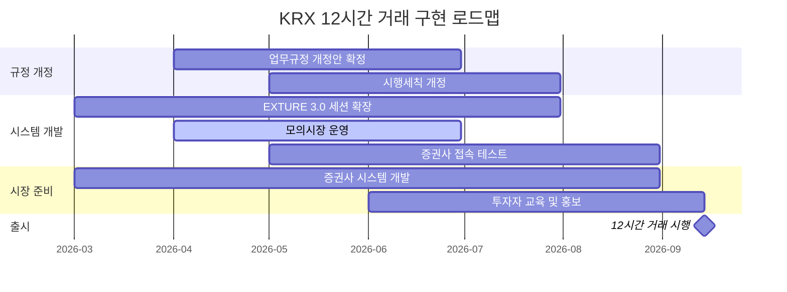
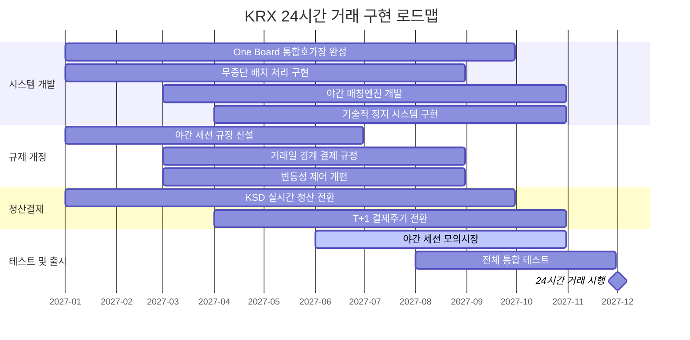

# KRX 24시간 거래 도입 전략: 글로벌 비교 종합 분석

> 작성일: 2026년 3월 27일
> 프로젝트: KRX 24시간 거래 도입 전략
> 문서 유형: 마스터 종합 리포트

---

## 목차

- [1. Executive Summary](#1-executive-summary-요약)
- [2. 프로젝트 배경 및 추진 경과](#2-프로젝트-배경-및-추진-경과)
- [3. 글로벌 비교 매트릭스](#3-글로벌-비교-매트릭스)
- [4. 거래 세션 아키텍처 비교](#4-거래-세션-아키텍처-비교)
- [5. 매칭엔진 및 시스템 아키텍처 비교](#5-매칭엔진-및-시스템-아키텍처-비교)
- [6. 주문 관리 및 TIF 규칙 비교](#6-주문-관리-및-tif-규칙-비교)
- [7. 변동성 제어 체계 비교](#7-변동성-제어-체계-비교)
- [8. 청산결제 인프라 비교](#8-청산결제-인프라-비교)
- [9. KRX 전략적 Gap 분석 종합](#9-krx-전략적-gap-분석-종합)
- [10. KRX 12시간 거래 구현 로드맵](#10-krx-12시간-거래-구현-로드맵)
- [11. KRX 24시간 거래 구현 로드맵](#11-krx-24시간-거래-구현-로드맵)
- [12. 규정 개정 패키지 권고안](#12-규정-개정-패키지-권고안)
- [13. 리스크 평가 및 완화 전략](#13-리스크-평가-및-완화-전략)
- [부록 A: 개별 리포트 색인](#부록-a-개별-리포트-색인)
- [부록 B: 참고문헌 목록](#부록-b-참고문헌-목록)
- [부록 C: 기술 용어 사전](#부록-c-기술-용어-사전)

---

## 1. Executive Summary (요약)

글로벌 주식시장은 24시간 연속 거래 체제로의 전환이라는 구조적 패러다임 전환의 한복판에 있다. NYSE Arca는 SEC Filing SR-NYSEARCA-2024-89를 통해 22~23시간 준연속 거래 모델을 제출하였고, NASDAQ은 SR-NASDAQ-2025-106으로 23/5 글로벌 거래 이니셔티브를 추진 중이며, 24X National Exchange는 SEC 승인을 획득한 최초의 23/5 국가 증권거래소로서 2026년 거래를 개시하였다. CME Globex는 이미 파생상품 시장에서 일일 60초 유지보수 창만을 남기는 23시간 연속 거래 모델을 수십 년간 성공적으로 운영해왔다. 이 전환의 핵심 동인은 디지털 자산의 "always-on" 기대 효과, APAC/EMEA 투자자의 미국 시장 직접 접근 수요(DTCC/EY 설문 대상의 72%가 APAC 투자자 수요를 핵심 동인으로 지목), 그리고 Blue Ocean ATS 등 대안거래시스템의 야간 유동성 선점이다.

KRX는 이러한 글로벌 추세 속에서 존재론적 경쟁 압력에 직면하고 있다. 넥스트레이드(Nextrade)가 2025년 3월 4일 출범 이후 불과 12개월 만에 시장점유율 약 32%를 달성하며 08:00~20:00의 12시간 거래를 제공하고 있으며, 07:00 개장까지 추진 중이다. 국내 유동성이 ATS로 급속히 이동하는 가운데, KRX가 정규장 6시간 30분 체제를 고수할 경우 글로벌 자본 유치 경쟁에서의 구조적 불이익은 심화될 수밖에 없다. 동시에 아시아 경쟁 거래소 중 TSE(JPX)가 30분 연장에 그치고 HKEX와 SGX도 구체적 24시간 계획을 발표하지 않은 현 시점에서, KRX는 아시아 최초의 24시간 현물주식 거래소가 될 수 있는 전략적 기회를 보유하고 있다.

본 보고서는 7개 개별 분석 리포트(NYSE Arca 22시간, NASDAQ 23/5, 24X National Exchange, CME Globex 24시간, DTCC 24/5 청산결제, TSE-JPX/JSCC, KRX 규정 분석)의 핵심 발견을 통합하여, KRX 24시간 거래 도입을 위한 종합적 전략 프레임워크를 제시한다. 글로벌 비교 분석 결과, 모든 거래소가 공통적으로 채택한 설계 원칙은 다음 네 가지이다: (1) 일일 기술적 정지(Technical Pause) 의무화, (2) 20:00 기준 거래일 경계(Trade Date Cutoff) 설정 및 FIX Tag 715 구현, (3) 야간 세션 Limit Order 전용 정책, (4) CCP 보증의 야간 즉시 적용(실시간 Novation). 이 네 가지 원칙은 KRX 24시간 체제 설계의 비협상적 기반(non-negotiable foundation)을 구성한다.

KRX의 임계 경로(critical path)는 EXTURE 3.0(2023.1.25 매매체결/정보분배, 2023.10.4 청산결제, 50us latency, 9.4억건/일) 기반 One Board 통합호가장 개발 → 12시간 거래 시행(2026년 9월 14일, 3개월 연기 확정) → T+1 결제주기 전환(이르면 2027년 10월) → 24시간 거래 달성(2027년 12월 목표)으로 구성된다. 최대 리스크 요인은 세 가지이다. 첫째, 일정 압축 리스크로 12시간 시행이 이미 3개월 연기되었으며 24시간까지 남은 기간이 15개월에 불과하다. 둘째, EXTURE 3.0의 stateful daily cycle 아키텍처가 24시간 연속 운영에 "structurally hostile"하여 One Board 완성과 무중단 배치 처리 전환이 절대적 전제조건이다. 셋째, T+1 전환과 24시간 확장의 동시 추진이 결제 실패율의 승수적(multiplicative) 증가를 유발할 수 있으며, 미국이 T+1을 먼저 완료한 후 24/5를 추진한 순차적 접근법과 대조적이다.

---

## 2. 프로젝트 배경 및 추진 경과

### 2.1 글로벌 24시간 거래 트렌드

미국 주식시장을 중심으로 24시간 거래 확장이 가속화되고 있다. NYSE Arca는 SR-NYSEARCA-2024-89 및 후속 개정안(Amendment No. 1, 2)을 통해 기존 16시간(04:00~20:00 ET)에서 22~23시간 모델(21:00 ET~익일 20:00 ET, 60분 유지보수 창)로의 전환을 추진 중이다. NASDAQ은 SR-NASDAQ-2025-106을 통해 Day Session(04:00~20:00 ET)과 Night Session(21:00~04:00 ET)을 분리한 이분화 모델(Bifurcated Session Model)로 23/5 거래를 제안하였다. 24X National Exchange는 SEC 승인을 획득한 최초의 23/5 거래소로, MEMX Memoir 기반의 최신 매칭엔진과 Aeron UDP 멀티캐스트 아키텍처를 채택하여 18us 온프레미스 레이턴시를 달성하고 있다(상세 분석은 03_24X_National_Exchange_분석 참조).

파생상품 시장에서는 CME Globex가 일요일 17:00 CT ~ 금요일 16:00 CT의 연속 거래를 이미 수십 년간 운영하며, 일일 유지보수 중단이 60초(16:00~16:01 CT)에 불과한 극한의 연속성을 실증하고 있다(상세 분석은 04_CME_Globex_24시간_분석 참조). 이 외에도 LSE, HKEX 등 주요 거래소가 거래시간 확장을 검토 중이며, 디지털 자산 거래소의 24/7 운영이 전통 증권시장에 대한 투자자 기대치를 근본적으로 변화시키고 있다.

이러한 전환의 후선(post-trade) 인프라 기반은 DTCC의 24/5 청산결제 현대화이다. NSCC의 Universal Trade Capture(UTC) 시스템이 Phase 1(2024년 9월, UTC 제출 창 01:30 ET로 전진)을 완료하였고, Phase 2(2026년 6월 28일 목표)에서 일요일 20:00 ET ~ 금요일 20:00 ET 전면 24/5 운영으로 전환 예정이다(상세 분석은 05_DTCC_24_5_청산결제_분석 참조).

### 2.2 국내 경쟁 환경

넥스트레이드(Nextrade)는 2025년 3월 4일 대한민국 최초의 ATS로 출범하여, 국내 주식시장의 구조적 경쟁 환경을 근본적으로 변화시켰다. 출범 12개월 만에 거래대금 기준 시장점유율 약 32%를 달성하였으며, 08:00~20:00의 12시간 거래를 제공하고 있다. 특히 프리마켓(08:00~08:50)과 애프터마켓(15:30~20:00)에서의 유동성 선점이 두드러지며, 07:00 개장 추진으로 경쟁 강도는 더욱 심화될 전망이다.

SOR(Smart Order Routing) 의무화 정책 시행으로 증권사는 고객 주문 시 KRX와 넥스트레이드의 호가를 비교하여 최선 가격에 체결하도록 의무화되었으며, 통합호가창(consolidated order book)을 통해 양 시장의 호가 정보가 투자자에게 통합 제공되고 있다. 이는 미국의 Reg NMS Rule 611(Order Protection Rule)과 기능적으로 유사한 구조이다(상세 분석은 07_KRX_규정_분석 참조).

### 2.3 KRX 추진 타임라인

| 일자 | 이벤트 |
|------|--------|
| 2023.01.25 | EXTURE 3.0 Phase 1 가동 (매매체결/정보분배) |
| 2023.10.04 | EXTURE 3.0 Phase 2 가동 (청산결제) |
| 2025.02.05 | 중간가호가, 스톱지정가호가 신설 (업무규정 개정) |
| 2025.03.04 | 넥스트레이드 출범 |
| 2025.10 | T+1 결제주기 단축 워킹그룹 출범 |
| 2025.12 | "One Board" 통합호가장 시스템 개발 착수 |
| 2026.01.11 | DTCC PSE 환경 산업 전반 테스트 개시 |
| 2026.03.17 | KRX 12시간 거래 시행일 6월 → 9월 연기 발표 |
| 2026.04 | KRX 12시간 거래 모의시장 운영 |
| 2026.06.28 | DTCC Phase 2 전면 24/5 UTC 가동 목표 |
| 2026.09.14 | **KRX 12시간 거래 시행** (프리마켓 07:00~07:50 + 애프터마켓 16:00~20:00) |
| 2027.10 | T+1 결제주기 전환 시행 가능성 (이르면) |
| 2027.12 | **KRX 24시간 거래 시행 목표** |

---

## 3. 글로벌 비교 매트릭스

| 비교 항목 | NYSE Arca | NASDAQ | 24X | CME Globex | TSE-JPX | KRX 현행 | KRX 12h 목표 | KRX 24h 목표 |
|-----------|-----------|--------|-----|------------|---------|----------|-------------|-------------|
| **운영시간** | 22~23h | 23h | 23h | ~23h | 5.4h | ~10h | 12h | 24h |
| **기술적 정지** | 1h (20:00~21:00 ET) | 1h (20:00~21:00 ET) | 1h (20:00~21:00 ET) | 60초 (16:00~16:01 CT) | N/A | N/A (야간배치 14h) | TBD | 1h (20:00~21:00 KST) |
| **매칭엔진** | Pillar (14 TXN) | Genium INET / Eqlipse | MEMX Memoir (Aeron) | Globex (17 세그먼트) | ARROWHEAD 4.0 | EXTURE 3.0 | EXTURE 3.0 | EXTURE 3.0+ |
| **레이턴시** | ~20us | sub-100us | 18us | 마이크로초 수준 | ~200us | 50us | 50us | TBD |
| **처리용량** | -- | -- | 수백만 msg/s | 수천만 건/일 | 확장 가능 (462대) | 9.4억건/일 | 9.4억건/일 | TBD |
| **옥션 메커니즘** | Opening/Closing Auction | Opening/Closing Cross | 없음 (순수 연속매칭) | Pre-Open Auction | Itayose (板寄せ) | 단일가(Random-End) | TBD | TBD |
| **야간 주문 제한** | 세션 ID 기반 적격성 강제 | Limit만 허용 | Limit만 허용 | 전 주문 유형 허용 | N/A (야간 미운영) | N/A | TBD | Limit 위주 |
| **GTC 주문** | 지원 (DB 영구저장+DR 복제) | 폐지 (2026.02) | Day+ TIF (23h 존속) | 지원 (세션 경계 존속) | 지원 | 미지원 (세션간 소멸) | One Board 개발중 | One Board |
| **가격제한폭** | LULD (동적, Tier 1: +-5%) | LULD (동적, Tier 1: +-5%) | 24X Bands (20/10/6%) | 동적 밴드 | Special Quote + 일일한도 | +-30% (정적, 전일종가 기준) | +-30% | 계층별 밴드 (20/10/6%) |
| **VI/서킷브레이커** | LULD + MWCB (7/13/20%) | LULD + CEE | 24X Bands + 크라우드소싱 밸브 | 동적 가격밴딩 + Kill Switch | Special Quote (3분) + CB | VI (3/6/10%) + CB (8/15/20%) | VI 유지 | VI 야간 조정 (5/10/15%) |
| **결제주기** | T+1 (2024.5 시행) | T+1 (2024.5 시행) | T+1 (2024.5 시행) | 상품별 다양 | T+2 (T+1 미정) | T+2 | T+2 | T+1 목표 (2027.10) |
| **CCP 보증** | NSCC 실시간 Novation | NSCC 실시간 Novation | NSCC 실시간 Novation | CME Clearing 자체 CCP | JSCC Batch 처리 | KSD 배치 처리 | KSD 배치 처리 | KSD 실시간 목표 |
| **거래일 경계** | 20:00 ET | 20:00 ET | 20:00 ET | 16:00 CT | 15:30 JST (장마감) | 18:00 KST (시간외 종료) | 20:00 KST | 20:00 KST |
| **시장데이터** | NYSE XDP Integrated Feed | TotalView/ITCH + SIP | 24X Top/Depth + SIP | MDP 3.0 (UDP 멀티캐스트) | FLEX Full + Per-order | EXTURE 3.0 Feed | 확장 | 24h 확장 |
| **프로토콜** | Pillar Binary + FIX 4.2/4.4 | OUCH 5.0/FIX/ITCH | FIX/Binary (Aeron) | iLink 3 (FIXP/SBE) | -- | FIX/FAST | FIX/FAST | TBD |
| **ATS 경쟁** | 다수 ATS + Blue Ocean | Blue Ocean ATS | N/A (자체가 신규거래소) | N/A | Japannext (~5%) | Nextrade (~32%) | Nextrade | Nextrade |

---

## 4. 거래 세션 아키텍처 비교

### 4.1 세션 구조 비교표

| 거래소 | 세션 1 | 세션 2 | 세션 3 | 세션 4 | 유지보수 |
|--------|--------|--------|--------|--------|----------|
| **NYSE Arca** | Extended Early (21:00~09:30 ET) | Core (09:30~16:00 ET) | Late (16:00~20:00 ET) | -- | 20:00~21:00 ET (1h) |
| **NASDAQ** | Night (21:00~04:00 ET) | Pre-Market (04:00~09:30 ET) | Regular (09:30~16:00 ET) | Post-Market (16:00~20:00 ET) | 20:00~21:00 ET (1h) |
| **24X** | 24X Market (20:00~04:00 ET) | Pre-Market (04:00~09:30 ET) | Core (09:30~16:00 ET) | Post-Market (16:00~19:00 ET) | 19:00~20:00 ET (1h) |
| **CME Globex** | 연속 거래 (일~금 17:00~16:00 CT) | -- | -- | -- | 16:00~16:01 CT (60초) |
| **TSE** | 전장 (09:00~11:30 JST) | 점심 (11:30~12:30 JST) | 후장 (12:30~15:25 JST) | Closing Auction (15:30 JST) | 야간 전체 |
| **KRX 현행** | 시간외 (08:00~09:00 KST) | 정규장 (09:00~15:30 KST) | 시간외 (15:40~18:00 KST) | -- | 18:00~08:00 KST (14h) |
| **KRX 12h** | 프리마켓 (07:00~07:50 KST) | 정규장 (09:00~15:30 KST) | 애프터마켓 (16:00~20:00 KST) | -- | TBD |
| **KRX 24h** | 야간세션 (21:00~07:00 KST) | 프리마켓 (07:00~07:50 KST) | 정규장 (09:00~15:30 KST) | 애프터마켓 (16:00~20:00 KST) | 20:00~21:00 KST (1h) |

### 4.2 기술적 정지 시간 비교

모든 글로벌 거래소가 24시간 체제에서도 일일 기술적 정지(Technical Pause)를 아키텍처의 필수 요소로 포함한다는 것이 핵심 발견이다. NYSE Arca는 이를 "진정한 24/7 연속 매칭 모델을 명시적으로 거부"한다고 표현하며, 결정론적 순서 지정(deterministic sequencing)과의 충돌을 이유로 든다(상세 분석은 01_NYSE_Arca_22시간_분석 참조).

| 거래소 | 정지 시간 | 정지 시각 | 수행 작업 |
|--------|-----------|-----------|-----------|
| **NYSE Arca** | 60분 | 20:00~21:00 ET | DB 백업, 시퀀스 초기화, Corporate Actions, 소프트웨어 배포, Symbol Index Mapping |
| **NASDAQ** | 60분 | 20:00~21:00 ET | Double-flush(전 주문 강제 취소), Trade Date 전환, Corporate Actions, 시스템 유지보수 |
| **24X** | 60분 | 20:00~21:00 ET | 전량 Hard Flush, 거래일 전환, 기업행위 처리 |
| **CME Globex** | 60초 (일일) | 16:00~16:01 CT | Trade Date Roll, 시퀀스 체크포인트, 로그 전환 |
| **CME Globex** | 105분 (화/토) | 02:00~03:45 CT | 소프트웨어 패치, 구성 변경, FIX 시퀀스 하드 리셋(토요일만) |
| **KRX 24h 목표** | 60분 (제안) | 20:00~21:00 KST | DB 동기화, Corporate Actions, 시퀀스 리셋, 거래일 전환, 기준가격 재산정 |

CME Globex의 60초 일일 리셋은 파생상품 시장의 구조적 특성(기초자산 참조 가격 발견, 증거금 기반 결제) 덕분에 가능하며, 현물 주식 거래소에서는 NBBO 재계산, SIP 동기화, 청산결제 배치 처리 등 추가 작업으로 인해 최소 60분의 유지보수 창이 불가피하다.

### 4.3 글로벌 세션 타임라인 (UTC 기준)

```mermaid
gantt
    title 글로벌 거래소 세션 타임라인 (UTC 기준, 24시간)
    dateFormat HH:mm
    axisFormat %H:%M

    section NYSE Arca
    Extended Early     :nyse1, 02:00, 14:30
    Core Session       :nyse2, 14:30, 21:00
    Late Trading       :nyse3, 21:00, 00:00

    section NASDAQ
    Night Session      :nas1, 02:00, 09:00
    Day Session        :nas2, 09:00, 00:00

    section 24X
    24X Market         :x1, 01:00, 09:00
    Pre+Core+Post      :x2, 09:00, 00:00

    section CME Globex
    Trading            :cme1, 00:00, 21:00
    Maintenance        :crit, cme2, 21:00, 21:01
    Trading            :cme3, 21:01, 23:59

    section TSE
    Morning            :tse1, 00:00, 02:30
    Lunch Break        :crit, tse_l, 02:30, 03:30
    Afternoon          :tse2, 03:30, 06:30

    section KRX 현행
    시간외              :krx0, 23:00, 00:00
    정규장              :krx2, 00:00, 06:30
    시간외              :krx3, 06:40, 09:00

    section KRX 24h 목표
    프리+정규+애프터    :krx24_2, 22:00, 23:59
    야간세션            :krx24_1, 12:00, 22:00
    기술적정지          :crit, krx24_p, 11:00, 12:00
```

> **참고:** KST = UTC + 9시간. ET = UTC - 4시간(서머타임). CT = UTC - 5시간(서머타임). JST = UTC + 9시간.

---

## 5. 매칭엔진 및 시스템 아키텍처 비교

### 5.1 아키텍처 유형 분류

글로벌 매칭엔진 아키텍처는 크게 두 가지 패러다임으로 분류된다:

**Stateful 아키텍처 (레거시)**:
- KRX EXTURE 3.0: 세션 경계에서 호가장 상태 단절(purge), End-of-Day 배치 처리 의존, 역일 기반 기준가격 체계
- TSE ARROWHEAD 4.0: Triple-redundant 동기화 데이터 서버, Batch 처리 기반 청산
- NYSE Pillar: 14개 TXN 분산 매칭이나 GTC 영구저장을 통한 세션 간 연속성 확보

**Stateless/Replicated State Machine 아키텍처 (최신)**:
- 24X MEMX Memoir: Aeron 기반 UDP 멀티캐스트, 공유 메모리 IPC, 무상태 매칭엔진으로 장애 시 순서화된 로그로부터 상태 즉시 재구성
- CME Globex: 17개 마켓 세그먼트 수평 분할, 듀얼 존 블루-그린 배포, 무중단 데이터베이스 마이그레이션

KRX EXTURE 3.0의 근본적 한계는 stateful daily cycle 설계에 있다. 시행세칙 제13조에 따라 세션 전환 시 미체결 호가가 체계적으로 소멸되며, 장종료 후 약 14시간이 대규모 배치 프로세싱에 활용된다. 24시간 연속 운영을 위해서는 24X/MEMX의 복제 상태 머신(Replicated State Machine) 패턴 도입과 무상태 아키텍처로의 점진적 전환이 필요하다(상세 분석은 03_24X_National_Exchange_분석 참조).

### 5.2 성능 벤치마크

| 거래소/시스템 | 주문 처리 Latency | 일일 처리용량 | 아키텍처 유형 | 이중화 |
|-------------|------------------|-------------|-------------|--------|
| NASDAQ Genium INET | ~10us (sub-100us) | -- | Cloud-Native / Eqlipse | Evergreen Rolling Updates |
| 24X MEMX Memoir | 18us (on-premises) | 수백만 msg/s | Stateless RSM (Aeron) | 복제 상태 머신 |
| NYSE Pillar | ~20us | -- | 14 TXN 분산 매칭 | Dual IP 고가용성 |
| KRX EXTURE 3.0 | **50us** | **9.4억건/일** | Stateful Daily Cycle | 이중화 (DR 센터) |
| CME Globex | 마이크로초 수준 | 수천만 건/일 | 17 세그먼트 수평 분할 | 듀얼 존 + 오로라 DC |
| TSE ARROWHEAD 4.0 | ~200us | 확장 가능 | Triple-redundant | 3-node 동기화 |

EXTURE 3.0의 50us 레이턴시와 9.4억건/일 처리 성능은 아시아 최고 수준이며, ARROWHEAD 4.0(~200us) 대비 4배 빠른 성능을 보유하고 있다. 순수 매칭 성능 관점에서는 24시간 확장에 충분한 기반이나, 아키텍처 패러다임(stateful → stateless)의 전환이 핵심 과제이다.

### 5.3 무중단 운영 전략

24시간 연속 운영을 위해 글로벌 거래소가 채택한 핵심 전략:

1. **듀얼 존 / 블루-그린 배포 (CME)**: 활성 존에서 라이브 거래를 처리하는 동안 대체 존에서 백그라운드 업그레이드를 수행하여 1분 유지보수 창 내 시스템 전환(상세 분석은 04_CME_Globex_24시간_분석 참조)
2. **무중단 데이터베이스 마이그레이션 (CME)**: 동적 기능 플래그(Feature Flags)를 활용, 운영 DB에서 트랜잭션 처리 중 백그라운드 비동기 데이터 마이그레이션
3. **복제 상태 머신 (24X/MEMX)**: 클러스터 노드 간 결정론적 복제로 하드웨어 장애 시 데이터 무손실(zero data loss) 및 즉시 복구
4. **Session 영속성 (CME iLink 3)**: UUID 기반 논리적 세션 상태 유지로 물리적 TCP 연결 단절 시에도 재연결 즉시 거래 재개

KRX는 EXTURE 3.0의 기존 이중화 체계를 최소 Triple-redundant로 강화하고, 블루-그린 배포 역량과 무중단 배치 처리 시스템(데이터베이스 샤딩, 기능 플래그 활용)을 구축해야 한다.

---

## 6. 주문 관리 및 TIF 규칙 비교

### 6.1 야간 세션 주문 유형 비교

| 주문 유형 | NYSE Arca 야간 | NASDAQ Night | 24X 24X Market | CME Globex | KRX 야간 (제안) |
|-----------|:-:|:-:|:-:|:-:|:-:|
| Limit Order | O | **O** (유일 허용) | **O** (유일 허용) | O | **O** |
| Market Order | O (double-wide collar) | **X** | **X** | O (보호 범위 적용) | **X** |
| MOO/LOO/MOC/LOC | O (해당 세션) | **X** | **X** (RHO만 허용) | BTIC/TACO | **X** |
| Pegged/Midpoint | O | **X** | **X** | -- | X (중간가호가 조건부 허용) |
| Stop Order | O | -- | -- | O (Open만) | O (스톱지정가호가) |
| GTC/GTD | O (DB 영구저장) | **폐지** (2026.02) | Day+ (23h 존속) | O (세션 경계 존속) | One Board (GTC 도입 검토) |

야간 세션에서 Market Order를 금지하는 것은 NASDAQ과 24X의 공통된 핵심 설계 원칙이다. 유동성이 얇은 환경에서 Market Order가 호가창의 여러 가격 수준을 관통(sweep)하여 극단적으로 불리한 가격에 체결되는 "fat finger" 리스크를 원천 차단한다. KRX도 동일한 원칙을 야간 세션에 적용해야 하며, 이는 업무규정 제2조 제4항의 시장가호가 정의와 시행세칙 제13조의 호가 효력 규정 개정을 통해 구현된다(상세 분석은 07_KRX_규정_분석 참조).

### 6.2 주문 지속성 (Order Persistence)

주문 지속성(세션 경계를 넘어 미체결 주문이 존속하는 방식)은 24시간 거래의 핵심 설계 변수이다:

- **NYSE Arca**: GTC 주문을 백엔드 관계형 데이터베이스에 영구 저장하고, 시카고 Cermak 데이터 센터로 다크 파이버를 통해 복제. 유지보수 창 종료 후 콜드 스타트 시 GTC 주문을 주문장에 재구성하고 ExecRestatementReason 플래그로 확인
- **NASDAQ**: GTC 주문을 2026년 2월 전면 폐지. "Double-flush"(20:00 ET 및 04:00 ET 이중 주문 정리)로 세션 간 clean slate 확보
- **24X**: Day+ TIF로 23시간 전체 존속하되, 19:59:59 ET 자동 만료. GTT(Good-Till-Time) 마이크로초 정밀 지원
- **CME Globex**: GTC/GTD 주문이 60초 일일 리셋을 통과하여 타임스탬프 우선순위까지 보존
- **KRX 현행**: 세션 전환 시 미체결 호가 체계적 소멸(시행세칙 제13조). 세션 간 주문 연속성 부재

KRX의 "One Board" 통합호가장 시스템(2025년 12월 개발 착수)은 이 Gap을 해소하기 위한 절대적 전제조건이다. Day+, GTC 등 신규 TIF 유형 도입과 세션 간 안전한 호가 이월 메커니즘이 핵심 개발 과제이다.

### 6.3 KRX 주문 체계 권고

KRX 24시간 야간 세션(21:00~07:00 KST)의 호가 유형 제한안:

| 호가 유형 | 야간 허용 | 제한 사유 |
|-----------|:-:|-----------|
| 지정가호가 | **O** | 기본 호가 유형, 가격 확실성 보장 |
| 시장가호가 | **X** | 얇은 유동성에서 극단적 슬리피지 위험 |
| 조건부지정가호가 | **X** | "장종료" 개념의 다중화로 전환 조건 모호 |
| 최유리지정가호가 | **X** | 호가장 일방 부재 시 비합리적 가격 산출 |
| 최우선지정가호가 | **X** | 호가장 일방 부재 시 비합리적 가격 산출 |
| 경쟁대량매매호가 | **X** | 야간 VWAP 산출 기반 부재 |
| 중간가호가 | **O** (조건부) | 양방향 호가 존재 시만 허용, 효력정지 조건 강화 |
| 스톱지정가호가 | **O** | 리스크 관리 목적, 지정가 전환만 허용 |

---

## 7. 변동성 제어 체계 비교

### 7.1 핵심 세션 제어

| 메커니즘 | 적용 거래소 | 작동 방식 | 특징 |
|----------|-----------|-----------|------|
| **LULD** | NYSE, NASDAQ (Core Session) | 후행 5분 평균 기준가 대비 Tier 1: +-5%, Tier 2: +-10% 밴드. 15초 Limit State → 5분 Trading Pause | 동적 밴드, SIP 통합 |
| **MWCB** | NYSE, NASDAQ | S&P 500 -7%/-13%/-20% 시 시장 전체 정지 | Core Session만 적용 |
| **VI** | KRX | 동적 VI: KOSPI200 구성 3%, 기타 6%. 정적 VI: 10%. 발동 시 2분 단일가매매 전환 | 종목별 개별 발동, Random-End 포함 |
| **CB** | KRX | 코스피 -8%/-15%/-20%, 1분 지속 시 20분 중단 | 3단계, 각 1회 |
| **Special Quote** | TSE | 갱신호가범위 초과 시 3분간 Special Quote 게시 후 재개 | 점진적 가격 조정 |
| **24X Bands** | 24X | 계층화: $1미만 20%, $1-25 10%, $25초과 6%. 30초/5분 Rolling 기준가 | 크라우드소싱 조정 밸브 포함 |

### 7.2 야간 세션 제어

야간 세션에서는 정규 세션의 변동성 제어 메커니즘이 대부분 비활성화되거나 대폭 수정된다:

- **NYSE Arca**: LULD/MWCB 미적용. Double-wide collar(대형주 ~10%, 중형주 ~20%)과 Risk Entity 기반 활동 통제로 대체
- **NASDAQ**: LULD 중지. Limit Order 전용 정책 자체가 암묵적 변동성 통제. CEE(Clearly Erroneous Execution) 사후 심사(확대 밴드), Venue-Specific Volatility Guard
- **24X**: 자체 Price Bands(20/10/6%) 상시 적용. 3개 이상 회원의 밴드 경계 주문이 30초 이상 지속 시 밴드 강제 재계산("크라우드소싱 조정 밸브")
- **CME Globex**: 동적 가격 밴딩 상시 적용. GCC가 거시경제 이벤트 시 실시간 밴드 수동 확대 가능

### 7.3 KRX 야간 변동성 제어 권고안

24X 모델을 참조한 **계층적 가격밴드(Tiered Price Bands)** 도입을 권고한다:

| 종목 가격대 | 야간 가격밴드 (제안) | 현행 정규장 가격제한폭 |
|------------|:-------------------:|:----------------------:|
| 5,000원 미만 | +-20% | +-30% |
| 5,000원~50,000원 | +-10% | +-30% |
| 50,000원 이상 | +-6% | +-30% |

야간 VI 임계치 조정안:

| 대상 종목 | 현행 동적 VI | 야간 동적 VI (제안) | 현행 정적 VI | 야간 정적 VI (제안) |
|-----------|:-----------:|:------------------:|:-----------:|:------------------:|
| KOSPI200 구성종목 | 3% | **5%** | 10% | **15%** |
| 기타 종목 | 6% | **10%** | 10% | **20%** |

야간 VI 발동 시 단일가매매 전환 기간을 현행 2분에서 **5분**으로 확대하여 얇은 유동성 환경에서의 가격 수렴 시간을 보장한다. 야간 서킷브레이커는 코스피 지수 실시간 산출이 곤란하므로, **종목별 서킷브레이커**로 대체하고 정지 종목 비율이 10%를 초과 시 야간 세션 전체 일시 중단하는 방안을 제안한다(상세 분석은 07_KRX_규정_분석 참조).

---

## 8. 청산결제 인프라 비교

### 8.1 CCP 모델 비교

| 항목 | NSCC (미국) | CME Clearing | JSCC (일본) | KSD (한국) |
|------|-----------|-------------|------------|----------|
| **CCP 역할** | 보편적 매수자/매도자, 즉시 Novation | 자체 CCP, 일 2천만건+ 처리 | JPX 완전자회사, CCP | CCP + 중앙예탁 |
| **거래 수집** | UTC 실시간 (24/5 Phase 2) | 실시간 통합 | Batch 처리 | Batch 처리 |
| **마진 계산** | 15분 주기 VaR + 동적 일중 마진콜 | 일중 정산 + 자동화 BAMS | VaR (2023.11 전환), 일 1회+ MTM | 일말 배치 기반 |
| **Default Fund** | 상호화 리스크 프로토콜 | 상호화 디폴트 펀드 | 청산업무별 별도 기금 | -- |
| **High-Value 임계값** | 야간 $10억/주간 $15억 | -- | -- | 단일 구조 |
| **야간 CCP 보증** | **즉시 적용** (Phase 2) | 상시 적용 (23h 운영) | N/A (야간 미운영) | **미구축** |

DTCC의 Phase 2 24/5 전환에서 핵심은 야간 거래에 대한 즉각적 Novation이다. 이전에는 야간 ATS 체결이 익일 아침까지 미-Novation 상태로 양자간 신용 리스크에 노출되었으나, Phase 2에서는 UTC 수집 즉시 NSCC CCP 보증이 적용된다. KSD도 동등한 수준의 실시간 Novation 역량을 구축해야 한다(상세 분석은 05_DTCC_24_5_청산결제_분석 참조).

### 8.2 결제주기 비교

| 국가/거래소 | 현행 결제주기 | T+1 전환 현황 |
|------------|-------------|-------------|
| 미국 (NSCC) | **T+1** | 2024년 5월 28일 시행 완료 |
| 영국 | T+2 | 2027년 10월 11일 목표 |
| EU | T+2 | 2027년 10월 11일 목표 |
| 일본 (JSCC) | T+2 | 구체적 일정 미정 (실무 검토 단계) |
| **한국 (KSD)** | **T+2** | **워킹그룹 출범 (2025.10), 이르면 2027.10 시행** |

미국이 T+1 전환을 먼저 완료한 후 24/5 청산 확장을 추진한 순차적 접근법은 KRX에 중요한 시사점을 제공한다. T+1 전환과 24시간 거래 확장을 동시에 추진할 경우 결제 실패율이 승수적으로 증가할 수 있으므로, 가능한 한 T+1을 선행 완료하는 것이 권장된다.

### 8.3 KRX/KSD 현대화 권고

1. **실시간 거래 캡처 인프라**: KSD가 배치 전송을 폐기하고, KRX/넥스트레이드 매칭엔진으로부터 마이크로초 레이턴시로 거래 데이터를 실시간 수집하는 한국형 UTC 시스템 구축
2. **연속 마진 계산**: NSCC의 15분 주기 VaR 재계산에 상응하는 연속 예측 모델로 전환. 완전 자동화된 야간 리스크 감시 및 자동 일중 마진콜 역량 확보
3. **FIX Tag 715 한국형 등가물 개발**: 거래일 경계(20:00 KST)를 기준으로 결제 기준일을 명시하는 태그를 모든 체결 보고에 포함
4. **교차 장소 네팅**: KRX와 넥스트레이드 양 거래소의 체결을 KSD에서 통합 네팅하여 자본 효율성 극대화. 표준화된 FIX 메시징을 모든 한국 체결 장소에 강제
5. **Good Night 프로토콜 한국형 설계**: DTCC의 Good Night 메시지 프로토콜에 상응하는 세션 관리 프로토콜을 KRX/KSD 공동 개발

---

## 9. KRX 전략적 Gap 분석 종합

### 9.1 기술적 Gap

| # | Gap 항목 | 현행 상태 | 목표 상태 | 우선순위 |
|---|---------|----------|----------|:--------:|
| 1 | Stateful → Stateless 아키텍처 | EXTURE 3.0 stateful daily cycle | 복제 상태 머신, 무상태 매칭 | 상 |
| 2 | One Board 연속 주문 처리 | 세션간 호가 소멸 (시행세칙 제13조) | Day+/GTC TIF, 세션간 이월 | 상 |
| 3 | 무중단 배치 처리 | 14시간 야간 배치 의존 | DB 샤딩, 블루-그린 배포, 60분 유지보수 창 | 상 |
| 4 | 24시간 매칭엔진 안정성 | 일 ~10시간 운영 | 일 23시간 연속 운영 | 상 |
| 5 | 바이너리 프로토콜 전환 | FIX/FAST ASCII 기반 | FIXP/SBE 또는 Aeron 바이너리 | 중 |
| 6 | 야간 세션 포트 분리 | 단일 접속 구조 | NASDAQ 모델 Day/Night 물리적 분리 | 중 |
| 7 | Cancel on Disconnect | 미구현 | 네트워크 장애 시 자동 전량 취소 | 중 |

### 9.2 규제적 Gap

| # | Gap 항목 | 현행 규정 | 필요 개정 | 대상 단계 |
|---|---------|----------|----------|:---------:|
| 1 | 거래시간 전면 개정 | 제4조: 정규시장 09:00~15:30 | 프리마켓/애프터마켓/야간세션 신설 | 12h/24h |
| 2 | 시간외매매 체계 | 제33조~제36조: 5종 체계 | 시간외단일가매매 폐지, 세션 기반 체계 전환 | 12h |
| 3 | 가격제한폭 | 제20조: +-30% 정적 | 야간 계층별 밴드 (20/10/6%) 도입 | 24h |
| 4 | VI/CB 야간 적용 | 제26조의2/제25조: 정규장 최적화 | 야간 VI 임계치 상향, 종목별 CB 대안 | 24h |
| 5 | 거래일 경계 정의 | 미정의 | 20:00 KST cutoff, FIX Tag 715 등가물 | 24h |
| 6 | 호가 효력 | 제12조: 당일 호가접수시간 내 | One Board 세션간 이월 근거 마련 | 24h |
| 7 | 결제주기 | 제7조: T+2 (3일째) | T+1 (2일째)로 개정 | 24h |
| 8 | 기술적 정지 | 미규정 | 제6조의2 신설: 20:00~21:00 KST 정지 | 24h |
| 9 | 휴장일 재정의 | 제5조: 토/일/공휴일/12.31 | 24시간 체제 하 "거래일" 재정의 | 24h |

상세 규정 개정안은 07_KRX_규정_분석에서 최소 14개 핵심 조항의 개정 우선순위 체크리스트와 함께 제시되었다.

### 9.3 운영적 Gap

| # | Gap 항목 | 현행 상태 | 목표 상태 |
|---|---------|----------|----------|
| 1 | Follow-the-Sun 인력 모델 | 단일 거점(서울) 정규 근무 | 국내 3교대 + 중기 글로벌 운영 데스크 |
| 2 | 24시간 시장 감시 | 정규장 중심 감시 | AI 기반 자동 감시 + 야간 전담팀 |
| 3 | 증권사 IT 인프라 | 12시간도 3개월 연기 유발 | 24시간 운영 가능 인프라 |
| 4 | 노조 협상 | 공식 반대 성명 | 교대 근무 합의, 건강권 보호 프로그램 |
| 5 | 투자자 보호 공시 | 야간 리스크 공시 프레임워크 부재 | SEC/FINRA Extended Hours 리스크 공시 수준 |

CME의 시카고-런던-싱가포르 Follow-the-Sun 모델은 황금 표준이나, KRX 초기 단계에서는 국내 3교대 운영과 자동화 시스템 강화가 현실적이다. 한국 근로기준법의 주 52시간 근무제, 야간 근무 가산 수당(50%), 건강검진 의무 등을 고려한 인력 운영 설계가 필수적이다(상세 분석은 04_CME_Globex_24시간_분석 참조).

### 9.4 청산결제 Gap

| # | Gap 항목 | 현행 상태 | 목표 상태 |
|---|---------|----------|----------|
| 1 | T+2 → T+1 미완 | 워킹그룹 단계 | T+1 시행 (2027.10 가능) |
| 2 | KSD 배치 → 실시간 | 일말 배치 기반 청산 | 15분 주기 VaR, 실시간 UTC 등가물 |
| 3 | 넥스트레이드 통합 네팅 | 이원 체계 | KSD 중심 단일 네팅 |
| 4 | 거래일 경계 결제 논리 | 미정의 | 20:00 KST cutoff, Good Night 프로토콜 |
| 5 | 야간 CCP 보증 | 미구축 | 야간 체결 즉시 Novation |
| 6 | 야간 마진 콜 | 수동 프로세스 | 자동화 일중 마진콜 |

---

## 10. KRX 12시간 거래 구현 로드맵 (2026년 9월)

### 10.1 핵심 마일스톤

| 시기 | 마일스톤 | 상세 |
|------|---------|------|
| 2026.04 | 모의시장 운영 개시 | 프리마켓/애프터마켓 시뮬레이션 |
| 2026.04~06 | 규정 개정안 확정 | 업무규정 제4조, 시행세칙 제11조 등 |
| 2026.05~08 | 증권사 접속 테스트 | EXTURE 3.0 세션 확장 연동 테스트 |
| 2026.06~07 | 프리마켓/애프터마켓 호가유형 확정 | 시장가호가 금지, 지정가 중심 |
| 2026.08 | 시스템 인증 | 전체 통합 테스트 완료 |
| **2026.09.14** | **12시간 거래 시행** | 프리마켓 07:00~07:50, 애프터마켓 16:00~20:00 |

### 10.2 기술 과제

- EXTURE 3.0 세션 확장: 프리마켓(07:00) 및 애프터마켓(20:00) 호가접수 시간 변경
- 프리마켓/애프터마켓 매칭 논리: 접속매매(연속매칭) 적용, 세션 개시 동시호가 구현
- 증권사 FIX 게이트웨이 업데이트: 신규 세션 ID, 호가접수시간 변경 반영
- 시장 데이터 확장: 프리마켓/애프터마켓 호가 정보 실시간 배포

### 10.3 규제 과제

- 업무규정 제4조 제3항 전면 개정: "프리마켓/정규시장/애프터마켓" 3분법 전환
- 시행세칙 제11조 호가접수시간 개정: 프리마켓 06:50~07:50, 애프터마켓 15:50~20:00
- 시간외매매 체계 재편: 시간외단일가매매(제34조의2) 폐지 또는 적용 범위 축소
- 프리마켓/애프터마켓 호가유형 결정: 시장가호가 금지, 조건부지정가호가 제외

---

## 11. KRX 24시간 거래 구현 로드맵 (2027년 12월)

### 11.1 핵심 마일스톤

| 시기 | 마일스톤 | 상세 |
|------|---------|------|
| 2027.Q1 | One Board 핵심 개발 완료 | Day+/GTC TIF, 세션간 호가 이월 |
| 2027.Q1~Q2 | 야간 세션 규정 신설 | 제6조의2(기술적 정지), 야간 VI/CB |
| 2027.Q2 | 무중단 배치 처리 구현 | DB 샤딩, 블루-그린 배포 |
| 2027.Q2~Q3 | 야간 매칭엔진 개발 | 포트 분리, Cancel on Disconnect |
| 2027.Q3 | 거래일 경계 결제 규정 확정 | 20:00 KST cutoff, FIX Tag 715 등가물 |
| 2027.Q3~Q4 | 야간 세션 모의시장 | 21:00~07:00 KST 시뮬레이션 |
| 2027.10 | T+1 결제주기 전환 (이르면) | 워킹그룹 결론에 따름 |
| 2027.Q4 | 전체 통합 테스트 | 24시간 풀 사이클 테스트 |
| **2027.12** | **24시간 거래 시행 목표** | 야간세션 21:00~07:00 + 기존 12h |

### 11.2 기술 과제

- **One Board 완성**: 세션 경계에서의 호가 소멸을 제거하고, 프리마켓-정규장-애프터마켓-야간세션 간 연속적 주문 이월. 유동성 환경이 극단적으로 상이한 시간대 간 지정가호가의 안전한 이월 및 알고리즘 차익거래 방지
- **무중단 배치 처리 구현**: 14시간 야간 배치를 60분 유지보수 창으로 압축. EXTURE 3.0 기준 최소 필요 유지보수 시간을 엄밀히 산정하고, 자동화 파이프라인의 병렬 실행 전략 수립
- **야간 매칭엔진**: NASDAQ 모델의 Day/Night 물리적 포트 분리를 채택하여 야간 장애의 "폭발 반경(blast radius)" 격리. Cancel on Disconnect 의무화
- **기술적 정지 시스템**: 20:00~21:00 KST, 60분 내 DB 백업, 시퀀스 초기화, Corporate Actions 처리, 소프트웨어 배포, 거래일 전환 완료

### 11.3 규제 과제

- 야간 세션 규정 신설: 업무규정 제6조의2(일일 기술적 정지), 야간 세션 매매방법 및 호가유형 제한
- 거래일 경계 정의: 20:00 KST cutoff, 업무규정 제7조 "매매계약을 체결한 날"을 역일이 아닌 거래일로 재정의
- 변동성 제어 개편: 야간 계층적 가격밴드, 야간 VI 임계치 상향, 종목별 서킷브레이커
- 결제주기 단축: 제7조 제1항 제3호 "3일째"를 "2일째"로 개정

### 11.4 인프라 과제

- KSD 청산결제 현대화: 실시간 거래 캡처, 연속 마진 계산, 자동 일중 마진콜
- Follow-the-Sun 운영 센터: 초기 국내 3교대 → 중기 해외 경량 운영 데스크
- 24시간 시장 감시: AI 기반 이상거래 탐지, 야간 전담 감시팀

---

## 12. 규정 개정 패키지 권고안

### 12.1 1차 개정 (12시간 체제, 2026년 9월)

| 조항 | 현행 | 개정안 | 우선순위 |
|------|------|--------|:--------:|
| 업무규정 제4조 제3항 | 정규시장 09:00~15:30, 시간외시장 08:00~18:00 | 프리마켓 07:00~07:50, 정규시장 09:00~15:30, 애프터마켓 16:00~20:00 | **1** |
| 시행세칙 제11조 | 호가접수시간 (기존 2분법) | 프리마켓/정규시장/애프터마켓 3분법 호가접수시간 | **2** |
| 업무규정 제33조~제34조의2 | 시간외매매 5종 | 시간외단일가매매 폐지, 시간외종가매매/대량매매 시간 재조정 | **3** |
| 시행세칙 제10조/제13조 | 세션별 호가유형 및 효력 제한 | 프리마켓/애프터마켓 호가유형 규정 (시장가호가 금지) | **4** |
| 업무규정 제26조의2 | VI: 정규시장 + 시간외단일가 | 프리마켓/애프터마켓으로 VI 적용 범위 확대 | **5** |

### 12.2 2차 개정 (24시간 체제, 2027년 12월)

| 조항 | 현행 | 개정안 | 우선순위 |
|------|------|--------|:--------:|
| 업무규정 제12조 | 호가 효력: 당일 호가접수시간 내 | One Board 세션간 이월 근거, Day+/GTC TIF 도입 | **1** |
| 업무규정 제6조의2 (신설) | 해당 없음 | 일일 기술적 정지 20:00~21:00 KST 신설 | **2** |
| 시행세칙 제41조의2 | 동적 VI 3%/6%, 정적 VI 10% | 야간 동적 VI 5%/10%, 야간 정적 VI 15%/20% | **3** |
| 업무규정 제20조 | 가격제한폭 +-30% (전일 종가 기준) | 야간 계층적 밴드 (20/10/6%), 기준가격 재정의 | **4** |
| 업무규정 제25조 | 서킷브레이커 -8/-15/-20% (코스피) | 야간 종목별 서킷브레이커 대안, "당일 종결" → "야간 일시중단" | **5** |
| 업무규정 제7조 | 보통거래 T+2 (3일째) | T+1 (2일째), 거래일 정의 명확화 | **6** |
| 업무규정 제5조 | 휴장일: 토/일/공휴일/12.31 | 24시간 체제 하 거래일 재정의 | **7** |

### 12.3 규정 개정 체크리스트

| # | 조항 | 내용 | 단계 | 복잡도 | 상태 |
|:-:|------|------|:----:|:------:|:----:|
| 1 | 업무규정 제4조 제3항 | 거래시간 전면 재정의 | 12h | 상 | 진행 중 |
| 2 | 시행세칙 제11조 | 호가접수시간 신설 | 12h | 상 | 진행 중 |
| 3 | 업무규정 제33조~34조의2 | 시간외매매 체계 재편 | 12h | 중 | 진행 중 |
| 4 | 시행세칙 제10조/13조 | 세션별 호가유형 | 12h | 중 | 진행 중 |
| 5 | 업무규정 제12조 | One Board 호가 효력 | 24h | 상 | 미착수 |
| 6 | 업무규정 제6조의2 (신설) | 기술적 정지 | 24h | 중 | 미착수 |
| 7 | 시행세칙 제41조의2 | 야간 VI 임계치 | 24h | 중 | 미착수 |
| 8 | 업무규정 제25조 | 야간 서킷브레이커 | 24h | 상 | 미착수 |
| 9 | 업무규정 제20조 | 야간 가격제한폭 | 24h | 상 | 미착수 |
| 10 | 업무규정 제7조 | T+1 전환 | 24h | 상 | 워킹그룹 |
| 11 | 업무규정 제5조 | 휴장일 재정의 | 24h | 중 | 미착수 |
| 12 | 시행세칙 제35조 | 야간 단일가매매 기간 | 24h | 중 | 미착수 |
| 13 | 시행세칙 제32조 | 야간 tick size 검토 | 24h | 하 | 미착수 |
| 14 | 업무규정 제26조의2 | VI 적용 범위 확대 | 12h/24h | 중 | 미착수 |

---

## 13. 리스크 평가 및 완화 전략

### 13.1 일정 리스크

12시간 거래 시행이 이미 3개월 연기(2026년 6월 → 9월)되었다. 증권사들의 "시스템 수정에 따른 상당한 부담"이 주된 원인이며, 이는 24시간 전환에서도 반복될 가능성이 높다. 12시간 시행(2026.9.14)에서 24시간 목표(2027.12)까지 15개월이라는 시간은 One Board 개발, 무중단 배치 처리 구현, 야간 매칭엔진 개발, T+1 전환을 모두 완료하기에 매우 빠듯하다.

### 13.2 기술 리스크

EXTURE 3.0의 stateful daily cycle 아키텍처는 24시간 연속 운영에 "structurally hostile"하다. One Board 개발 일정이 2025년 12월에야 착수되어, 2027년 12월까지 완성하려면 약 24개월의 개발 기간이 필요하다. 24X/MEMX의 무상태 아키텍처나 CME의 듀얼 존 배포 수준에 도달하기 위한 아키텍처 전환은 단계적으로 추진해야 한다.

### 13.3 시장 리스크

야간 유동성 부족은 모든 거래소의 공통 과제이다. Blue Ocean ATS도 야간 거래가 전체의 10%에 도달할 수 있다고 전망하는 수준이며, 24X의 야간 세션도 유동성이 구조적으로 얇다. KRX 야간 세션에서 소수 대형주 외의 종목에서는 의미 있는 유동성이 형성되지 않을 가능성이 높으며, 이는 flash crash 위험과 직결된다.

### 13.4 운영 리스크

KRX 노조의 거래시간 연장 공식 반대는 일본 TSE에서도 점심시간 폐지 논의 시 유사하게 관찰되는 현상이다. 한국 근로기준법의 주 52시간 근무제 하에서 24시간 3교대 운영을 위한 인력 확보, 야간 근무 가산 수당(50%) 비용, 야간 근무자 건강권 보호 등이 해결되어야 한다. 증권사 차원에서도 결제, 자금관리, 출금 등 다수 운영 영역의 추가 인력이 필요하다.

### 13.5 규제 리스크

업무규정 및 시행세칙의 최소 14개 핵심 조항에 대한 전면적/부분적 개정이 필요하며, 금융위원회 승인까지 포함하면 상당한 규제 리드타임이 소요된다. 특히 T+1 전환은 옴니버스계좌 제도 도입, 자동화 무역확인 플랫폼 구축 등 선결 과제가 산적하여 2027년 10월 시행 여부가 불확실하다.

### 13.6 완화 전략 매트릭스

| 리스크 | 확률 | 영향 | 완화 전략 | 담당 |
|--------|:----:|:----:|-----------|------|
| 일정 추가 연기 | **높음** | 상 | 12h 운영 경험 최소 6개월 축적 후 24h 착수. 24h 시행일 2028 Q1 대안 | KRX 경영진 |
| One Board 개발 지연 | **중** | 상 | MVP 우선 배포(Day+ TIF만 선행), GTC는 2차 배포 | KRX IT/코스콤 |
| EXTURE 3.0 24h 안정성 | **중** | 상 | 야간 세션 별도 매칭 인스턴스 격리, 단계적 종목 확대(KOSPI200 선행) | KRX IT |
| T+1 동시 전환 리스크 | **높음** | 상 | T+1을 24h보다 선행 완료(미국 순차적 접근법 참조). 동시 전환 불가피 시 야간 전용 증거금 정책 | KRX/KSD |
| 야간 유동성 부족 | **높음** | 중 | 야간 마켓메이커 인센티브 프로그램, 단계적 종목 확대, 야간 전용 수수료 체계 | KRX |
| 노조 반발 | **높음** | 중 | 교대 근무 합의, 건강 지원 프로그램, 가속 경력 경로, 자동화 우선 전략 | KRX 인사 |
| 증권사 인프라 미준비 | **높음** | 상 | 충분한 모의시장 기간(6개월+), 단계적 참여 허용, 기술 지원 프로그램 | KRX/증권사 |
| 규정 개정 지연 | **중** | 상 | 12h/24h 규정을 패키지로 사전 준비, 금융위 사전 협의 | KRX 법무 |
| 사이버 보안 위협 | **중** | 상 | 24/7 SOC 운영, 야간 전용 보안 프로토콜, 정기 침투 테스트 | KRX IT |

---

## 부록 A: 개별 리포트 색인 {#부록-a-개별-리포트-색인}

| # | 리포트 제목 | HTML | DOCX | 주요 내용 |
|---|------------|------|------|----------|
| 01 | NYSE Arca 22시간 거래 체제 분석 | [HTML](01_NYSE_Arca_22시간_분석.html) | [DOCX](../docx/01_NYSE_Arca_22시간_분석.docx) | Pillar 14 TXN 아키텍처, 22~23시간 세션, GTC 영구저장/DR복제, Double-wide collar, FIX Tag 715 |
| 02 | NASDAQ 23/5 글로벌 거래 생태계 분석 | [HTML](02_NASDAQ_23_5_분석.html) | [DOCX](../docx/02_NASDAQ_23_5_분석.docx) | 이분화 세션 모델, Double-flush, Genium INET/Eqlipse, Night Session Limit 전용, GTC 폐지 |
| 03 | 24X National Exchange 23/5 거래 체제 분석 | [HTML](03_24X_National_Exchange_분석.html) | [DOCX](../docx/03_24X_National_Exchange_분석.docx) | MEMX Aeron 18us, 무상태 RSM, 24X Price Bands (20/10/6%), 옥션 부재 모델, Day+ TIF |
| 04 | CME Globex 24시간 거래 인프라 분석 | [HTML](04_CME_Globex_24시간_분석.html) | [DOCX](../docx/04_CME_Globex_24시간_분석.docx) | 60초 리셋, 17 세그먼트, Follow-the-Sun, GC2 신용통제, 듀얼 존 배포, BTIC/TACO |
| 05 | DTCC 24/5 청산결제 로드맵 분석 | [HTML](05_DTCC_24_5_청산결제_분석.html) | [DOCX](../docx/05_DTCC_24_5_청산결제_분석.docx) | UTC 24/5, FIX Tag 715, 실시간 Novation, Good Night 프로토콜, $1B 임계값, 9A/9B 분리 |
| 06 | TSE-JPX 및 JSCC 거래/청산 인프라 분석 | [HTML](06_TSE_JPX_JSCC_분석.html) | [DOCX](../docx/06_TSE_JPX_JSCC_분석.docx) | ARROWHEAD 4.0 Triple-redundant, Itayose Closing Auction, JSCC Batch, 아시아 경쟁 구도 |
| 07 | KRX 유가증권시장 규정 분석 및 24시간 전환 규정 개정안 | [HTML](07_KRX_규정_분석.html) | [DOCX](../docx/07_KRX_규정_분석.docx) | 업무규정/시행세칙 14개 조항 분석, EXTURE 3.0 프로파일, One Board, 12h/24h 규정 개정 로드맵 |

---

## 부록 B: 참고문헌 목록 {#부록-b-참고문헌-목록}

### 분석 보고서

1. "Comparative Analysis of Global 24-Hour Trading Architectures: Regulatory Frameworks, System Evolution, and Strategic Roadmap for the Korea Exchange" (KRX 24-Hour Trading: Global Comparison)
2. SEC Filing SR-NYSEARCA-2024-89 및 Amendment No. 1, 2 - NYSE Arca Extended Trading
3. SR-NASDAQ-2025-106 - NASDAQ Global Trading Hours
4. 24X National Exchange LLC Rules (SEC Filing) 및 User Manual
5. CME GLOBEX REFERENCE GUIDE, CME Group
6. DTCC, "THE SHIFT TO 24X5 TRADING: What It Means for U.S. Equity Markets" (DTCC/EY Whitepaper)
7. DTCC, "Equities Clearing Enhancements: UTC - 24/5 Extended Trading Hours"
8. DTCC, "Universal Trade Capture (UTC) 24x5 Trade Processing FAQ"

### 한국 규정

1. 유가증권시장 업무규정 (2026.1.28. 최종 개정, 규정 제2405호)
2. 유가증권시장 업무규정 시행세칙 (2026.2.9. 최종 개정, 규정 제2396호)

### 웹 리서치 소스

- EXTURE 3.0 배포: Phase 1 (2023.1.25), Phase 2 (2023.10.4) - KRX 공식 발표
- KRX 12시간 거래 확대 계획 (Korea Times, 2026.1.13)
- KRX 12시간 시행일 연기 발표 (KRX, 2026.3.17)
- 넥스트레이드 출범 및 시장점유율 (FSC/FSS 발표, East Asia Forum)
- T+1 워킹그룹 출범 (2025.10) 및 시행 가능 시기 보도
- KRX 노조 거래시간 연장 반대 성명
- SOR 의무화 및 통합호가창 운영 현황
- Seoul Economic Daily, "Korea Exchange Begins Building 'Order Carryover' System" (2025.12.25)
- SIFMA, "Extended Trading Hours: A New Frontier for US Equity Markets"
- BlackRock, "Market Spotlight: 24 Hour Trading"
- KCMI, "Trends and Challenges in Extending Stock Market Trading Hours"

---

## 부록 C: 기술 용어 사전 (한영) {#부록-c-기술-용어-사전-한영}

| 한국어 | English | 설명 |
|--------|---------|------|
| 접속매매 | Continuous Auction | 복수가격에 의한 개별경쟁매매. 매도/매수 호가의 경합에 의해 체결 |
| 단일가매매 | Call Auction | 단일가격에 의한 개별경쟁매매. 일정 시간 주문 축적 후 일괄 체결 |
| 호가 | Order/Quote | 매도 또는 매수의 의사표시 |
| 지정가호가 | Limit Order | 종목, 수량 및 가격을 지정하는 호가 |
| 시장가호가 | Market Order | 가격을 지정하지 않는 호가 |
| 변동성완화장치 | Volatility Interruption (VI) | 급격한 가격변동 시 단일가매매로 전환하는 장치 |
| 가격제한폭 | Price Limit Band | 일일 가격 변동 허용 범위 (KRX: +-30%) |
| 서킷브레이커 | Circuit Breaker (CB) | 시장 전체 급락 시 매매 중단 (KRX: -8%/-15%/-20%) |
| 시간외종가매매 | After-Hours Closing Price Trade | 종가 기준 매매 |
| 시간외단일가매매 | After-Hours Call Auction | 장종료 후 10분 간격 단일가매매 |
| 기준가격 | Base/Reference Price | 가격제한폭/VI 산정의 기준이 되는 가격 |
| 최선집행 | Best Execution | SOR를 통한 최적 가격 집행 의무 |
| 통합호가장 | Unified Order Book (One Board) | 세션간 주문 연속성을 보장하는 시스템 |
| 청산결제 | Clearing and Settlement | 매매 확인, 차감(netting), 결제 일련의 과정 |
| 중앙거래상대방 | Central Counterparty (CCP) | 매매 보증 기관. 한국: KSD, 미국: NSCC, 일본: JSCC |
| 프리마켓 | Pre-Market Session | 정규장 개시 전 거래 세션 |
| 애프터마켓 | After-Market Session | 정규장 종료 후 거래 세션 |
| 거래일 경계 | Trade Date Cutoff | 논리적 거래일이 전환되는 시점 (20:00 ET/KST) |
| 기술적 정지 | Technical Pause | 일일 시스템 유지보수를 위한 의무적 거래 중단 |
| 채무인수 | Novation | CCP가 매수자/매도자 사이에 개입하여 신용리스크 인수 |
| 다자간 차감 | Multilateral Netting | 복수 거래의 매도/매수를 상계하여 순잔량 산출 |
| 이중주문정리 | Double-Flush | NASDAQ 모델의 20:00/04:00 이중 주문 강제 취소 |
| 주문지속성 | Order Persistence | 세션 경계를 넘어 미체결 주문이 존속하는 메커니즘 |
| 복제상태머신 | Replicated State Machine (RSM) | 클러스터 노드 간 결정론적 복제를 통한 장애 복구 |
| 무상태 매칭 | Stateless Matching | 장애 시 로그로부터 상태를 재구성하는 매칭엔진 설계 |
| 수평분할 | Horizontal Partitioning | 종목/자산군별 매칭엔진 인스턴스 분리 (CME: 17 세그먼트) |
| 듀얼존 배포 | Dual Zone/Blue-Green Deploy | 활성/대기 환경 교대 운영으로 무중단 업데이트 |
| 킬 스위치 | Kill Switch | 비상 시 전 주문 즉시 차단/취소 기능 |
| 자기거래방지 | Self-Match Prevention (SMP) | 동일 회사 내 알고리즘 간 의도치 않은 거래 방지 |
| 연결해제시취소 | Cancel on Disconnect (CoD) | 네트워크 장애 시 대기 주문 자동 취소 |
| 스마트주문라우팅 | Smart Order Routing (SOR) | 복수 거래소 간 최선 가격 자동 체결 |
| 야간세션 | Night/Overnight Session | 정규장 외 야간 시간대 거래 세션 |
| 거래소시스템 | Exchange System | 매매계약체결 중개를 위한 전산시스템 (EXTURE 3.0) |
