# NYSE Arca 22시간 거래 체제 분석

> 작성일: 2026년 3월 27일 | 프로젝트: KRX 24시간 거래 도입 전략

## 목차

- [1. Executive Summary (요약)](#1-executive-summary-요약)
- [2. 세션 아키텍처](#2-세션-아키텍처)
  - [2.1 22시간 거래일 구조](#21-22시간-거래일-구조)
  - [2.2 기술적 유지보수 창 (Technical Pause)](#22-기술적-유지보수-창-technical-pause)
- [3. 옥션 메커니즘 (Auction Mechanisms)](#3-옥션-메커니즘-auction-mechanisms)
  - [3.1 Core Open Auction](#31-core-open-auction)
  - [3.2 Closing Auction](#32-closing-auction)
  - [3.3 Trading Halt Auctions](#33-trading-halt-auctions)
- [4. 주문 관리 및 TIF (Time-in-Force) 규칙](#4-주문-관리-및-tif-time-in-force-규칙)
  - [4.1 세션별 주문 유효성](#41-세션별-주문-유효성)
  - [4.2 야간 주문 지속성 (Order Persistence)](#42-야간-주문-지속성-order-persistence)
  - [4.3 거래일 경계 처리 (Trade Date Rollover)](#43-거래일-경계-처리-trade-date-rollover)
- [5. 시스템 아키텍처: NYSE Pillar](#5-시스템-아키텍처-nyse-pillar)
  - [5.1 플랫폼 개요](#51-플랫폼-개요)
  - [5.2 처리 성능](#52-처리-성능)
  - [5.3 복합 거래 ID 체계](#53-복합-거래-id-체계)
- [6. DTCC/NSCC 청산결제 연계](#6-dtccnscc-청산결제-연계)
  - [6.1 T+1 결제와 연속 거래](#61-t1-결제와-연속-거래)
  - [6.2 FIX Tag 715 구현](#62-fix-tag-715-구현)
  - [6.3 리스크 관리](#63-리스크-관리)
- [7. 변동성 제어 (Volatility Controls)](#7-변동성-제어-volatility-controls)
  - [7.1 핵심 세션 LULD](#71-핵심-세션-luld)
  - [7.2 야간 세션 제어](#72-야간-세션-제어)
- [8. KRX 시사점 및 도입 권고](#8-krx-시사점-및-도입-권고)
  - [8.1 기술적 시사점](#81-기술적-시사점)
  - [8.2 운영적 시사점](#82-운영적-시사점)
  - [8.3 규제적 시사점](#83-규제적-시사점)
  - [8.4 핵심 Gap 분석](#84-핵심-gap-분석)
- [9. 세션 타임라인 비교 다이어그램](#9-세션-타임라인-비교-다이어그램)
- [참고문헌](#참고문헌)

---

## 1. Executive Summary (요약)

NYSE Arca는 SEC 규칙 제출 SR-NYSEARCA-2024-89 및 후속 개정안을 통해 기존 16시간 운영 체제(04:00~20:00 ET)에서 22~23시간 준연속(near-continuous) 거래 모델로의 전환을 추진하고 있다. 이 이니셔티브의 핵심은 완전 전자식 거래소인 NYSE Arca 플랫폼의 Extended Early Session을 전일(前日) 21:00 ET까지 앞당기고, Late Trading Session을 20:00 ET까지 유지하여, 하루 60분(20:00~21:00 ET)의 기술적 유지보수 창(Technical Pause)만을 남기는 구조이다. 이를 통해 아시아-태평양(APAC) 및 유럽(EMEA) 시장의 거래 시간대와 직접 중첩하는 글로벌 유동성 포착을 목표로 한다.

이 전환은 단순한 매칭 엔진의 가동 시간 연장이 아니다. DTCC/NSCC의 Universal Trade Capture(UTC) 시스템 24x5 전환, FIX Tag 715(Clearing Business Date)를 통한 거래일 경계 관리, NYSE Pillar 아키텍처의 14개 독립 Trading Unit(TXN) 기반 분산 매칭, 8-byte DealID 복합 식별 체계, 그리고 야간 세션에 특화된 double-wide 가격 제한폭 등 포스트 트레이드 인프라 전반의 근본적 재설계를 수반한다. T+1 결제 주기를 엄격히 유지하면서 20:00 ET을 거래일 전환의 hard cutoff로 설정하는 DTCC의 접근 방식은, 연속 거래와 일괄 결제(batch settlement) 사이의 구조적 모순을 해결하는 핵심 메커니즘이다.

한국거래소(KRX)가 2026년 9월 14일 12시간 거래 시행을 거쳐 2027년 12월 24시간 목표를 달성하기 위해서는, NYSE Arca 프레임워크가 제공하는 세션 아키텍처, 옥션 메커니즘, 주문 지속성 로직, 청산결제 연계 전략이 직접적인 벤치마크로 활용되어야 한다. 특히 EXTURE 3.0(2023.1.25 매매체결/정보분배, 2023.10.4 청산결제 가동, 50us latency, 9.4억건/일 처리용량) 기반의 기술적 역량을 야간 세션 운영에 최적화하는 구체적 전략 수립이 필수적이다.

---

## 2. 세션 아키텍처

### 2.1 22시간 거래일 구조

NYSE Arca의 연장 거래 체제는 진정한 24/7 연속 매칭 모델을 명시적으로 거부하고, 일일 시스템 정지(maintenance window)를 아키텍처의 필수 요소로 포함한다. 이는 비동기식 분산 원장이나 완벽한 이중화(hot-swappable) 매칭 엔진을 필요로 하는 24/7 모델이 Regulation NMS가 요구하는 결정론적 순서 지정(deterministic sequencing)과 충돌하며, 극단적인 운영 복잡성과 비용을 유발하기 때문이다.

당초 SEC가 승인한 22시간 모델(01:30~23:30 ET)은 후속 규제 개정과 SIP/DTCC와의 조율을 거쳐 23시간 목표(21:00 ET ~ 익일 20:00 ET)로 진화했다. 세션별 상세 구조는 다음과 같다:

| 세션 명칭 | 기존 시간 (ET) | 목표 연장 시간 (ET) | 주요 운영 특성 |
|---|---|---|---|
| **Technical Pause (유지보수 창)** | 20:00 ~ 04:00 | 20:00 ~ 21:00 (60분) | 시스템 초기화, 거래일 전환, DB 백업, Corporate Actions 처리, 소프트웨어 배포 |
| **Extended Early Session** | 04:00 ~ 09:30 | 21:00 (전일) ~ 09:30 | APAC/EMEA 유동성 포착; LULD 미적용, double-wide collar 적용; 20:55 ET부터 주문 접수 시작 |
| **Core Trading Session** | 09:30 ~ 16:00 | 09:30 ~ 16:00 (변동 없음) | 주요 기관/소매 가격 발견; 표준 LULD 변동성 메커니즘 활성; MWCB 적용 |
| **Late Trading Session** | 16:00 ~ 20:00 | 16:00 ~ 20:00 (변동 없음) | 실적 발표 반응, 포트폴리오 리밸런싱; SIP 보고에 .T modifier 사용 |

Extended Early Session은 기존 04:00 ET 시작에서 전일 21:00 ET로 대폭 앞당겨져 12.5시간으로 확장된다. 이 세션은 아시아 장중(KST 10:00~22:30)과 유럽 개장(CET 03:00~15:30)에 걸쳐 글로벌 유동성을 직접 포착하는 핵심 창구가 된다. Core Session(09:30~16:00 ET)과 Late Session(16:00~20:00 ET)은 기존과 동일하게 유지되어, 핵심 가격 발견 기능의 안정성을 보장한다.

### 2.2 기술적 유지보수 창 (Technical Pause)

20:00~21:00 ET(목표 기준)의 60분 유지보수 창은 NYSE Arca 준연속 모델의 아키텍처적 핵심이다. 기존에는 20:00~04:00 ET의 8시간이었던 이 창을 60분으로 압축한 것은 근본적인 기술적 도전이며, 이 시간 동안 외부 FIX 트래픽이 완전히 차단된다.

이 60분 동안 수행되는 mission-critical 자동화 파이프라인은 다음과 같다:

**1) 데이터베이스 백업 및 시퀀스 초기화**
- FIX 시퀀스 번호, 매칭 엔진 실행 ID, XDP 피드 Symbol Sequence Number가 체계적으로 1로 재설정된다. 이는 정수 오버플로 방지 및 새 거래일의 깨끗한 진단 기준선을 제공한다.
- 모든 영구 주문(GTC), 사용자 설정, 라우팅 규칙, 리스크 한도 활용률의 상태를 스냅샷한다.
- GTC 주문은 로컬 디스크에 기록됨과 동시에 시카고 Cermak 데이터 센터의 재해 복구 클러스터로 다크 파이버를 통해 복제된다.

**2) 거래일(Trade Date) 전환**
- 논리적 거래일을 현재 역일(calendar day)에서 다음 역일로 전환한다. 이 전환은 DTCC의 20:00 ET hard cutoff와 동기화된다.
- Continuous Net Settlement(CNS) 배치 프로세스, 일말 잔고 조정, Corporate Action 권리 인식(record date, ex-dividend date)이 표준 일일 배치 주기에 고정된다.

**3) Corporate Actions 처리**
- 주식 분할, 배당금 적용, 심볼 변경 업데이트가 수행된다.
- 조정된 종가 및 심볼 참조 데이터가 SIP의 시작일 Symbol Reference Data 메시지(CQS/CTS 출력)를 통해 배포되어, 21:00 ET 개장 전에 참가자들에게 정확한 참조 데이터를 제공한다.

**4) 소프트웨어 배포 및 회귀 테스트**
- 매칭 엔진 패치, 게이트웨이 로직 업데이트, OS 패치, 네트워크 라우팅 최적화가 이 시간에 배포된다.
- 업데이트된 Symbol Index Mapping 파일이 공개 FTP 서버에 `$Market$SymbolMapping_YYYYMMDD.xml` 형식으로 게시된다.
- 새로운 Symbol Index Mapping 메시지(Msg Type 3)가 생성되어 다음 23시간 주기의 최소 가격 단위(MPV)와 가격 척도 코드를 제공한다.
- 외부 참가자 주문 흐름과 연결이 차단된 상태이므로, 오류 감지 시 이전 소프트웨어 상태로의 즉각 롤백이 가능하다.

---

## 3. 옥션 메커니즘 (Auction Mechanisms)

### 3.1 Core Open Auction

Core Open Auction(09:30 ET)은 Extended Early Session에서 규제가 엄격한 Core Session으로의 전환을 관장하는 핵심 유동성 이벤트이다. 야간의 거시경제적 전개에 대비한 가격 안정을 보장하기 위해 엄격한 시간적 동결 프레임워크를 사용한다.

**경매 기준가(Auction Reference Price) 결정 로직:**

Cascading reference price 로직은 다음 우선순위를 따른다:
1. **최종 통합 라운드-롯(round-lot) 거래가**: 가장 최근의 온-익스체인지 체결 가격
2. **Auction NBBO 중간가(midpoint)**: 1번이 없는 경우
3. **Locked price**: NBBO가 락(lock) 상태인 경우
4. **전일 공식 종가(Official Closing Price)**: 위 모든 기준이 부재한 경우

핵심적으로, NYSE Arca Rule 7.35-E는 Auction Reference Price 계산에서 **Trade Reporting Facilities(TRF)에 보고된 장외 거래를 명시적으로 배제**한다. 이는 고도로 특이한(idiosyncratic) 장외 협상 거래가 주요 가격 발견 과정을 왜곡하는 것을 방지하기 위함이다.

**시간적 동결 프레임워크:**

| 시각 (ET) | 이벤트 |
|---|---|
| 08:00 | Auction Imbalance Information 배포 시작 (1초 간격) |
| 09:29:00 | MOO/LOO 주문의 취소 및 수량 감소 요청 거부 시작 |
| 09:29:55 | **Core Open Auction Imbalance Freeze** 공식 개시. 새로운 MOO/LOO 입력 즉시 거부. 불균형 상쇄(contra-side) 지정가 주문은 흡수하되 공개 불균형 계산에서 마스킹 |
| 09:30:00 | 매칭 엔진이 주문 교차 체결. 사전 정의된 Auction Collar 내에서 엄격히 제한 |

불균형을 상쇄하는 지정가 주문이 공개 불균형 계산에서 의도적으로 마스킹되는 것은, 알고리즘이 시가를 게임화(gamification)하는 것을 방지하기 위한 설계이다. 주 상장 시장(Primary listing market)이 경매를 수행할 수 없는 경우, NYSE Arca 라우팅 로직은 주 시장 첫 거래 또는 10:00 ET(빠른 시점)까지 미체결 관심 주문을 대기시킨다.

### 3.2 Closing Auction

Closing Auction(16:00 ET)은 뮤추얼 펀드 NAV 계산 및 파생상품 결제에 사용되는 공식 종가(Official Closing Price)를 결정하는 거래일 최대의 유동성 이벤트이다. NYSE Closing Auction은 일일 수백억 달러를 체결하며, 전체 통합 시장 거래량의 약 10%를 차지한다.

**경매 기준가 로직:**
- 해당 거래일의 마지막 통합 라운드-롯(round-lot) 가격을 벤치마크로 사용한다.

**주문 유형 및 동결 프레임워크:**

| 시각 (ET) | 이벤트 |
|---|---|
| ~15:50 이전 | MOC/LOC 주문 자유롭게 입력, 수정, 취소 가능 |
| 15:50:00 | **Closing Imbalance Freeze** 개시. 이후 MOC/LOC 입력은 게시된 중대한 불균형(Significant Imbalance)의 contra-side에 해당하는 경우만 허용 |
| 16:00:00 | Closing Auction 체결. 공식 종가(OCP) 결정, 'M' sale condition으로 배포 |

**Closing Offset(CO) 주문**: 다른 모든 종가 관심 주문에 양보하도록 설계된 엄격한 지정가 주문으로, 불균형의 contra-side에 대해서만 체결되며 기존 불균형을 가중시키지 않는다.

연장 시간대 도입에도 불구하고, Core Open Auction(09:30 ET)과 Closing Auction(16:00 ET)의 시간적 배치 및 근본적 메커니즘은 **변경 없이 유지**된다. Limit-On-Open(LOO), Market-On-Open(MOO), Limit-On-Close(LOC), Market-On-Close(MOC) 주문의 대기 우선순위, 체결 로직, Time-in-Force 검증 파라미터가 모두 기존과 동일하게 적용된다.

### 3.3 Trading Halt Auctions

**Extended Early Session Open Auction (21:00 ET)**

Extended Early Session의 개장 경매는 전일 Late Session과 새로운 글로벌 거래 주기를 연결하는 다리 역할을 한다:

- **20:55 ET**: 주문 접수 시작 (5분 주문 누적 창)
- **21:00 ET**: 경매 체결

이 경매의 연산 로직은 기존 04:00 ET 조기 오픈 경매를 모방하며, 오직 Early Session 지정 지정가 주문만을 체결 대상으로 한다. Pillar 매칭 엔진은 대기 중인 Reserve Order의 비표시 수량을 포함하여 최대 주식 거래량을 체결할 수 있는 최적 가격인 Indicative Match Price(IMP)를 계산한다. 최대 거래량이 체결 가능한 가격이 복수인 경우, 경매 기준가(Auction Reference Price, 전일 공식 종가)에 가장 가까운 가격을 선택한다.

**체결량 0인 경우의 처리:**

비유동 종목에서 체결 가능한 Matched Volume이 없는 경우, Rule 7.35-E(h)에 따라 시스템은 경매 프린트를 완전히 건너뛰고, 현재의 최우선 매수/매도 호가(BBO)를 게시하며 즉시 연속 거래로 전환한다.

**Imbalance Freeze 메커니즘:**

체결 직전의 Imbalance Freeze 기간 동안, 방향성 불균형을 증가시키거나 불균형의 방향을 뒤집는(매수 → 매도 또는 반대) 새로운 주문을 체계적으로 거부하여, 체결 전 주문장을 강제로 균형 상태로 유도한다.

---

## 4. 주문 관리 및 TIF (Time-in-Force) 규칙

### 4.1 세션별 주문 유효성

22시간 거래 체제에서 주문은 22시간 세션 전체에 자동으로 유지되지 않는다. 주문 입력 시 설정하는 Time-in-Force(TIF) 및 Session Eligibility 조건에 따라 효력 유지 여부가 엄격히 통제된다. NYSE Pillar는 FIX Tag 336(TradingSessionID)과 Tag 59(TimeInForce)를 활용하여 실행 경계를 규정한다.

**주문 유형별 세션 적격성:**

| 주문 유형 | TIF/설정 | 유효 세션 | 유지보수 창 통과 |
|---|---|---|---|
| **Day Orders** | TIF = 0 | Core Session만 유효 | 불가. 20:00 ET에 체계적으로 삭제 |
| **Session-Specific Orders** | Tag 336 명시 지정 | 지정된 세션만 유효 | 불가. 세션 종료 시 효력 상실 |
| **GTC/GTD Orders** | TIF = GTC/GTD | 전 세션 유효 | 가능. 디스크에 영구 저장 후 재구성 |
| **MOO/LOO** | 경매 전용 | Core Open Auction만 | 해당 없음 (09:30 ET 경매 시까지 대기) |
| **MOC/LOC** | 경매 전용 | Closing Auction만 | 해당 없음 |

**Pillar Binary Gateway의 세션 ID 강제:**

참가자는 주문 시 `tradingSession` choice 파라미터를 통해 특정 세션을 명시적으로 지정해야 한다. Extended Early Session 지정 없이 해당 시간대에 제출된 주문은 Pillar Gateway에서 **즉시 거부(reject)**되어 의도치 않은 야간 노출을 방지한다. 이러한 순차적 세션 ID 강제(sequential session ID enforcement)는 out-of-order 주문의 진입을 원천 차단한다.

**주문 수정 시 우선순위 로직:**

대기 주문이 Modify Order Message(MsgType 101)를 통해 수정될 경우:
- 가격 변경 또는 표시 수량 증가: 즉시 시간 우선순위(time priority) 상실
- 수량 감소만: 원래의 대기열 위치 유지

### 4.2 야간 주문 지속성 (Order Persistence)

GTC 주문의 유지보수 창 통과는 NYSE Pillar 아키텍처의 핵심 설계 과제이다.

**지속성 메커니즘:**

1. **20:00 ET (Late Session 종료)**: 모든 non-GTC Day 주문이 매칭 엔진 RAM에서 즉시 삭제(purge)된다.
2. **유지보수 창 진입**: GTC 주문은 백엔드 관계형 데이터베이스(relational database)에 안전하게 영구 저장된다. 동시에 시카고 Cermak 데이터 센터의 재해 복구 클러스터로 다크 파이버를 통해 복제된다.
3. **FIX Sequence Number Reset**: 유지보수 창 종료 시점에 고도로 동기화된 Sequence Number Reset(MsgType 1)이 수행된다. 기존에는 NYSE Arca가 02:03 ET, NYSE American이 02:01 ET에 리셋했으나, 신규 일정에서는 유지보수 창 종료 시점으로 재조정된다.
4. **21:00 ET (콜드 스타트)**: 영구 데이터 저장소에서 GTC 주문이 주문장에 재구성(reconstitute)된다. 재구성된 주문은 Extended Early Session 경매 시작 수 밀리초 전에 대량의 Add Order 메시지(MsgType 100)로 브로드캐스트된다.
5. **확인 메시지**: FIX 드롭 카피 및 독점 데이터 피드를 통해 복원(restatement) 메시지가 생성된다. FIX 실행 보고서는 `ExecTransType = 3(Status)` 및 `ExecType = D(Restated)`와 함께 전송되어, GTC 주문이 유지보수 공백을 성공적으로 통과했음을 명시적으로 확인한다. 이월된 주문에는 `ExecRestatementReason = 1` 복원 플래그가 포함된다.

**GTC 주문의 야간 리스크:**

야간 세션은 본장의 깊은 기관 유동성 버퍼가 없어, 비교적 작은 시장가 주문이 얇은 대기 주문장을 스윕하여 펀더멘털 가치에서 크게 이탈된 가격에 GTC 주문을 체결시킬 위험이 있다. 이에 정교한 브로커-딜러 및 마켓 메이커들은 NYSE Pillar Risk Controls의 알고리즘적 Kill Switch를 활용하여 Extended Early Session 개시 전에 대기 GTC 주문을 대량 취소한 후, 야간 시장 상황을 평가한 뒤 동적으로 재진입하는 전략을 채택한다.

### 4.3 거래일 경계 처리 (Trade Date Rollover)

T+1 결제 주기를 유지하면서 준연속 거래를 운영하기 위한 핵심 메커니즘은 **20:00 ET Trade Date Hard Cutoff**이다. 이 시점을 기준으로 논리적 거래일이 전환되며, 물리적 체결 시간과 무관하게 거래일이 결정론적으로 할당된다.

**거래일/결제일 할당 매트릭스:**

| 물리적 체결 시각 (ET) | 역일 | 할당 거래일 (TD) | FIX Tag 715 | 결제일 (T+1) |
|---|---|---|---|---|
| 화요일 19:55 | 10월 20일 | 10월 20일 (화) | 10월 20일 | 10월 21일 (수) |
| 화요일 20:00~21:00 | 10월 20일 | 시스템 유지보수 | N/A | N/A |
| 화요일 21:05 | 10월 20일 | **10월 21일 (수)** | 10월 21일 | 10월 22일 (목) |
| 수요일 01:15 | 10월 21일 | 10월 21일 (수) | 10월 21일 | 10월 22일 (목) |
| 수요일 09:30 | 10월 21일 | 10월 21일 (수) | 10월 21일 | 10월 22일 (목) |

핵심 관찰점: 화요일 21:05 ET에 체결된 거래는 물리적으로 화요일에 발생했지만, 논리적 거래일은 수요일로 할당된다. 이는 21:00~자정 사이의 모든 거래가 다음 역일의 거래일로 지정됨을 의미한다.

**FIX Tag 715 (Clearing Business Date) 구현:**

DTCC는 확장된 FIX 메시징 스키마에서 UTC 실시간 출력 메시지에 FIX Tag 715를 의무화했다. 이 태그는 청산 참가자에게 체결의 로컬 타임스탬프를 무시하고, 트랜잭션에 적용 가능한 정확한 영업일을 명시적으로 지시한다. 이를 통해 하위 회계 장부를 손상시키지 않고 시간적 불일치를 프로그래밍 방식으로 조정한다.

---

## 5. 시스템 아키텍처: NYSE Pillar

### 5.1 플랫폼 개요

NYSE Pillar는 NYSE 그룹 산하 주식 및 옵션 거래소를 통합하기 위해 설계된 결정론적(deterministic), 초저지연(ultra-low-latency) 매칭 아키텍처이다. Pillar는 매칭 엔진, 주문 게이트웨이, 시장 데이터 퍼블리셔를 응집력 있는 이진 상태 머신(binary state machine)으로 통합한다.

**핵심 아키텍처 특성:**

- **분산 파티션 구조**: Pillar 매칭 엔진은 단일 모놀리식 프로세스가 아니라, **14개의 독립 Trading Unit(TXN)**으로 분산 구성된다. 전체 1.5백만 이상의 미국 거래 가능 종목이 야간 Symbol Index Mapping 프로토콜을 통해 14개 TXN에 결정론적으로 샤딩(shard)된다.
- **이중 프로토콜 지원**: Pillar FIX Gateway(FIX 4.2/4.4)와 Pillar Native Binary Gateway를 동시 지원한다.
- **듀얼 IP 고가용성**: 활성(Primary) 및 대기(Secondary) 네트워크 파티션에 이중 IP 주소를 할당하여 failover를 보장한다. Secondary IP 로그인 시 시퀀스 번호가 Primary IP의 마지막 메시지부터 연속된다.
- **Cancel on Disconnect(COD)**: 네트워크 장애 시 경매 주문을 제외한 모든 대기 주문에 대해 즉각적이고 자동적인 취소를 실행하여, 얇은 야간 유동성에서 오래된 호가가 약탈적 차익거래에 노출되는 것을 방지한다.

**메시지 레이트 쓰로틀링 및 DoS 보호:**

21:00 ET 개장 전 알고리즘 주문 대량 유입 시, Pillar Binary Gateway는 두 가지 쓰로틀 모드를 제공한다:
- **Queue and Process**: 쓰로틀된 메시지를 게이트웨이 메모리에 버퍼링하여 시간 순서대로 처리
- **Queue and Reject**: 임계값 초과 시 즉시 `<78 - Throttle Reject>` 코드로 거부 (단, 취소 요청과 취소-대체 수정은 리스크 감소를 위해 계속 처리)

**DoS 제한**: 특정 SenderCompID 또는 Target IP에서 거래일 동안 100회의 로그인 실패 또는 세션 레벨 거부가 발생하면, 자동으로 DoS 모드에 진입하여 해당 SenderCompID의 모든 미체결 주문을 Cancel-on-Disconnect 설정에 따라 취소하고, 해당 Target IP의 추가 연결 시도를 60초간 거부한다.

### 5.2 처리 성능

**매칭 성능:**
- 마이크로초 수준(microsecond-level)의 결정론적 매칭 처리
- 멀티캐스트 기반 시장 데이터 배포: NYSE Integrated Feed(XDP) 통해 레벨 3 주문장 투명성 제공
- 주문별 순차 시퀀싱(order-by-order sequencing)으로 완전한 재현성 보장

**시장 데이터 배포 체계:**

| 데이터 유형 | 피드 | 프로토콜 | 커버리지 |
|---|---|---|---|
| 통합 데이터 (SIP) | CTS/CQS | MoldUdp64 | NBBO 업데이트, 23시간 운영 |
| 독점 데이터 | XDP Integrated Feed / BQT | 독점 바이너리 | 레벨 3 deep-book, 밀리초 이하 지연 |

SIP는 NYSE 확장에 맞춰 일요일 21:00 ET ~ 금요일 20:00 ET의 23시간 패러다임으로 운영 시간을 개정했다. Extended Early 및 Late Session 체결 건에는 **'.T' sale condition**이 필수적으로 부착되어, 해당 거래가 공식 일일 고가/저가 또는 최종 거래가 계산에서 배제됨을 표시한다. 공식 종가(OCP)는 16:00 ET Core Closing Auction에 불변적으로 고정되며, 'M' sale condition으로 배포된다.

**Risk Entity 아키텍처:**

Pillar는 Symbol + MPID + SubID(4자리 영숫자)를 연결하여 프로그래밍 방식으로 Risk Entity를 생성한다:
- MPID/SubID 쌍당 최대 400개 심볼을 활성 Risk Entity로 지정 가능
- 활동 기반 리스크 통제는 100ms ~ 300초 슬라이딩 시간 간격 내에서 거래량, 총 주식 수, 백분율 한도를 계산
- 한도 위반 시 자동 Cancel Non-Auction Orders & Block 명령 실행, 총 리스크 승수(GRMP) 카운터 증가

### 5.3 복합 거래 ID 체계

22시간 타임라인에서 수백만 건의 주문과 체결을 데이터 충돌 없이 비동기적으로 추적하기 위해, Pillar는 복합 식별 전략을 채택한다.

**8-byte DealID 구조 (FIX Tag 9483):**

```
┌─────────┬──────────┬──────────┐
│ 1-byte  │  2-byte  │  4-byte  │
│ SystemID│ MarketID │ TradeID  │
└─────────┴──────────┴──────────┘
```

| 구성 요소 | 크기 | 설명 |
|---|---|---|
| **SystemID** | 1 byte | Symbol Index Mapping에서 파생된 Pillar 심볼 파티션 고유 ID |
| **MarketID** | 2 bytes | 발생 거래소(originating exchange) ID |
| **TradeID** | 4 bytes | 특정 Trading Unit 내에서 독립 생성된 체결 ID |

XDP Market Data 피드가 배포하는 4-byte TradeID는 해당 Trading Unit 내에서만 고유하다. 전체 거래소 복합체(exchange complex)에 걸친 **글로벌 유일성(global uniqueness)**은 SystemID + MarketID를 전치(prepend)하여 달성한다. 이 구조는 중앙 집중식, 지연 유발 시퀀스 생성기(centralized sequence generator) 없이도 확장된 거래 타임라인 전체에서 모든 주문과 체결의 절대적 글로벌 유일성을 보장한다.

**주문 상태 관리 메시지 유형:**

| MsgType | 명칭 | 기능 |
|---|---|---|
| 1 | Sequence Number Reset | 유지보수 창 종료 시 시퀀스 초기화 |
| 3 | Symbol Index Mapping | 심볼-TXN 매핑 정보 배포 |
| 100 | Add Order | 주문장에 새 유동성 추가 |
| 101 | Modify Order | 대기 주문의 가격/수량 조정 |
| 102 | Delete Order | 주문 완전 삭제 |
| 103 | Order Execution | 체결 발생 신호 |

OrderID는 "good for current day only"로 엄격히 정의되며, 유지보수 창의 시퀀스 리셋 이후 새로운 거래일에서는 무효화된다.

---

## 6. DTCC/NSCC 청산결제 연계

### 6.1 T+1 결제와 연속 거래

22시간 준연속 거래의 가장 근본적인 구조적 장벽은 매칭 엔진의 처리 용량이 아니라, **포스트 트레이드 청산 및 결제 인프라**이다. 미국 주식 시장은 2024년 5월 도입된 T+1 결제 주기를 엄격히 유지해야 하며, 이를 위해 NSCC의 Universal Trade Capture(UTC) 시스템과의 정확한 동기화가 필수적이다.

**DTCC UTC 현대화 2단계 로드맵:**

| 단계 | 시기 | 내용 |
|---|---|---|
| **Phase 1** | 2024년 9월 (완료) | UTC 개시 시간을 04:00 ET에서 01:30 ET으로 앞당김. 야간 플랫폼 및 ATS의 체결 건이 약 2.5시간 더 일찍 청산 제출 가능 |
| **Phase 2** | 2026년 6월 (목표, 규제 심사 중) | UTC 24x5 전면 전환. 일요일 20:00 ET ~ 금요일 20:00 ET 연속 운영. FIX/MQ 메시지 지속 수신 |

**Phase 2의 핵심 혁신: 즉각적 노베이션(Immediate Novation)**

24x5 UTC 운영에서 NSCC의 중앙 거래 상대방(CCP) 보증은 야간 거래 제출 즉시 적용된다. 이는 과거 야간 시간대에 장외 ATS를 괴롭히던 양자 간 신용 위험(bilateral counterparty credit risk)을 근본적으로 제거한다. 즉각적 노베이션은 개별 브로커-딜러에서 청산소(clearinghouse)로 디폴트 리스크를 이전하여, 비유동적 야간 시간대의 거래 안전성을 극적으로 향상시킨다.

### 6.2 FIX Tag 715 구현

DTCC는 거래일(Trading Day)과 청산 영업일(Clearing Business Day)의 분리 문제를 해결하기 위해 UTC 실시간 출력 메시지에 **FIX Tag 715 (Clearing Business Date)**를 의무화했다.

**구현 로직:**

```
IF 체결시각 < 20:00 ET THEN
    Tag 715 = 현재 역일(calendar day)
ELSE IF 체결시각 >= 21:00 ET THEN
    Tag 715 = 다음 역일(next calendar day)
END IF
```

이 태그는 청산 참가자에게 체결의 로컬 타임스탬프를 무시하고 트랜잭션에 적용 가능한 정확한 영업일을 명시적으로 지시한다. 연장 세션 참가 기업은 FIX 메시징 연결을 업데이트하여 Tag 715를 결정론적으로 추적할 수 있도록 해야 한다.

### 6.3 리스크 관리

글로벌 시간대에 걸친 비동기적 거래의 리스크를 관리하기 위해 NSCC는 다층적이고 고도로 자동화된 통제 체계를 운영한다.

**15분 주기 리스크 재계산:**

NSCC 리스크 시스템은 야간을 포함한 전 세션에 걸쳐 **15분마다** 회원 노출을 평가한다. 이를 통해 야간 변동성 급등(volatility spike) 시 빠른 대응으로 일중 증거금 콜(intraday margin call)을 발행할 수 있는 권한을 확보한다.

**Margin Requirement Differential(MRD) 차지:**

MRD는 Core 유동성이 도래하기 전에 누적되는 야간 포지션의 특수한 미네팅(un-netted) 리스크를 처리하기 위한 추가 증거금 부과 메커니즘이다.

**결정론적 검증 통제:**

| 통제 유형 | 세부 사항 |
|---|---|
| 고액 거래 임계값 | 야간 Correspondent Clearing 또는 OTC 거래 중 10억 달러 초과 건은 자동 플래그 및 격리 |
| 분리된 9A/9B 계약 | 야간 세션 전용의 별도 Correspondent Clearing(CORR) 및 Qualified Special Representative(QSR) 관계 설정 의무 |
| 리스크 구획화 | APAC 시간대 알고리즘 오류가 기업 전체 주간 증거금 한도를 위반하지 않도록 핵심 시간대와 야간 시간대의 리스크를 엄격히 분리 |

---

## 7. 변동성 제어 (Volatility Controls)

### 7.1 핵심 세션 LULD

Core Trading Session(09:30~16:00 ET) 동안에는 SEC가 의무화한 표준 **Limit-Up-Limit-Down(LULD)** 메커니즘이 완전히 적용된다. LULD는 후행 5분 평균 기준 가격에 기초하여 허용 가능한 가격 밴드를 동적으로 재계산한다:

- **Tier 1 증권** (S&P 500, Russell 1000 등): 기준가 대비 ±5%
- **Tier 2 증권**: 기준가 대비 ±10%

가격이 LULD 밴드의 경계에 도달하면 15초간의 Limit State에 진입하며, 이 기간 내에 가격이 밴드 내로 복귀하지 않으면 5분간의 거래 정지(Trading Pause)가 발동된다. 이와 더불어 **Market-Wide Circuit Breakers(MWCB)**가 S&P 500 지수 하락 7%, 13%, 20% 시점에 시장 전체 거래를 정지시킨다.

### 7.2 야간 세션 제어

**LULD 미적용:**

핵심적으로, LULD 메커니즘과 MWCB는 **정규 거래 시간(Core Session) 이외에는 적용되지 않는다**. Extended Early Session과 Late Session에서는 이러한 업계 전반의 보호 장치가 완전히 비활성화되어 있어, 증권이 무제한 가격 변동에 노출될 수 있다.

야간 03:00 ET에 5%의 좁은 LULD 밴드를 강제하려 하면, 구조적으로 얇은 유동성 환경에서 지속적이고 연쇄적인 거래 정지가 발생하여 야간 시장의 효용성을 심각하게 저해할 것이다.

**Double-Wide Collar (거래소 자체 보호):**

업계 전반 LULD의 공백을 보완하기 위해, NYSE Arca는 Pillar Gateway 내의 독점적인 Limit Order Price Protection에 의존한다. 참가자는 기준 가격 대비 지정가 주문 거부 임계값을 동적으로 확장하는 double-wide 가격 확인을 프로그래밍 방식으로 구성할 수 있다:

| 증권 유형 | Core Session 밴드 | Extended/Late Session 밴드 |
|---|---|---|
| 대형주 | ~5% | ~10% (double-wide) |
| 중형주 | ~10% | ~20% (double-wide) |
| 소형주/저가주 | 기타 | 최대 20% |

**Risk Entity 기반 활동 통제:**

야간 세션 동안 Pillar의 Risk Entity 프레임워크가 연속적으로 활성화되어, 100ms~300초 슬라이딩 윈도우 내에서 거래량, 총 주식 수, 백분율 한도를 모니터링한다. 클라이언트 알고리즘이 한도를 위반하면 자동 Cancel Non-Auction Orders & Block 명령이 실행되어 해당 엔티티의 야간 유동성 프로필을 즉시 0으로 만든다.

---

## 8. KRX 시사점 및 도입 권고

### 8.1 기술적 시사점

**1) Pillar 스타일 통합 아키텍처 도입**

NYSE Pillar의 14개 독립 Trading Unit(TXN) 기반 분산 매칭 아키텍처는 KRX의 EXTURE 3.0(50us latency, 9.4억건/일 처리용량) 확장 전략의 직접적 벤치마크가 된다. EXTURE 3.0의 야간 세션 운영을 위해서는:
- 심볼 유니버스의 TXN 기반 결정론적 샤딩 전략 수립
- 독립 파티션 간 장애 격리(fault isolation) 메커니즘 강화
- 야간 세션 전용 심볼 매핑 프로토콜 설계

**2) 세션 ID 관리 체계**

FIX Tag 336(TradingSessionID)과 Tag 59(TimeInForce)를 결합한 NYSE Pillar의 세션 적격성 강제 메커니즘을 EXTURE 3.0 FIX 게이트웨이에 적용해야 한다. 야간 세션 지정 없이 제출된 주문의 즉시 거부(reject) 로직은 의도치 않은 야간 노출을 방지하는 핵심 안전장치이다.

**3) GTC 주문 지속성 엔진**

디스크 영구 저장 + 원격 재해 복구 클러스터 복제의 이중 지속성 모델, 그리고 콜드 스타트 시 ExecRestatementReason 플래그를 통한 주문장 재구성 확인 프로토콜을 도입해야 한다.

**4) FIX Sequence Reset 재설계**

유지보수 창 종료 시점의 동기화된 시퀀스 리셋(MsgType 1)과 교차 거래소 시차 리셋(staggered reset) 전략을 EXTURE 3.0의 야간/주간 전환에 적용해야 한다.

### 8.2 운영적 시사점

**1) 기술적 유지보수 창(Technical Pause) 설계**

NYSE Arca의 60분 유지보수 창 모델은 KRX 24시간 체제의 핵심 설계 변수이다. 이 60분 내에 DB 백업, 시퀀스 초기화, Corporate Actions 처리, 소프트웨어 배포, Symbol Index Mapping 갱신이 모두 완료되어야 한다. KRX는:
- EXTURE 3.0 기준 최소 필요 유지보수 시간을 엄밀히 산정
- 자동화 파이프라인의 병렬 실행 전략 수립
- 오류 시 즉각 롤백이 가능한 배포 아키텍처 구축

**2) 거래일 경계 관리**

20:00 ET hard cutoff 모델을 KST 기준으로 변환하여, KRX의 거래일 전환 시점과 KSD 결제 주기를 정렬해야 한다. CNS 배치, 일말 잔고 조정, 배당락/기준일 인식이 일일 배치 주기에 정확히 고정되어야 한다.

**3) Follow-the-Sun 운영 모델**

NYSE의 일요일 21:00 ET ~ 금요일 20:00 ET 연속 운영 핫라인 모델을 참고하여, KRX는 전담 3교대 시스템을 구축해야 한다:
- **교대 1 (KST 주간)**: 본장 운영, 기관 지원
- **교대 2 (KST 야간 전반)**: 유럽 시장 중첩, FIX 연결 모니터링
- **교대 3 (KST 야간 후반)**: 미국 시장 중첩, 변동성 이벤트 대응

야간 인력의 순환 교대 대신 전담 고정 야간팀을 편성하고, 시차 적응을 위한 건강 지원 프로그램과 가속 경력 경로를 제공해야 한다.

### 8.3 규제적 시사점

**1) 옥션 로직 적용**

NYSE Arca의 Cascading Reference Price 로직(최종 통합 거래가 → Auction NBBO midpoint → locked price → 전일 종가)과 TRF 배제 규칙을 KRX 경매 메커니즘에 적용해야 한다. 특히 Extended Early Session의 체결량 0 시 경매 건너뛰기 로직과 BBO 게시 → 연속 거래 전환 메커니즘은 비유동 종목이 많은 야간 세션에 필수적이다.

**2) 야간 변동성 제어 체제**

KRX는 기존의 경직된 일일 상하한가(±30%) 대신, 야간 세션에 특화된 동적 변동성 제어를 설계해야 한다:
- 시간대별 동적 확장 가격 제한폭(dynamic auction collars): 유동성 깊이에 따라 프로그래밍 방식으로 확장
- 야간 전용 "LULD-Lite" 알고리즘: 임계값(예: ±10%) 위반 시 개별 종목 연속 거래 중단 → 5분 동결 → 재개장 경매
- 거래소 수준 Kill Switch 의무화: 모든 청산 회원에게 자동 주문 차단 및 GTC 대량 취소 기능 테스트 및 구성 의무화

**3) SIP 동등성 확보**

NYSE Arca 사례에서 SEC/SIFMA가 SIP의 23시간 운영을 연장 거래의 법적 전제조건으로 요구한 점은 KRX에 직접적 시사점을 준다:
- 코스콤(Koscom) 등 국내 데이터 벤더와의 야간 체결 건 분류 체계 합의
- '.T' modifier에 상당하는 야간 체결 식별자 도입: KOSPI 200 등 국내 지수 계산에서 야간 가격 데이터 격리
- 야간 세션 데이터의 공식 일일 고가/저가/종가 계산 배제 프로토콜

### 8.4 핵심 Gap 분석

| 비교 항목 | NYSE Arca (목표) | KRX 현행 | Gap 및 권고 |
|---|---|---|---|
| **거래 시간** | 23시간 (21:00~20:00 ET) | 10시간 (08:00~18:00 KST, 시간외 포함) | 12시간 거래(2026.9.14) → 24시간(2027.12) 단계적 확장 필요 |
| **유지보수 창** | 60분 (20:00~21:00 ET) | 14시간 (18:00~08:00 KST) | 60~120분 압축 목표; EXTURE 3.0 기준 최소 시간 산정 필요 |
| **매칭 엔진** | Pillar (14 TXN 분산, us급 지연) | EXTURE 3.0 (50us, 9.4억건/일) | 성능 충분; 야간 세션 파티션 전략 및 GTC 지속성 엔진 보강 필요 |
| **청산결제 연계** | DTCC UTC 24x5 (2026.6 목표) | KSD 일괄 결제 (T+2 → T+1 전환 중) | Tag 715 상당 거래일 경계 메커니즘 도입; KSD 실시간 청산 역량 확보 |
| **거래일 경계** | 20:00 ET hard cutoff + FIX Tag 715 | 해당 없음 | 거래일 전환 시점 정의 및 FIX 메시징 스키마 확장 필요 |
| **변동성 제어** | Core: LULD/MWCB; 야간: Double-wide collar | 일일 상하한가 ±30%; MWCB (8%/15%/20%) | 야간 전용 동적 가격 제한폭 및 종목별 거래 정지 메커니즘 설계 |
| **시장 데이터** | SIP 23시간 운영, '.T' modifier | 코스콤 정규장 중심 | 야간 데이터 배포 인프라 및 식별자 체계 구축 |
| **주문 지속성** | GTC: DB 영구 저장 + DR 복제 + 콜드 스타트 재구성 | GTC 지원 (시간외 미적용) | 유지보수 창 통과 GTC 지속성 엔진 및 확인 프로토콜 도입 |
| **리스크 관리** | 15분 주기 재계산, MRD, 10억달러 임계값, 분리된 9A/9B | 일중 증거금 관리 (정규장 중심) | 야간 전용 15분 주기 증거금 재계산 및 고액 거래 자동 검증 도입 |
| **운영 인력** | 일~금 연속 핫라인; 전담 야간팀 | 정규 근무 시간 중심 | Follow-the-Sun 3교대 모델; 전담 야간 감시/IT/청산팀 편성 |

---

## 9. 세션 타임라인 비교 다이어그램

```mermaid
gantt
    title NYSE Arca vs KRX 세션 타임라인 비교 (ET/KST)
    dateFormat HH:mm
    axisFormat %H:%M

    section NYSE Arca (ET)
    Extended Early Session     :active, nyse1, 21:00, 23:30
    Technical Pause           :crit, nyse_pause, 23:30, 01:30
    Extended Early (cont)     :active, nyse2, 01:30, 09:30
    Core Session              :nyse3, 09:30, 16:00
    Late Session              :nyse4, 16:00, 20:00

    section KRX 현행 (KST)
    장개시전 시간외          :krx1, 08:00, 09:00
    정규장                   :krx2, 09:00, 15:30
    장종료후 시간외          :krx3, 15:40, 18:00

    section KRX 12시간 목표 (KST)
    프리마켓                 :krx12_1, 07:00, 07:50
    정규장                   :krx12_2, 09:00, 15:30
    애프터마켓               :krx12_3, 16:00, 20:00
```



---

## 참고문헌

1. **SEC Filing SR-NYSEARCA-2024-89**: "Self-Regulatory Organizations; NYSE Arca, Inc.; Notice of Filing of Proposed Rule Change To Adopt Temporary Rule 7.34-E(T) and Revise Rules 1.1 and 7.34-E To Lengthen Current Extended Trading Sessions." Federal Register, November 14, 2024.
2. **NYSE Extended Hours Trading**: "Extended Hours Trading." NYSE, https://www.nyse.com/extended-hours-trading
3. **DTCC 24x5 Transformation**: "Preparing US Equity Markets for 24x5 Trading." DTCC, https://www.dtcc.com/dtcctransformation/24x5
4. **SEC Release 34-101985**: "Securities and Exchange Commission Release." SEC.gov, https://www.sec.gov/files/rules/sro/nysearca/2024/34-101985.pdf
5. **SEC Amendment No. 1**: "Self-Regulatory Organizations; NYSE Arca, Inc.; Notice of Filing of Amendment No. 1." Federal Register, December 30, 2024.
6. **SEC Amendment No. 2**: "Notice of Filing of Amendment No. 2 and Order Granting Accelerated Approval." SEC.gov, https://www.sec.gov/files/rules/sro/nysearca/2025/34-102400.pdf
7. **ICE Insights**: "Expanding market hours: key considerations and the NYSE's approach." ICE, https://www.ice.com/insights/
8. **DTCC Shift to 24x5**: "THE SHIFT TO 24X5 TRADING." DTCC White Paper, https://www.dtcc.com/-/media/Files/Downloads/Transformation/theshiftto24x5trading.pdf
9. **DTCC UTC Extended Hours**: "Equities Clearing Enhancements: UTC - 24/5 Extended Trading Hours." DTCC, https://www.dtcc.com/-/media/Files/Downloads/Transformation/UTC-24-x-5-Extended-Trading-Hours.pdf
10. **NYSE Extended Hours FAQ**: "Extended-Hours Trading Frequently Asked Questions." NYSE, https://www.nyse.com/publicdocs/nyse/NYSE_Extended_Hours_Trading_FAQ.pdf
11. **NYSE Closing Auction Insights**: "NYSE Closing Auction: price discovery opportunities reach new highs." NYSE Data Insights.
12. **NYSE Pillar Integrated Feed Specification**: "PILLAR INTEGRATED FEED - CLIENT SPECIFICATION v2.5c." NYSE.
13. **NYSE Pillar Risk Controls**: "NYSE Pillar Risk Controls." NYSE, https://www.nyse.com/publicdocs/nyse/NYSE_Pillar_Risk_Controls.pdf
14. **NYSE Pillar Gateway FIX Protocol Specification**: NYSE, https://www.nyse.com/publicdocs/nyse/NYSE_Pillar_Gateway_FIX_Protocol_Specification.pdf
15. **NYSE Pillar Gateway Binary Protocol Specification**: NYSE, https://www.nyse.com/publicdocs/nyse/NYSE_Pillar_Gateway_Binary_Protocol_Specification.pdf
16. **SIFMA Extended Trading Hours**: "Extended Trading Hours: A New Frontier for US Equity Markets." SIFMA, https://www.sifma.org/news/blog/extended-trading-hours-a-new-frontier-for-us-equity-markets
17. **DTCC UTC 24x5 FAQ**: "UNIVERSAL TRADE CAPTURE (UTC) 24x5 TRADE PROCESSING FAQ." DTCC, https://www.dtcc.com/-/media/Files/Downloads/Transformation/Universal-Trade-Capture-FAQs.pdf
