# NASDAQ 23/5 글로벌 거래 생태계 분석

> 작성일: 2026년 3월 27일 | 프로젝트: KRX 24시간 거래 도입 전략

## 목차

- [1. Executive Summary (요약)](#1-executive-summary-요약)
- [2. 세션 아키텍처](#2-세션-아키텍처)
  - [2.1 이분화 세션 모델 (Bifurcated Session Model)](#21-이분화-세션-모델-bifurcated-session-model)
  - [2.2 기술적 유지보수 창 (Technical Pause)](#22-기술적-유지보수-창-technical-pause)
  - [2.3 Opening/Closing Cross 메커니즘](#23-openingclosing-cross-메커니즘)
- [3. 야간 세션 주문 제한](#3-야간-세션-주문-제한)
  - [3.1 금지 주문 유형](#31-금지-주문-유형)
  - [3.2 TIF 규칙](#32-tif-규칙)
  - [3.3 야간 주문 리스크 관리](#33-야간-주문-리스크-관리)
- [4. 시스템 아키텍처: Genium INET](#4-시스템-아키텍처-genium-inet)
  - [4.1 플랫폼 개요](#41-플랫폼-개요)
  - [4.2 프로토콜](#42-프로토콜)
  - [4.3 야간 세션 인프라 분리](#43-야간-세션-인프라-분리)
- [5. 규제 프레임워크](#5-규제-프레임워크)
  - [5.1 Reg NMS 적용 범위](#51-reg-nms-적용-범위)
  - [5.2 LULD vs CEE](#52-luld-vs-cee)
  - [5.3 Blue Ocean ATS 경쟁 동학](#53-blue-ocean-ats-경쟁-동학)
- [6. DTCC/NSCC 청산결제 연계](#6-dtccnscc-청산결제-연계)
  - [6.1 UTC 24/5 통합](#61-utc-245-통합)
  - [6.2 야간 거래 결제 논리](#62-야간-거래-결제-논리)
- [7. 변동성 제어](#7-변동성-제어)
  - [7.1 핵심 세션 LULD](#71-핵심-세션-luld)
  - [7.2 야간 세션 제어](#72-야간-세션-제어)
- [8. KRX 시사점 및 도입 권고](#8-krx-시사점-및-도입-권고)
  - [8.1 기술적 시사점](#81-기술적-시사점)
  - [8.2 운영적 시사점](#82-운영적-시사점)
  - [8.3 규제적 시사점](#83-규제적-시사점)
  - [8.4 핵심 Gap 분석](#84-핵심-gap-분석)
- [9. NASDAQ 세션 라이프사이클 다이어그램](#9-nasdaq-세션-라이프사이클-다이어그램)
- [참고문헌](#참고문헌)

---

## 1. Executive Summary (요약)

NASDAQ의 "Global Trading Hours" 이니셔티브(SR-NASDAQ-2025-106)는 단순한 거래시간 연장이 아니라 거래일 라이프사이클의 근본적 재설계를 의미한다. 핵심은 **이분화 세션 모델(Bifurcated Session Model)**로, Day Session(04:00~20:00 ET)과 Night Session(21:00~04:00 ET)을 법적·기술적·운영적으로 완전히 분리하는 구조이다. 두 세션 사이에는 20:00~21:00 ET의 1시간 유지보수 창(Maintenance Pause)이 위치하며, 이 시간 동안 모든 미체결 주문이 강제 취소(order flush)되고 거래일(Trade Date)이 T에서 T+1로 전환된다. 이 "double-flush" 프로토콜은 야간 세션에서의 stale order 집행 리스크를 원천적으로 차단하는 핵심 안전장치이다.

NASDAQ의 23/5 모델은 Blue Ocean ATS 등 대안거래시스템(Alternative Trading System)이 선점한 야간 유동성을 규제된 거래소 환경으로 환수하려는 전략적 대응이다. Blue Ocean ATS는 이미 Robinhood, 삼성증권 등 리테일 어그리게이터와의 제휴를 통해 수십억 달러 규모의 야간 거래량을 확보하고 있다. 이에 NASDAQ은 거래소(National Securities Exchange)로서의 규제 신뢰성, SRO(Self-Regulatory Organization) 통합 감시, 그리고 NSCC의 실시간 청산 보증을 경쟁 무기로 내세우고 있다. NYSE Arca의 22시간 거래 신청, 24X National Exchange의 23시간 모델 등 업계 전반의 확장 추세가 이를 뒷받침한다.

KRX의 24시간 거래 도입(12시간 단계: 2026년 9월 14일, 24시간 목표: 2027년 12월) 관점에서 NASDAQ 모델은 가장 실질적인 참조 아키텍처를 제공한다. 특히 물리적 포트 분리, Limit Order 전용 야간 세션, GTC 주문 폐지, 그리고 DTCC/NSCC와의 동기화된 청산결제 확장은 KRX가 EXTURE 3.0(50us latency, 9.4억건/일 처리 성능) 기반의 야간 세션을 설계할 때 직접적으로 적용 가능한 기술적·운영적 청사진이다.

---

## 2. 세션 아키텍처

### 2.1 이분화 세션 모델 (Bifurcated Session Model)

NASDAQ은 거래일을 **Day Session**과 **Night Session**이라는 두 개의 독립적 운영 단위로 분할한다. 이 구분은 단순한 시간대 분리가 아니라, 규제 적용 범위, 주문 유형, 포트 접속, 가격 보호 메커니즘이 모두 달라지는 법적·기술적 분리이다.

| 시간 (ET) | 세션 | 활동 상태 | 거래일 | 주요 특성 |
|---|---|---|---|---|
| 04:00~09:30 | Pre-Market (Day) | 거래 활성 | T | Limit Order 전용, 공식 시가 미형성 |
| 09:30~16:00 | Regular Market Hours (Day) | 거래 활성 (Crosses) | T | 완전한 Reg NMS 보호, Opening/Closing Cross |
| 16:00~20:00 | Post-Market (Day) | 거래 활성 | T | 축소된 규제 보호, 낮은 유동성 |
| **20:00~21:00** | **Maintenance Pause** | **거래 중단 / Order Flush** | **T → T+1 전환** | **Double-flush 프로토콜 실행** |
| 21:00~23:59 | Night Session (Part 1) | 거래 활성 | T+1 | Limit Order 전용, LULD 미적용 |
| 00:00~04:00 | Night Session (Part 2) | 거래 활성 | T+1 | Limit Order 전용, LULD 미적용 |
| 04:00 | 세션 전환 | Order Flush / 재진입 | T+1 | 야간 주문 전량 취소, Pre-Market 재개 |

**Night Session 운영일**: 일요일~목요일. 거래 주간은 실질적으로 일요일 밤 21:00 ET에 시작된다.

Day Session은 기존 NASDAQ 운영 구조를 포괄하며, Pre-Market(04:00~09:30), Regular Market Hours(09:30~16:00), Post-Market(16:00~20:00)의 3단계로 세분화된다. Day Session은 20:00 ET에 경성 종료(hard stop)되며, 이 시점에서 NASDAQ 호가창의 모든 미체결 주문(Day, GTC, Extended Hours 주문 포함)이 자동 취소된다. 이로써 Day Session과 후속 Night Session 사이에 stale liquidity가 존재하지 않는 clean slate가 확보된다.

### 2.2 기술적 유지보수 창 (Technical Pause)

20:00~21:00 ET의 1시간 유지보수 창은 NASDAQ 생태계의 운영적 "에어록(airlock)"이다. 이 기간 동안 거래는 전면 중단되며, 다음 세 가지 핵심 기능이 수행된다:

**1) 거래일 전환(Trade Date Rollover)**: 미국 은행 시스템과 DTCC는 20:00 ET를 현재 거래일(T)의 마감 시점으로 사용한다. 유지보수 창 동안 당일 거래의 일괄 처리(batch processing)가 수행되고 논리적 일자가 T+1로 재설정된다.

**2) 기업행위 처리(Corporate Action Processing)**: 합병, 주식 분할, 배당 조정 등은 통상 "야간"에 효력이 발생한다. 이 시간 동안 거래소는 참조 데이터를 갱신하고 호가 가격을 조정한다(예: 2:1 주식 분할 시 가격 반감). 활성 주문이 없는 상태에서 처리되므로 데이터 정합성이 보장된다.

**3) 시스템 유지보수(System Maintenance)**: 소프트웨어 패치, 하드웨어 페일오버, 매칭 엔진 메모리 캐시 플러싱을 위한 시간이다. 다음 23시간 사이클의 성능 안정성을 확보한다.

이 **"double-flush" 메커니즘**(20:00 및 04:00에 각각 실행)은 핵심적 리스크 관리 수단이다. 20:00 시점의 정보에 기반하여 설정된 주문이 04:00에 유럽이나 아시아의 거시경제 뉴스로 자산의 공정가치가 근본적으로 변동한 상황에서 집행되는 것을 방지한다. 참가자들이 능동적으로 주문을 관리하도록 강제함으로써 거래소의 stale execution 관련 책임을 경감한다.

### 2.3 Opening/Closing Cross 메커니즘

**Opening Cross**와 **Closing Cross**는 Day Session의 Regular Market Hours 내에서만 작동하는 가격 발견(price discovery) 메커니즘이다.

- **Opening Cross (09:30 ET)**: Pre-Market 시간 동안 축적된 주문을 단일 가격으로 매칭하여 공식 시가(Official Opening Price)를 결정한다. MOO(Market-On-Open), LOO(Limit-On-Open) 주문이 이 시점에서 집행된다.
- **Closing Cross (15:50~16:00 ET)**: MOC(Market-On-Close), LOC(Limit-On-Close) 주문을 집계하여 공식 종가(Official Closing Price)를 결정한다. 인덱스 펀드와 ETF의 NAV(Net Asset Value) 산정의 기준이 되므로 시장에서 가장 중요한 가격 형성 이벤트 중 하나이다.

**Night Session에서는 Opening Cross와 Closing Cross가 모두 실행되지 않는다.** 야간에는 연속 매매(continuous matching)만 이루어지며, MOO/LOO/MOC/LOC 주문 유형은 야간 세션에서 거부(reject)된다. 이는 야간의 유동성 수준으로는 의미 있는 가격 발견 경매를 수행할 수 없다는 판단에 기반한다.

---

## 3. 야간 세션 주문 제한

### 3.1 금지 주문 유형

NASDAQ은 유동성이 희박한 Night Session의 복잡성과 변동성 리스크를 최소화하기 위해 주문 유형을 엄격히 제한한다. Regular Market Hours에서 사용 가능한 복잡한 알고리즘 주문 유형이 대부분 비활성화된다.

| 주문 유형 | Day Session | Night Session | 비활성화 사유 |
|---|---|---|---|
| **Limit Order** | 허용 | **허용** | 야간 유일 허용 주문 유형 |
| **Intermarket Sweep Order (ISO)** | 허용 | **허용** | 가격 확실성 필요 |
| **Market Order** | 허용 | **금지** | 넓은 스프레드 환경에서 치명적 집행가 발생 방지 |
| **Pegged Order** (Primary/Market/Midpoint) | 허용 | **금지** | 야간 통합 NBBO 부재로 Peg 기준가 없음 |
| **MOO/LOO** | 허용 | **금지** | Night Session에 Opening Cross 미실행 |
| **MOC/LOC** | 허용 | **금지** | Night Session에 Closing Cross 미실행 |
| **Discretionary Order** | 허용 | **금지** | 매칭 엔진 연산 부하 절감 |

Night Session의 Limit Order 전용 정책은 가격 확실성(price certainty)을 보장하기 위한 것이다. 유동성이 얇은 시장에서 Market Order가 호가창(order book)의 여러 가격 수준을 관통(sweep)하면 극단적으로 불리한 가격에 체결될 수 있으며, 이는 "fat finger" 오류 시 더욱 심각한 결과를 초래한다.

### 3.2 TIF 규칙

Stale order가 근본적으로 다른 유동성 환경에서 집행되는 리스크를 방지하기 위해, NASDAQ은 세션 간 엄격한 논리적 분리를 시행한다.

**GTC(Good-Til-Cancelled) 주문 전면 폐지**: 가장 중요한 변경 사항은 **2026년 2월부터 NASDAQ 시스템에서 GTC 주문을 완전히 폐지**한 것이다. GTC 주문이 제거됨으로써 참가자는 세션 경계를 넘어 무기한 주문을 유지할 수 없게 되었다.

**Day-to-Night 전환**: Day Session(04:00~20:00 ET)에서 활성화된 모든 주문은 20:00 ET flush에서 강제 취소된다. 1시간 유지보수 창을 넘어 존속하는 주문은 없다.

**Night-to-Day 전환**: Night Session(21:00~04:00 ET)에서 진입된 주문은 04:00 ET flush에서 자동 만료 및 취소된다. 참가자는 후속 Pre-Market 세션에 참여하려면 주문을 완전히 재진입해야 한다.

**TIF 코드의 세션별 해석**: "Day" 또는 "SDAY"(System Day)와 같은 Time-in-Force 지시는 물리적 세션 flush에 의해 엄격히 한정된다. OUCH 5.0 프로토콜에서 Enter Order 메시지의 TIF 값(예: 99999 for Market Day)은 해당 메시지가 Day Port에서 수신되었는지 Night Port에서 수신되었는지에 따라 호스트가 다르게 해석한다.

### 3.3 야간 주문 리스크 관리

Night Session은 Day Session 대비 근본적으로 다른 리스크 환경에서 운영된다. 이 차이를 이해하는 것은 KRX 야간 세션 설계의 핵심이다.

**1) 신뢰할 수 있는 NBBO 부재**: Night Session 시간대에는 대부분의 미국 거래소가 운영하지 않으므로 통합 NBBO(National Best Bid and Offer)가 형성되지 않는다. 가격 형성은 NASDAQ 단일 venue에 국한되는 고립된 유동성 풀(isolated liquidity pool)에서 이루어진다. 이는 ECN(Electronic Communication Network)과 유사한 운영 환경이다.

**2) Reg NMS Rule 611(Order Protection Rule) 미적용**: Night Session은 "Extended Hours"로 지정되어 Rule 611이 적용되지 않는다. NASDAQ이 Apple(AAPL)을 $150.00에 호가하고 Blue Ocean ATS가 $149.90에 호가하더라도, NASDAQ은 Blue Ocean으로 주문을 라우팅할 의무가 없다. 이는 야간 거래에서의 best execution 기준이 주간과 근본적으로 다름을 의미한다.

**3) LULD(Limit Up-Limit Down) 중지**: Regular Market Hours에서 특정 밴드(예: 5분 내 5% 변동) 초과 시 거래를 일시 중단하는 LULD 메커니즘은 Night Session에서 작동하지 않는다.

**4) CEE(Clearly Erroneous Execution) 심사 규칙**: LULD를 대체하여 Rule 11890에 따른 명백한 오류 집행(CEE) 규칙이 적용된다. 야간에는 주간 대비 확대된 편차 기준이 적용될 가능성이 높다. 예를 들어, 주간에 3% 편차가 심사 대상이라면 야간에는 특정 종목에 대해 20% 편차까지 허용될 수 있으며, 이를 넘어서는 거래만 취소(break) 대상이 된다.

**5) 리스크 공시 의무**: SEC와 FINRA는 연장 시간 거래에 대한 특별 공시를 의무화한다. 브로커는 고객에게 낮은 유동성, 높은 변동성, 비연결 시장(unlinked markets), 가격 괴리 등의 리스크를 명시적으로 고지해야 한다.

---

## 4. 시스템 아키텍처: Genium INET

### 4.1 플랫폼 개요

NASDAQ의 매칭 엔진은 **Genium INET** 플랫폼을 기반으로 하며, 최근 **Eqlipse** 기술 스택으로의 현대화를 추진 중이다. Eqlipse 스택의 핵심 특성은 다음과 같다:

- **Cloud-Native 아키텍처**: AWS와 파트너십을 통한 클라우드 비종속적(cloud-agnostic) 설계로, 매칭 엔진 인스턴스를 동적으로 확장(spin up) 가능
- **Sub-100 마이크로초 레이턴시**: FPGA 가속 게이트웨이와 커널 바이패스 네트워킹(Solarflare/Xilinx 기반 기술 추정)을 활용하여 결정론적 성능(deterministic performance) 보장
- **Evergreen Updates**: 24시간 가동에 필수적인 무중단 패치 능력 제공. "Rolling restarts"와 마이크로서비스 아키텍처를 통해 개별 컴포넌트(게이트웨이, 시장 데이터 퍼블리셔 등)를 매칭 엔진 가동 중 갱신 가능
- **수평적 확장성(Horizontal Scalability)**: 야간 세션을 위한 별도 매칭 엔진 인스턴스 또는 파티션 운영 가능

비교 관점에서, KRX의 EXTURE 3.0은 50us latency와 일 9.4억건 처리 성능을 보유하고 있어 NASDAQ Eqlipse 대비 경쟁력 있는 기술적 기반을 갖추고 있다. EXTURE 3.0은 2023년 1월 25일(매매체결/정보분배)과 2023년 10월 4일(청산결제) 두 단계에 걸쳐 가동을 개시하였다.

### 4.2 프로토콜

NASDAQ 생태계는 용도와 성능 요구사항에 따라 분화된 프로토콜 체계를 운영한다.

**OUCH 5.0 (주문 진입 - 초저지연)**

| 특성 | 상세 |
|---|---|
| 유형 | Native Binary Protocol |
| 용도 | HFT 기업의 초저지연 주문 진입 |
| 메시지 구조 | 고정 길이(fixed-length) 메시지, ASCII 오버헤드 제거 |
| 아키텍처 | 매칭 엔진 메모리에 직접 바이너리 주입(direct binary injection) |
| 야간 특이사항 | FIX 대비 재접속 시 풍부한 execution report 이력 미제공. 참가자는 Night Session 익스포저를 실시간 자체 추적 필요 |
| TIF 해석 | Enter Order의 TIF 값(예: 99999)은 Day Port/Night Port에 따라 호스트가 상이하게 해석 |

**Core FIX (주문 라우팅 - 표준 연결)**

| 특성 | 상세 |
|---|---|
| 유형 | ASCII 기반 표준 프로토콜 |
| 용도 | 초저지연이 불필요한 참가자의 범용 주문 라우팅 |
| 아키텍처 | FIX 게이트웨이가 FIX 메시지를 OUCH 명령으로 변환하여 매칭 엔진에 전달 |
| 전략적 의미 | 한국 증권사 등 OUCH 개발 리소스가 부족한 국제 참가자의 진입 장벽을 낮춤 |

**ITCH (시장 데이터 - 아웃바운드)**

| 특성 | 상세 |
|---|---|
| 유형 | 독점 데이터 피드(Proprietary Feed) |
| 데이터 수준 | Level 3 (개별 주문 및 체결 전체 브로드캐스트) |
| 야간 제공 | "Complete" 피드(23시간 통합)와 "Night Session" 전용 피드 병행 제공 |
| 야간 중요성 | SIP(Consolidated Tape)와 달리 full depth-of-book 제공. 유동성이 희박한 야간에 호가창의 "에어 포켓(air pocket)"을 파악하여 주문 규모 결정에 필수 |

### 4.3 야간 세션 인프라 분리

NASDAQ은 Night Session을 위해 **별도의 논리적 포트(separate logical ports)**를 의무화한다. 기존 Day Session 연결은 Night Session에 사용할 수 없다.

- **Day Ports**: 04:00~20:00 ET 운영. 이 시간 외 주문 진입을 하드코딩 수준에서 거부(reject)
- **Night Ports**: 21:00~04:00 ET 운영. 참가자가 별도로 주문하고 비용을 지불해야 하는 신규 논리적 엔터티
- **리스크 격리(Risk Isolation)**: 포트 분리를 통해 NASDAQ은 Night Session을 위한 별도 매칭 엔진 인스턴스 또는 파티션을 운영할 수 있다. Night Session 인스턴스에서 치명적 소프트웨어 장애(메모리 누수, 무한 루프 등)가 발생하더라도 Day Session 인프라는 오염되지 않는다. 야간 장애의 "폭발 반경(blast radius)"이 격리된다.

이 물리적·논리적 분리 아키텍처는 야간의 변동성 급등(volatility spike)이 핵심 세션 하드웨어의 성능을 저하시키는 것을 원천적으로 방지한다. KRX가 EXTURE 3.0 기반 야간 세션을 구축할 때, 이와 동일한 포트 분리 및 인스턴스 격리 전략을 채택해야 한다.

---

## 5. 규제 프레임워크

### 5.1 Reg NMS 적용 범위

미국 National Market System의 핵심 규제인 Regulation NMS는 **Regular Market Hours(09:30~16:00 ET)**에만 완전히 적용된다. NASDAQ의 Night Session은 "Extended Hours"로 지정되어 핵심 규제 조항의 적용이 배제된다.

**Rule 611 (Order Protection Rule)**: 다른 venue에 더 좋은 가격이 있을 때 열등한 가격에 체결하는 "trade-through"를 금지하는 이 규칙은 Night Session에서 적용되지 않는다. 이는 야간 시간대에 대부분의 미국 거래소가 운영하지 않으므로 통합된 protected NBBO가 존재하지 않기 때문이다.

**실질적 의미**: Night Session은 완전 연결된 National Market이 아니라 고립된 유동성 풀(isolated liquidity pool)로 기능한다. 가격 형성은 해당 venue에 국한된다(local to the venue). 이는 ECN과 유사한 운영 환경이며, "규제 공백(regulatory vacuum)" 상태에서의 거래를 의미한다.

### 5.2 LULD vs CEE

| 메커니즘 | 적용 시간 | 작동 방식 | Night Session 적용 |
|---|---|---|---|
| **LULD** (Limit Up-Limit Down) | Regular Market Hours (09:30~16:00) | 가격이 특정 밴드(예: 5분 내 5%) 초과 시 거래 일시 중단 | **미적용** (중지) |
| **CEE** (Clearly Erroneous Execution) | 전 시간대 (Night Session 포함) | Rule 11890에 따라 명백한 오류 체결을 사후 심사 및 취소 | **적용** (확대 기준) |

Night Session에서 LULD가 중지되는 대신, NASDAQ은 다음과 같은 대체 메커니즘을 적용한다:

- **CEE 심사 기준 확대**: 야간에는 주간 대비 넓은 편차 기준 적용. 주간 3% → 야간 특정 종목 20% 편차까지 허용 가능
- **Venue-Specific Volatility Guard**: LULD를 대체하는 내부 "collar" 메커니즘. 최종 체결가(last sale price) 대비 과도하게 공격적인 주문을 거부하여 얇은 호가창에서의 "flash crash" 시나리오 방지
- **집행 확정성(Execution Certainty)**: CEE 심사에도 불구하고, 정해진 기준 내의 체결은 확정되어 집행의 확실성을 보장

### 5.3 Blue Ocean ATS 경쟁 동학

Blue Ocean ATS는 야간 거래 공간의 선발주자(first mover)로서 다음과 같은 시장 지위를 확보하고 있다:

- **운영 시간**: 20:00~04:00 ET (NASDAQ Night Session 21:00~04:00 ET 대비 1시간 조기 개시)
- **성장 전망**: 야간 거래가 전체 거래량의 10%에 도달할 수 있다고 전망
- **파트너 네트워크**: Robinhood, 삼성증권 등 리테일 어그리게이터와의 제휴 기반. 기관 직접 시장 접근(DMA) 대비 리테일 플로우 집중
- **규제 체계**: Regulation ATS(브로커-딜러 수준) 적용. SRO의 통합 감시가 아닌 내부 ATS 통제에 의존

**NASDAQ의 경쟁 대응 전략**:

| 차원 | Blue Ocean ATS | NASDAQ Night Session | NASDAQ 우위 |
|---|---|---|---|
| 법적 구조 | Alternative Trading System | National Securities Exchange | 규제 신뢰성, SRO 감시 |
| 청산 | NSCC (T+1 보고) | NSCC (실시간 Novation) | 즉각적 CCP 보증 |
| 참가자 | 리테일 위주 | 리테일 + 기관 | 기관 투자자 유치 가능 |
| 시장 데이터 | 독점 피드 (벤더 경유) | ITCH (독점) + SIP | 풀 depth-of-book 제공 |
| 가격 보호 | 내부 ATS 통제 | Rule 11890 (엄격한 밴드) | 체계적 CEE 심사 |

**24X National Exchange**는 제3의 위협 요인으로, 레거시 기술 부채 없이 24/7 연속 운영을 위해 설계된 신규 거래소이다. 낮은 비용 또는 우수한 기술로 NASDAQ의 기존 인프라를 개조한(retrofitted) 스택에 도전할 수 있다.

---

## 6. DTCC/NSCC 청산결제 연계

### 6.1 UTC 24/5 통합

24시간 거래의 가장 큰 병목은 주문 매칭이 아니라 **청산(clearing)**이다. "거래 시간"(24/7)과 "은행 시간"(9-5) 사이의 괴리가 신용 및 결제 리스크를 발생시킨다. NASDAQ의 이니셔티브는 DTCC의 확장과 동기화되어 있다.

**NSCC(National Securities Clearing Corporation)** 24x5 확장의 핵심:

- **목표 시점**: 2026년 Q3 구현
- **핵심 시스템**: Universal Trade Capture (UTC) - 연속적 거래 수용(continuous ingestion)
- **실시간 Novation**: 기존 일괄 처리(batch processing) 방식에서 즉각적 CCP(Central Counterparty) 보증 제공으로 전환
- **FIX Tag 715**: 거래의 세션 귀속 및 결제 사이클 식별을 위해 Execution Report에 ClearingBusinessDate(Tag 715)를 명시

**리스크 전환(Risk Transfer)**: NASDAQ에서 새벽 2시에 매칭된 거래가 NSCC에 보고되면, 양측 거래상대방 간의 신용 리스크가 CCP로 이전된다. 이는 비유동적 시간대에 익명성과 신뢰를 확보한 거래를 가능하게 하는 핵심 인프라이다.

### 6.2 야간 거래 결제 논리

업계는 **20:00 ET를 Trade Date Cutoff**로 표준화하여 은행 결제 창(banking window)과 정렬한다.

**시나리오 A: 월요일 19:55 거래**
| 항목 | 값 |
|---|---|
| 세션 | Day Session (Post-Market) |
| 거래일 | 월요일 (T) |
| 결제일 | 수요일 (T+1) |

**시나리오 B: 월요일 21:05 거래**
| 항목 | 값 |
|---|---|
| 세션 | Night Session |
| 거래일 | **화요일** (T+1) |
| 결제일 | **수요일** (T+1) |

**핵심 원리**: "월요일 밤" 세션은 법적으로 "화요일"에 해당한다. 이는 현금 결제가 항상 연방준비은행 Fedwire 시스템이 가동되는 날에 이루어지도록 보장한다.

**KRX 시사점**: KRX는 야간 거래일을 한국은행 결제 시스템(BOK-Wire+)의 운영 시간과 정렬해야 한다. KSD(한국예탁결제원)의 실시간 거래 수용(real-time trade capture)과 청산 보증은 야간 유동성의 기반이 된다. 이것이 없으면 거래소는 단순히 무담보 신용 리스크를 축적하는 것에 불과하다.

**마진 및 담보 관리**: 야간 운영은 회원사의 마진 부담을 증가시킨다.
- NSCC는 야간 활동 회원에 대해 일중 마진 콜(intraday margin call) 또는 높은 VaR(Value-at-Risk) 부과금을 적용할 수 있음
- 다수 브로커는 리테일 고객의 야간 거래에 100% 사전 입금(pre-funding)을 요구하여 신용 리스크를 완화(마진 레버리지 불허)

---

## 7. 변동성 제어

### 7.1 핵심 세션 LULD

Regular Market Hours(09:30~16:00 ET) 동안에는 표준 **LULD(Limit Up-Limit Down)** 메커니즘이 완전히 작동한다.

- **작동 원리**: 참조 가격(reference price) 대비 특정 밴드(예: Tier 1 종목 5%, Tier 2 종목 10%) 초과 변동 시 거래가 일시 정지(Trading Pause)되고 15초 Limit State가 발동
- **목적**: 급격한 가격 변동(flash crash)으로부터 시장 질서를 보호하고, 가격이 참조 밴드 내로 복귀할 시간을 제공
- **적용 범위**: NMS 주식 전체에 적용. SIP(Consolidated Tape)를 통해 모든 거래소에 동기화

LULD는 복수의 거래소가 활발히 운영되어 통합 NBBO가 신뢰성 있게 형성되는 Regular Market Hours를 전제로 설계된 메커니즘이다.

### 7.2 야간 세션 제어

Night Session(21:00~04:00 ET)에서는 LULD가 중지되며, 다음과 같은 대체 변동성 제어 체계가 적용된다:

**1) Limit Order 전용 제한 (암묵적 변동성 통제)**
야간에 Market Order를 금지하고 Limit Order만 허용하는 것 자체가 가장 강력한 변동성 통제 수단이다. Market Order는 호가창의 여러 수준을 관통할 수 있지만, Limit Order는 지정가 이상/이하에서만 체결되므로 가격 변동 폭이 자연적으로 제한된다.

**2) Venue-Specific Volatility Guard**
NASDAQ은 LULD를 대체하는 내부 "collar" 메커니즘을 논의 중이다. 이 내부 칼라는 최종 체결가(last sale price) 대비 과도하게 공격적으로 가격이 설정된 주문을 거부(reject)한다. 단일 대규모 주문이 얇은 호가창을 관통하여 발생하는 "flash crash" 시나리오를 방지하기 위한 것이다.

**3) CEE(Clearly Erroneous Execution) 사후 심사**
Rule 11890에 따라 명백히 비정상적인 체결을 사후적으로 심사하고 취소(break)할 수 있다. 야간에는 넓은 스프레드를 반영하여 확대된 편차 기준이 적용된다.

**4) 100% 사전 입금 요구**
브로커 수준에서 야간 거래에 마진 레버리지를 불허하고 100% 사전 입금을 요구함으로써, 개인 투자자의 과도한 포지션 구축을 방지하고 시스템적 리스크를 경감한다.

---

## 8. KRX 시사점 및 도입 권고

### 8.1 기술적 시사점

**이분화 모델의 KRX 적용**: NASDAQ의 Bifurcated Session Model은 KRX가 EXTURE 3.0 기반 24시간 거래를 구축할 때 가장 직접적으로 참조할 수 있는 아키텍처이다. 핵심 시장(KOSPI/KOSDAQ)의 정규 거래와 야간 세션을 법적·기술적으로 완전히 분리하되, 동일한 매칭 엔진 플랫폼 위에서 운영하는 구조가 권장된다.

**물리적 포트 분리**: NASDAQ의 Day Port/Night Port 분리 전략을 그대로 채택해야 한다. 야간 세션을 위한 별도 논리적 포트 또는 매칭 엔진 파티션을 운영하여, 야간의 기술적 장애가 정규장 개장에 영향을 미치지 않도록 "에어갭(air-gap)" 리스크 격리를 구현해야 한다.

**OUCH 유사 프로토콜의 한국 HFT 기업 지원**: EXTURE 3.0의 FIX 게이트웨이와 KOSCOM 인프라가 "Next Day" 거래 보고 플래그를 처리할 수 있어야 한다. Execution Report의 FIX Tag 75(TradeDate)를 통해 참가자에게 해당 거래의 결제 사이클 귀속을 명확히 시그널링해야 한다. 국내 HFT 기업을 위한 바이너리 프로토콜 인터페이스(OUCH 유사)도 검토할 필요가 있다.

### 8.2 운영적 시사점

**GTC 폐지 근거**: NASDAQ의 GTC 주문 폐지(2026년 2월)는 세션 경계에서의 stale order 리스크를 근본적으로 제거하기 위한 조치이다. KRX도 24시간 운영 전환 시 유사한 정책을 검토해야 한다. 세션 전환 시점에 모든 미체결 주문을 강제 취소하는 clean-slate 접근법은 야간 시장의 안정성을 확보하는 핵심 수단이다.

**Night Session 주문 제한 템플릿**: NASDAQ의 야간 Limit Order 전용 정책, Market Order/Pegged Order/Auction Order 금지 규칙은 KRX 야간 세션의 주문 유형 설계에 직접 적용 가능한 템플릿이다. 유동성이 얇은 환경에서의 "fat finger" 보호와 가격 확실성 확보를 위해 이 제한은 필수적이다.

**Double-Flush 프로토콜**: NASDAQ의 이중 주문 정리(20:00 및 04:00)는 KRX의 정규장-야간 세션-정규장 전환 설계의 모델이 된다. 거래일 전환, 기업행위 처리, 시스템 유지보수를 위한 유지보수 창(Maintenance Window) 도입은 선택이 아닌 필수 요건이다.

**인력 운영**: 23/5 모델은 전통적인 "follow-the-sun" 지원 모델에 도전한다. KRX 및 회원사는 야간 "eyes on glass" 감시 역량을 유지해야 하며, 이는 아시아 시간대 트레이딩 데스크 운영 또는 미국 교대 근무를 필요로 한다. 사이버 보안 운영 센터(SOC)는 24/7 완전 가동 상태여야 한다.

### 8.3 규제적 시사점

**야간 규제 프레임워크 독립 설계**: NASDAQ이 Night Session을 "Extended Hours"로 지정하여 Reg NMS Rule 611을 배제한 것처럼, KRX도 야간 세션에 대한 명시적인 별도 규제 범주를 신설해야 한다. 해외 시장이 폐장된 상태에서 엄격한 "최선집행" 또는 "trade-through" 의무를 충족하는 것은 불가능하므로, 야간에 적합한 별도 기준을 정의해야 한다.

**VI(Volatility Interruption) 야간 적용**: NASDAQ이 LULD를 야간에 중지한 것과 유사하게, KRX의 정적/동적 VI(변동성 완화장치)의 야간 적용 여부를 결정해야 한다. 대안으로 다음을 검토할 수 있다:
- 국내 종가 기준 엄격한 가격 밴드(예: ±15%) 적용으로 비정상 거래 방지
- Limit Order 전용 정책을 통한 암묵적 변동성 통제
- CEE 유사 사후 심사 메커니즘 도입

**투자자 보호**: SEC/FINRA의 Extended Hours 리스크 공시 의무를 참조하여, 금융감독원 및 금융투자협회 차원에서 야간 거래 리스크 공시 프레임워크를 수립해야 한다.

### 8.4 핵심 Gap 분석

| 파라미터 | NASDAQ Night Session | KRX 현행 시간외단일가매매 | Gap |
|---|---|---|---|
| **운영 시간** | 21:00~04:00 ET (7시간) | 18:00~20:00 KST (2시간) / 07:30~08:30 (1시간) | KRX는 최대 3시간, NASDAQ 대비 4시간 부족 |
| **매매 방식** | 연속 매매 (Continuous Matching) | 단일가 매매 (Single-Price Auction) | KRX는 연속 매매 미지원 |
| **허용 주문** | Limit Order, ISO | 지정가 주문 | 유사하나 KRX는 ISO 개념 없음 |
| **Market Order** | 금지 | 금지 | Gap 없음 |
| **가격 제한** | CEE 사후 심사 (확대 밴드) | 정규장 종가 기준 ±10% | KRX가 더 엄격 |
| **LULD/VI** | LULD 미적용, 내부 칼라 | VI 미적용 | 유사 |
| **포트 분리** | Day/Night 물리적 분리 | 해당 없음 | KRX 신규 구축 필요 |
| **거래일 전환** | 20:00 ET cutoff, double-flush | 정규장 종가 기준 | KRX 독자 cutoff 설계 필요 |
| **GTC 주문** | 2026년 2월 폐지 | 해당 없음 (시간외에 GTC 없음) | Gap 없음 |
| **청산 보증** | NSCC 실시간 Novation | KSD 정규 결제 | KSD 24시간 대응 필요 |
| **시장 데이터** | ITCH full depth-of-book | 제한적 | EXTURE 3.0 야간 데이터 피드 설계 필요 |
| **매칭 엔진** | Eqlipse (cloud-native) | EXTURE 3.0 (50us, 9.4억건/일) | 성능 충분, 야간 파티션 설계 필요 |
| **목표 시점** | 2026년 상반기 (SEC 승인 시) | 12시간: 2026.9.14 / 24시간: 2027.12 | KRX 12시간 단계가 NASDAQ과 유사 시기 |

---

## 9. NASDAQ 세션 라이프사이클 다이어그램

```mermaid
gantt
    title NASDAQ 23/5 세션 라이프사이클 (ET)
    dateFormat HH:mm
    axisFormat %H:%M

    section Day Session
    Pre-Market           :active, pre, 04:00, 09:30
    Opening Cross        :crit, oc, 09:30, 09:31
    Core Trading         :core, 09:31, 15:50
    Closing Cross        :crit, cc, 15:50, 16:00
    Post-Market          :post, 16:00, 20:00

    section Maintenance
    Technical Pause      :crit, pause, 20:00, 21:00

    section Night Session
    Night Trading        :active, night, 21:00, 23:59
    Night Trading (cont) :active, night2, 00:00, 04:00
```

**다이어그램 해설**:

- **Day Session (16시간)**: 04:00~20:00 ET. Pre-Market(5.5시간) → Opening Cross(~1분) → Core Trading(6시간 19분) → Closing Cross(10분) → Post-Market(4시간)
- **Maintenance Pause (1시간)**: 20:00~21:00 ET. Order flush, trade date rollover(T→T+1), corporate action 처리, 시스템 유지보수
- **Night Session (7시간)**: 21:00~04:00 ET. Limit Order 전용, LULD 미적용, 별도 포트 운영
- **총 거래 가능 시간**: 23시간 (Day 16시간 + Night 7시간)
- **비거래 시간**: 1시간 (Maintenance Pause)

---

## 참고문헌

1. NASDAQ, "Nasdaq Seeks SEC Approval For 23-Hour, Five-Day Trading Schedule," nasdaq.com, 2026년 2월 12일 액세스.
2. SR-NASDAQ-2025-106, NASDAQ Rule Filing, listingcenter.nasdaq.com, 2026년 2월 12일 액세스.
3. Federal Register, "Self-Regulatory Organizations; The Nasdaq Stock Market LLC; Notice of Filing of Proposed Rule Change To Extend the Exchange's U.S. Equities Trading Hours to 23 Hours a Day, Five Days a Week," 2026년 1월 13일.
4. NASDAQ, "Nasdaq Global Trading Hours FAQs," nasdaq.com, 2026년 2월 12일 액세스.
5. Blue Ocean ATS, "Blue Ocean ATS Joins Pyth Network: Institutional Overnight Hours US Equity Data," blueocean-tech.io, 2025년 9월 25일.
6. Global Trading, "Blue Ocean: Overnight trading could reach 10% of total volumes," globaltrading.net, 2026년 2월 12일 액세스.
7. BlackRock, "Market Spotlight: 24 Hour Trading," blackrock.com, 2026년 2월 12일 액세스.
8. Cadwalader, Wickersham & Taft LLP, "Nasdaq Proposes Near-24-Hour Trading," JDSupra, 2026년 2월 12일 액세스.
9. SIFMA, "Extended Trading Hours: A New Frontier for US Equity Markets," sifma.org, 2026년 2월 12일 액세스.
10. DTCC, "THE SHIFT TO 24X5 TRADING," dtcc.com, 2026년 2월 12일 액세스.
11. DTCC, "DTCC's NSCC to Increase Clearing Hours to Support Extended Trading," dtcc.com, 2025년 3월 18일.
12. NASDAQ Trader, "OUCH Protocol and Technical Specs," nasdaqtrader.com, 2026년 2월 12일 액세스.
13. Markets Media, "Nasdaq Reaches 'New Base Camp' with Eqlipse," marketsmedia.com, 2026년 2월 12일 액세스.
14. Exegy, "Achieving Ultra-Low Latency in Trading Infrastructure," exegy.com, 2026년 2월 12일 액세스.
15. Exegy, "24-Hour Market Trading Regulation Issues," exegy.com, 2026년 2월 12일 액세스.
16. Find Know Do, "Nasdaq Proposes 'Night Session' Trading," findknowdo.com, 2026년 1월 13일.
17. NASDAQ, "Future-Ready Markets - Preparing for 24/7 Trading," nasdaq.com, 2026년 2월 12일 액세스.
18. Daily Sabah, "Nasdaq looks to extend trading hours as Wall Street eyes 24/7 move," dailysabah.com, 2026년 2월 12일 액세스.
19. Westlaw/Practical Law, "Nasdaq Proposes to Extend Trading Hours During Weekdays," 2026년 2월 12일 액세스.
20. SIFMA, "Equity Market Structure," sifma.org, 2026년 2월 12일 액세스.
