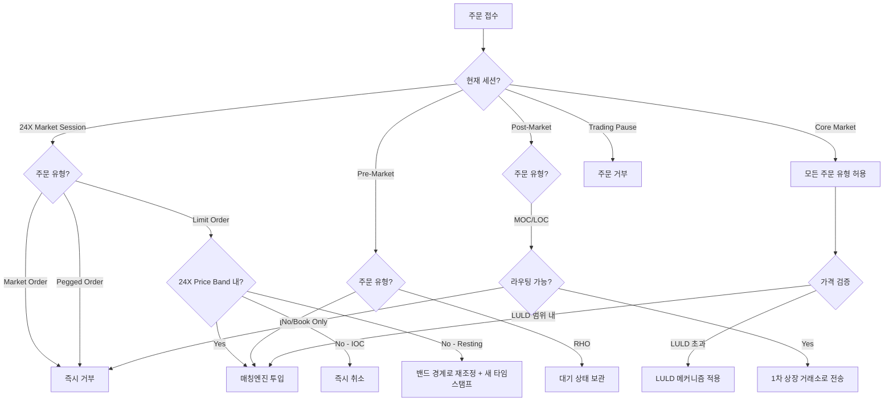

# 24X National Exchange 23/5 거래 체제 분석

> 작성일: 2026년 3월 27일 | 프로젝트: KRX 24시간 거래 도입 전략

## 목차

- [1. Executive Summary (요약)](#1-executive-summary-요약)
- [2. 세션 아키텍처](#2-세션-아키텍처)
  - [2.1 24X 거래일 정의 (24X Trading Day)](#21-24x-거래일-정의-24x-trading-day)
  - [2.2 4-세션 구조](#22-4-세션-구조)
  - [2.3 옥션 메커니즘의 전략적 부재](#23-옥션-메커니즘의-전략적-부재)
- [3. 주문 관리 및 실행 논리](#3-주문-관리-및-실행-논리)
  - [3.1 TIF 한정자 (Time-in-Force Qualifiers)](#31-tif-한정자-time-in-force-qualifiers)
  - [3.2 야간 세션 주문 제한](#32-야간-세션-주문-제한)
  - [3.3 MOO/LOO/MOC/LOC 처리](#33-mooloomocloc-처리)
  - [3.4 Self-Trade Prevention](#34-self-trade-prevention)
- [4. 24X Price Bands (변동성 제어)](#4-24x-price-bands-변동성-제어)
  - [4.1 계층화된 가격 밴드](#41-계층화된-가격-밴드)
  - [4.2 LULD와의 관계](#42-luld와의-관계)
- [5. 시스템 아키텍처: MEMX Memoir 엔진](#5-시스템-아키텍처-memx-memoir-엔진)
  - [5.1 Aeron Sequencer](#51-aeron-sequencer)
  - [5.2 복제 상태 머신 (Replicated State Machine)](#52-복제-상태-머신-replicated-state-machine)
  - [5.3 NY4 데이터센터](#53-ny4-데이터센터)
- [6. DTCC/NSCC 청산결제 연계](#6-dtccnscc-청산결제-연계)
  - [6.1 Novation Gap 해소](#61-novation-gap-해소)
  - [6.2 9A/9B 인가 분리](#62-9a9b-인가-분리)
  - [6.3 거래일 경계 및 결제 논리](#63-거래일-경계-및-결제-논리)
- [7. 시장 데이터 분배](#7-시장-데이터-분배)
  - [7.1 SIP 운영시간 확장](#71-sip-운영시간-확장)
  - [7.2 직접 피드 vs SIP](#72-직접-피드-vs-sip)
- [8. KRX 시사점 및 도입 권고](#8-krx-시사점-및-도입-권고)
  - [8.1 기술적 시사점](#81-기술적-시사점)
  - [8.2 운영적 시사점](#82-운영적-시사점)
  - [8.3 규제적 시사점](#83-규제적-시사점)
  - [8.4 핵심 Gap 분석](#84-핵심-gap-분석)
- [9. 24X 주문 흐름 의사결정 다이어그램](#9-24x-주문-흐름-의사결정-다이어그램)
- [참고문헌](#참고문헌)

---

## 1. Executive Summary (요약)

24X National Exchange LLC("24X")는 미국 증권거래위원회(SEC)의 인가를 받아 23시간/주 5일(23/5) 연속 거래를 지원하는 최초의 미국 국가증권거래소(National Securities Exchange)로서, 글로벌 주식시장 구조의 근본적 전환점을 형성하고 있다. 수십 년간 미국 주식 거래의 기본 아키텍처는 동부시간(ET) 기준 오전 9시 30분~오후 4시라는 엄격한 시간적 틀 안에 제한되어 왔으며, 이러한 구조는 동기화된 시장 데이터 분배, 일괄 처리(batch-processed) 기반 리스크 관리, 그리고 지역화된 청산 역량에 의존해 왔다. 24X 모델은 이러한 시간적 장벽을 근본적으로 해체하여, 특히 아시아태평양(APAC) 및 유럽-중동-아프리카(EMEA) 지역에서 급증하는 기관 및 개인 투자자 수요에 대응하는 글로벌 유동성 접근 체계를 구축하였다.

KRX가 2026년 9월 14일 12시간 거래 시행(연기 확정)과 2027년 12월 24시간 거래 달성을 목표로 하는 상황에서, 24X는 가장 직접적이고 실질적인 벤치마크 사례를 제공한다. 24X의 23/5 모델은 단순히 매칭엔진 서버를 야간에 가동하는 수준이 아니라, 거래 생애주기(trade lifecycle) 전반에 걸친 심층적이고 체계적인 재설계를 요구한다. 전통적 규제 안전장치인 Reg NMS Order Protection Rule, 통합 NBBO(National Best Bid and Offer), LULD(Limit Up-Limit Down) 변동성 메커니즘이 모두 SIP(Securities Information Processor)의 운영 시간에 의존하기 때문에, 야간 거래소 운영은 고유한 규제 공백(regulatory vacuum) 속에서 이루어진다. 이러한 구조적 도전에 대한 24X의 대응 방식 -- MEMX Technologies의 최신 매칭 아키텍처, 독자적 변동성 제어 장치인 24X Price Bands, 그리고 DTCC와의 심층 통합 -- 은 KRX의 EXTURE 3.0 기반 24시간 거래 체제 설계에 핵심적인 기술적, 운영적, 규제적 참조 프레임워크를 구성한다.

---

## 2. 세션 아키텍처

### 2.1 24X 거래일 정의 (24X Trading Day)

24X Trading Day는 SEC Form 1 제출서 및 후속 규칙 개정에 의거하여, **동부시간(ET) 기준 오후 9시(21:00)부터 익일 오후 8시(20:00)까지의 연속 23시간 운영 블록**으로 정의된다. 이 시간적 구조는 의도적으로 아시아 시장 개장 시간대와 정렬되어 설계되었다. 예를 들어, 화요일의 미국 주식 거래일은 실질적으로 월요일 밤 뉴욕 시간 오후 9시에 시작된다. 이를 통해 도쿄, 홍콩, 싱가포르 등 APAC 지역의 기관 데스크와 리테일 집계자(aggregator)가 현지 주간 업무 시간 중에 미국 자산을 거래할 수 있는 환경이 조성된다.

이 23시간 연속 구조에서 핵심적인 설계 원칙은, 글로벌 유동성 흐름을 중단하지 않으면서도 시간적(chronological) 거래일 경계를 명확히 설정하는 것이다. 레거시 미국 거래소들이 주요 정규장(core session)을 중심으로 단기간의 프리마켓/애프터마켓 세션을 운영하는 것과 달리, 24X는 거래 주기(trading cycle) 자체의 개념을 재정의하였다.

### 2.2 4-세션 구조

24X Trading Day는 규제 준수 및 주문 유형 적격성 관리를 위해 **4개의 개별 시장 세션**과 **1시간의 의무적 시스템 전체 일시 중지(Trading Pause)** 로 구분된다.

| 세션 | 시작 시간 (ET) | 종료 시간 (ET) | 운영 및 규제 특성 |
|---|---|---|---|
| **24X Market Session** | 21:00 | 04:00 | 야간 거래 창구. Reg NMS 보호 및 LULD 비활성. 독자적 24X Price Bands 적용. **Market Order 및 Pegged Order 금지.** Limit Order + IOC/FOK만 허용. |
| **Pre-Market Session** | 04:00 | 09:30 | 레거시 프리마켓 거래와 정렬. 표준 프리마켓 리스크 통제 적용. SIP 데이터 제한적 또는 비활성. |
| **Core Market Session** | 09:30 | 16:00 | 미국 정규 거래 시간. **완전한 Reg NMS 준수 의무화.** SIP 완전 운영으로 공식 NBBO 설정. 시장 전체 서킷 브레이커 및 LULD 메커니즘 완전 활성. |
| **Post-Market Session** | 16:00 | 20:00 | 전통적 장후 거래. 일일 시스템 리셋으로 직접 전환. 기관 마켓메이커 참여 감소에 따라 변동성 파라미터 확대. |
| **Trading Pause** | 20:00 | 21:00 | **의무적 거래 완전 중단.** 매칭엔진 정지, 미체결 주문 전량 강제 소거(hard flush), 일괄 처리, 시퀀스 리셋, 데이터베이스 재인덱싱 실행. 다음 Trade Date 준비. |

**주간 추가 유지보수**: 매주 토요일 오전 8시~11시(ET)에 확장 유지보수 창구를 운영하여, 심층 인프라 업그레이드, 물리적 하드웨어 교체, 1차(NY4), 미러(LD4) 및 재해복구(CH4) 데이터센터 간 의무 백업 시스템 스트레스 테스트를 수행한다.

### 2.3 옥션 메커니즘의 전략적 부재

24X National Exchange와 NYSE, Nasdaq 등 1차 상장 거래소(primary listing venue) 간의 결정적 아키텍처 분기점은, **개장/폐장 옥션(opening/closing auction)의 완전하고 의도적인 부재**이다. 24X 생태계 내에서 모든 거래 대상 종목은 **non-auction eligible(옥션 부적격)** 으로 엄격히 지정되어 있다.

전통적 시장 구조에서 개장/폐장 크로스(cross)는 핵심적 가격 발견 메커니즘으로 기능하며, 특정 고정 시점(예: 오전 9시 30분 개장, 오후 4시 폐장)에 대규모 유동성 풀을 집중시켜 기준 가격(reference price)을 확정한다. 그러나 23시간 연속 거래 패러다임에서는 단일 지리적 시점에 유동성을 집중하는 행위가 운영 목표와 근본적으로 모순된다. 24X의 목표는 유동성을 글로벌 시간대에 균일하게 분배하여, 도쿄, 런던, 뉴욕 등에서 거시경제 뉴스가 발생할 때 가격 발견이 유기적으로 이루어지도록 하는 것이다.

**운영적 결과**: 24X Market Session, Pre-Market Session, Core Market Session 간의 전환은 **완전히 무결절(seamless)** 으로 이루어진다. 거래 중단(trading halt)이 없고, 주문 불균형 공시(order imbalance publication)가 없으며, 오전 4시 또는 오전 9시 30분(ET)에 별도의 크로싱 알고리즘이 배치되지 않는다. 시스템은 단순히 엄격한 시간 순서에 따라 수신 주문을 지속적으로 처리하고 매칭하며, 가장 오래된 마이크로초 타임스탬프를 가진 주문부터 시작하여, 규칙집(rulebook)에 인코딩된 세션 파라미터에 따라 특정 주문 유형 적격성을 자동으로 활성/비활성화한다.

---

## 3. 주문 관리 및 실행 논리

23/5 거래 주기에 내재된 유동성 깊이와 변동성의 극심한 변동을 관리하기 위해, 24X는 고도로 결정론적(deterministic)인 주문 관리 프로토콜을 적용한다. 주간 Core Market Session에서는 기관 자본의 깊은 풀이 좁은 스프레드와 신뢰성 있는 체결을 제공하나, 24X Market Session(21:00~04:00 ET)에서는 유동성이 현저히 얇고, 통합 NBBO의 부재가 참여자를 심각한 가격 변위(price dislocation) 위험에 노출시킨다.

### 3.1 TIF 한정자 (Time-in-Force Qualifiers)

자정 경계, 상이한 유동성 레짐, 다일(multi-day) 세션을 횡단하는 잔존 호가(resting quote) 관리를 위해, 24X는 연속 모델에 특화된 고도로 맞춤화된 TIF 수식어(modifier) 모음을 지원한다.

| TIF 한정자 | 설명 | 유효 기간 | 핵심 특성 |
|---|---|---|---|
| **Day+ (Extended Hours)** | 24시간 트레이더를 위한 최상위 TIF 지시. 단일 24X Trading Day 전체에 걸쳐 체결 가능. | 주문 제출 시점 ~ **19:59:59 ET** (Trading Pause 1초 전 자동 만료) | 야간 세션, Pre-Market, Core Session, Post-Market 전체를 관통하여 지속. 유지보수 경계 횡단 위험 차단. |
| **RHO (Regular Hours Only)** | 정규 주간 체결만 추구하는 기관 고객용. | 09:30:00 ET ~ 16:00:00 ET | 24X Market Session 또는 Pre-Market Session에 제출 시 **대기(suspended/dormant) 상태로 보관**. 호가창에 표시되지 않으며 체결 불가. 1차 상장 시장이 09:30:00 ET 이후 해당 증권 거래를 공식 개시할 때까지 유지. |
| **GTT (Good-'til Time)** | 알고리즘/프로그래매틱 트레이더용 **마이크로초 정밀 만료 타임스탬프** 지정. | 사용자 지정 시점 (최대 20:00 ET) | 통계적 차익거래 알고리즘의 알파 감쇠(alpha decay) 계산에 최적화. 사용자 지정 만료 시점이 현재 Post-Market Session 종료(20:00 ET)를 초과할 수 없어, GTT 주문이 시스템 유지보수 창구까지 잔존하는 것을 방지. |
| **IOC (Immediate-Or-Cancel)** | 가용 잔존 유동성에 대해 공격적으로 체결, 미체결 잔량 즉시 취소. | 즉시 | 4개 거래 세션 전체에서 동일하게 작동. 24X Book에 잔존하지 않음. |
| **FOK (Fill-Or-Kill)** | 지정 수량 전량의 즉시 체결을 요구, 불가 시 전량 취소. | 즉시 | IOC와 동일한 세션 범위. 부분 체결 불가. |

### 3.2 야간 세션 주문 제한

24X Market Session(21:00~04:00 ET) 중 적용되는 가장 엄격한 운영 제약은 **비가격 위험(unpriced risk)의 절대적 금지**이다.

**Market Order 금지**: 전통적 시장가 주문은 최적의 표시 가격에서 즉시 매수/매도하는 지시로, 요청 수량이 충족될 때까지 호가창 깊이를 관통(sweep)한다. 정규 시간에는 이러한 공격적 관통 행위가 LULD 변동성 밴드에 의해 억제되나, LULD는 SIP에 의존하므로 야간에는 비활성화된다. 호가창이 극도로 얇은 24X Market Session에서 대규모 시장가 주문을 허용할 경우, 수십 개 가격 수준을 관통하여 극도로 왜곡된 가격에 체결되어 국지적 플래시 크래시(flash crash)를 유발할 수 있다. 따라서 **모든 야간 유동성 상호작용은 명시적으로 가격이 지정된 Limit Order를 통해서만 수행**되어야 하며, 최대 위험 노출은 진입 전 사용자에 의해 수학적으로 제한된다.

**Pegged Order 금지**: Midpoint Peg, Primary Peg 등 Pegged Order는 SIP가 모든 미국 거래소로부터 데이터를 수집하여 산출하는 통합 실시간 NBBO에 의존한다. SIP 운영위원회가 역사적으로 20:00 ET에 인프라를 종료하므로, 24X Market Session 동안에는 공식 NBBO가 존재하지 않는다. 외부 통합 기준점 없이 Pegged Order가 국지적이고 잠재적으로 비유동적인 24X 지정가 호가창에만 고정(anchor)될 경우, 심각한 지연 차익거래(latency arbitrage)와 호가 남발(quote-stuffing) 전술을 초래할 수 있다. 따라서 **페깅 지시를 포함한 모든 주문은 21:00~04:00 ET 사이에 제출될 경우 자동 거부**된다.

### 3.3 MOO/LOO/MOC/LOC 처리

24X 아키텍처는 본질적으로 네이티브 개장/폐장 크로싱 메커니즘이 없으므로, Limit-On-Open(LOO), Market-On-Open(MOO), Limit-On-Close(LOC), Market-On-Close(MOC) 주문을 내부적으로 해결할 수 있는 방법론이 존재하지 않는다. 시스템이 공식적인 "개장" 또는 "폐장" 프린트를 생성하지 않으므로, 이러한 주문 유형이 24X Book에 잔존할 경우 사실상 "고립된 논리(stranded logic)"가 된다.

**처리 흐름**:

1. **Routable 주문**: 참가자가 MOO, LOO, MOC, LOC 주문을 24X 게이트웨이에 제출하면, 시스템 로직은 주문의 라우팅 지시를 즉시 확인한다. 라우팅 가능(routable)으로 지정된 경우, 24X 시스템은 **제3자 라우팅 브로커(third-party routing broker)를 통해 해당 주문을 1차 상장 거래소로 직접 전송**한다. 예: AAPL의 MOC 주문을 Nasdaq Closing Cross로 전달.

2. **Book Only / Do Not Route 주문**: 사용자가 MOO, LOO, MOC, LOC 주문에 엄격한 "Book Only" 또는 "Do Not Route" 수식어를 부착한 경우, 체결 조건을 로컬에서 충족하는 것이 불가능하므로 **24X 매칭엔진이 FIX 프로토콜을 통해 즉시 거부 메시지를 반환**한다.

### 3.4 Self-Trade Prevention

고속 연속 시장 환경에서 알고리즘 마켓메이커는 서로 다른 트레이딩 데스크 간에 자사의 매수 및 매도 주문이 의도치 않게 매칭될 수 있다. MEMX 아키텍처는 **통합된 Self-Trade Prevention(STP) 수식어**를 네이티브로 실행한다.

STP 메커니즘은 전체 논리적 24X Book에 걸쳐 **마이크로초 수준의 검사**를 수행하여 대응하는 Member ID를 식별하며, 사전 구성된 지시에 따라 **가장 오래된 주문, 가장 새로운 주문, 또는 양쪽 주문을 자동 취소**하여 불법적인 자전거래(wash trade)를 방지한다. 이 기능은 24X Book의 통합 논리적 호가창 구조와 결합되어, 물리적 보드 분리 없이도 전 종목에 걸쳐 일관된 자전거래 방지 통제를 보장한다.

---

## 4. 24X Price Bands (변동성 제어)

### 4.1 계층화된 가격 밴드

LULD가 SIP에 의존하여 야간에 비활성화되는 상황에서, 변동성 관리자(volatility governor) 없이 중앙 지정가 호가창을 운영하는 것은 얇은 유동성을 관통하는 오류 알고리즘에 의한 국지적 플래시 크래시 위험을 초래한다. 이를 해결하기 위해 24X는 통합 테이프(consolidated tape)와 독립적인 **독자적 "24X Price Bands"** 를 설계, 구현하였다.

24X Price Band는 증권의 현재 공정가치 주위에 수학적으로 정의된 경성 칼라(hard collar)를 설정한다. 매칭엔진은 이 임계치를 초과하는 공격적 지정가 주문을 **자동으로 거부하거나 재가격 설정(re-price)** 하도록 프로그래밍되어 있다.

**계층별 Percentage Parameter**:

| 증권 가격대 | Percentage Parameter | 밴드 폭 (상하 합산) |
|---|---|---|
| $0.01 ~ $25.00 | **10%** | 20% |
| $25.01 ~ $50.00 | **5%** | 10% |
| $50.01 이상 | **3%** | 6% |

> **참고**: 야간 세션은 자연적으로 주간 시장 대비 더 넓은 매수-매도 스프레드와 낮은 거래량을 경험하므로, 24X Price Bands의 Percentage Parameter는 주간 LULD 밴드 대비 의도적으로 더 관대(permissive)하게 보정되어 있다. 이는 표준적 야간 가격 발견으로 인해 시스템이 동결되는 것을 방지하기 위함이다.

**주문 처리 논리**:
- **Market Order / IOC 주문이 밴드 외부에 위치하는 경우**: 즉시 취소(instant cancel)
- **잔존(resting) Limit Order가 밴드 외부에 위치하는 경우**: 밴드 경계(band edge)로 재가격 설정(reprice)되며, **새로운 타임스탬프가 부여**되어 기존 시간 우선순위를 상실

**Reference Price 결정 체계** (21:00 ET 초기 설정을 위한 엄격한 계층적 캐스케이드):
1. 직전 24X Post-Market Session에서 체결된 마지막 매매 가격
2. (불가 시) 정규거래시간 중 1차 상장 시장에서 확정된 최근 종가
3. (여전히 불가 시) 전일 공식 종가

**동적 갱신**: 24X Market Session 개시 후 5분 경과 시, 시스템은 정적 초기 가격을 포기하고 **동적 연속 계산으로 전환**한다. 매 30초마다 매칭엔진이 직전 5분 블록의 평균 가격을 산출하며, 이 새로운 평균이 현재 활성 Reference Price로부터 **최소 1% 이상 괴리**되는 경우에만 Reference Price가 공식 갱신된다.

**크라우드소싱 조정 밸브(Crowdsourced Adjustment Valve)**: 경직된 자동화 가격 밴드가 진정한 거시경제 충격에 의한 합법적 대폭 가격 재설정을 "잠금(lock out)"하는 2차 위험을 완화하기 위해, 24X는 고유한 메커니즘을 설계하였다. **3개의 서로 다른 개별 Member**로부터의 지정가 주문이 Upper 또는 Lower Price Band의 절대 경계(edge)에 정확히 **최소 30초 동안 중단 없이 표시**(각 주문 최소 100주)되는 경우, 시스템 로직은 시장이 변위된 수준에서의 합법적 다자간 거래 의도(multi-party intent)를 보유하고 있다고 결론짓고, **Reference Price를 해당 밴드 경계로 강제 재계산**하여 새로운 가격 수준에서의 거래 지속을 허용한다.

### 4.2 LULD와의 관계

LULD(Limit Up-Limit Down)는 Core Market Session(09:30~16:00 ET) 동안에만 활성화되는 시장 전체(market-wide) 변동성 억제 메커니즘이다. SIP가 모든 미국 거래소로부터 통합 데이터를 수집하여 산출하는 동적 가격 밴드에 기반하며, 증권 가격이 이 밴드를 초과하여 체결을 시도할 경우 SIP가 모든 미국 거래소에 걸쳐 유니버설 거래 일시중지(trading pause)를 트리거한다.

24X Price Bands는 **SIP 오프라인 시간대에 LULD를 대체하는 독자적(proprietary) 메커니즘**으로 기능한다. 양자 간의 핵심 차이점은 다음과 같다:

| 비교 항목 | LULD | 24X Price Bands |
|---|---|---|
| 적용 시간 | Core Market Session (09:30~16:00 ET) | 24X Market Session (21:00~04:00 ET) |
| 데이터 의존 | SIP 통합 데이터 (NBBO) | 24X 자체 거래 데이터 |
| 적용 범위 | 모든 미국 거래소 (시장 전체) | 24X 단일 거래소 (국지적) |
| 거래 중지 | 시장 전체 거래 일시중지 트리거 | 주문 거부/재가격만 수행, 거래 중지 없음 |
| 밴드 폭 | 상대적으로 좁음 | 야간 유동성 특성 반영하여 상대적으로 넓음 |
| 조정 메커니즘 | SIP 기반 동적 재계산 | 30초 평균 + 크라우드소싱 밸브 |

---

## 5. 시스템 아키텍처: MEMX Memoir 엔진

24X는 Regulation Systems Compliance and Integrity(Reg SCI)의 엄격한 성능 및 복원력 요건을 충족하기 위해, 자체 엔진을 처음부터 개발하는 대신 **"market-as-a-service" 기술 패러다임**을 채택하였다. MEMX Technologies, LLC로부터 Delivery, Licenses and Services Agreement(DLSA)를 통해 핵심 거래 인프라를 라이선스받아 운영한다.

### 5.1 Aeron Sequencer

MEMX Memoir 매칭엔진의 기술적 기반은 **데이터 중심(data-centric) 고성능 아키텍처**로 설계되었다. 레거시 순차 처리(sequential processing)를 폐기하고, **고도로 병렬화된 분산 서버 네트워크**를 채택하였다.

**Aeron 기반 메시징 아키텍처**의 핵심 특성:
- **프로토콜**: UDP 멀티캐스트 + 공유 메모리 IPC(Inter-Process Communication)를 활용하는 고성능 오픈소스 메시징 프레임워크
- **온프레미스 지연시간**: **18 마이크로초** (co-location 환경)
- **클라우드 지연시간**: **50 마이크로초 미만**
- **처리량**: **초당 수백만 건의 메시지** 처리 능력
- **결정론적 지연시간**: 오전 3시의 알고리즘 참여자가 경험하는 지연시간이 피크 거래량 시간대인 오전 9시 30분과 동일하도록 보장

매칭엔진은 **엄격한 가격/시간 우선순위(price/time priority) 모델**로 작동한다. 수신 주문이 거래소 게이트웨이에 도달하면 즉시 매칭 코어로 라우팅되어 순차적으로 순위가 매겨진다. 엔진은 먼저 표시 가격(display price)을 평가하여, 가장 공격적인 가격을 제시하는 주문에 체결 우선권을 부여한다. 동일 가격 수준에 복수의 잔존 지정가 주문이 존재하는 경우, **고정밀 타임스탬프**에 의거하여 게이트웨이에 마이크로초라도 먼저 도착한 주문에 절대적 우선권을 부여한다.

### 5.2 복제 상태 머신 (Replicated State Machine)

Memoir 아키텍처의 핵심 설계 원리는 **복제 상태 머신(Replicated State Machine)** 패턴이다.

- **글로벌 순서화 로그**: 모든 주문은 처리(processing) 전에 **글로벌하게 순서화된 로그에 직렬화(serialized)** 된다. 이를 통해 클러스터 내 모든 노드가 동일한 순서로 동일한 이벤트를 처리할 수 있다.
- **무상태(stateless) 매칭엔진**: 매칭엔진 자체는 상태를 보유하지 않으며, 순서화된 로그로부터 상태를 재구성한다.
- **결정론적 복제**: 클러스터 노드 간의 결정론적 복제를 통해, 어느 시점에서든 임의의 노드가 동일한 상태를 유지한다.
- **하드웨어 장애 시 데이터 무손실**: 개별 하드웨어 장애가 발생하더라도 **데이터 손실이 제로(zero data loss)** 를 보장한다.
- **즉시 복구**: 장애 발생 시 백업 노드가 순서화된 로그로부터 상태를 즉시 재구성할 수 있어, **23/5 연속 운영에 필수적인 무중단 복구**가 가능하다.

**통합 논리적 호가창(24X Book)**: 물리적 보드(Board)의 경직된 분할을 추상화하고, **탄력적으로 확장 가능한(elastically scalable) 매칭 노드 클러스터에 걸쳐 분산된 단일 논리적 호가창**을 유지한다. 게이트웨이 서버는 정교한 로드밸런싱 알고리즘을 활용하여 수신 FIX 및 바이너리 메시지를 최적의 매칭 노드로 동적 라우팅함으로써, 국지적 처리 큐(queue)를 방지한다.

24X Book은 라운드 랏(round lot), 혼합 랏(mixed lot), 단주(odd lot)의 수집 및 표시를 네이티브로 지원하며, 최대 단일 주문 규모는 **1,000,000주**까지 허용된다. 또한 복수의 소규모 잔존 비시장성(non-marketable) 단주 주문이 특정 가격 지점에 누적되어 1 라운드 랏(통상 100주)에 도달할 경우, Memoir 엔진이 자동으로 통합하여 호가창 상단 피드(top-of-book feed)로 승격시켜 공개 호가 분배에 활용한다.

### 5.3 NY4 데이터센터

24X National Exchange의 물리적 인프라는 **뉴저지주 시코커스(Secaucus, NJ) 소재 Equinix NY4 데이터센터**에 호스팅된다.

**인프라 분리 원칙**: DLSA에 의거하여 Reg SCI 시스템 보안 요건을 충족하고 규제적 얽힘(regulatory entanglement)을 방지하기 위해, 24X 플랫폼은 MEMX Exchange와 **완전히 분리된 전용 인스턴스(discrete, dedicated instance)** 로 운영된다:
- **물리적으로 격리된 서버 하드웨어** 사용
- 24X Member 전용의 **별도 전용 통신 크로스 커넥트** 활용
- MEMX Exchange의 거래량 급증 또는 사이버 이벤트가 24X 운영에 영향을 미치지 못하도록 완전 차단

**글로벌 연결성 (TNS 통합)**: APAC 지역의 기관 데스크와 리테일 집계자를 위한 태평양 횡단 주문 라우팅의 지리적 마찰을 해소하기 위해, 24X는 Transaction Network Services(TNS)와 전략적 인프라 파트너십을 체결하였다. TNS는 **최적화된 대양횡단 해저 케이블**을 활용하여 공용 인터넷을 완전히 우회하는 초저지연 금융 전용 네트워크를 운영한다. 이를 통해 홍콩의 자기매매 회사가 미국 야간 가격 데이터를 수집하고, 복잡한 라우팅 결정을 실행하며, FIX 주문을 Equinix NY4의 MEMX Memoir 매칭엔진으로 **결정론적 밀리초 수준의 정밀도**로 전송할 수 있다.

**다중 데이터센터 구조**:
- **1차(Primary)**: NY4 (Equinix, Secaucus, NJ)
- **미러(Mirror)**: LD4
- **재해복구(Disaster Recovery)**: CH4

---

## 6. DTCC/NSCC 청산결제 연계

24시간 주식 거래소의 실현은 단순한 프런트오피스 매칭 과제가 아니라, 근본적으로 **백오피스 청산결제 딜레마**이다. DTCC 및 그 중앙거래상대방(CCP) 자회사인 NSCC가 관리하는 미국 청산 인프라는 역사적으로 09:30~16:00 시장의 시간적 현실에 맞추어 설계되었으며, 다자간 차감(multilateral netting), 위험 증거금 산정(risk margining), 결제 처리에 필요한 방대한 계산 작업을 위해 광범위한 야간 일괄 처리 창구에 의존하여, Universal Trade Capture(UTC) 시스템을 심야 및 새벽 시간대에 사실상 오프라인으로 전환해 왔다.

### 6.1 Novation Gap 해소

21:00~04:00 ET에 운영되는 거래소에게 UTC 시스템의 폐쇄는 **중앙거래상대방 노베이션(novation) 지연**이라는 치명적 시스템 위험을 초래한다. Novation은 NSCC가 매수자와 매도자 사이에 개입하여 거래의 신용 위험을 인수하고 결제를 보증하는 법적 절차이다. 두 브로커-딜러가 22:00 ET에 24X에서 거래를 체결했으나 NSCC 시스템이 다음날 아침까지 오프라인인 경우, 해당 거래는 야간 내내 **미-노베이션 상태**로 잔존한다.

이 수 시간에 걸친 "novation gap" 동안, 체결 브로커-딜러는 **양자간 거래상대방 신용위험(bilateral counterparty credit risk)** 을 부담하게 된다. SIFMA 등 업계 단체는 24X 인가 과정에서 이 구조적 위험을 주요 우려사항으로 제기하며, 장기간의 미-노베이션 양자간 위험 노출이 자본 효율성을 심각하게 저하시키고 대형 기관 마켓메이커의 야간 유동성 공급을 억제한다고 지적하였다.

**DTCC 24x5 UTC 현대화 이니셔티브**:

| 단계 | 시행 시점 | 내용 |
|---|---|---|
| **Phase 1** | 2024년 9월 시행 완료 | NSCC의 UTC 시스템 개장 시간을 기존 04:00 ET에서 **01:30 ET으로 2.5시간 앞당김**. 아시아 조조 거래 시간대의 일부 위험 완화. 그러나 20:00~01:30 ET 사이 체결 거래는 여전히 양자간 의무로 잔존. |
| **Phase 2** | **2026년 6월 목표** | NSCC가 **연속 24x5 운영 체제로 전환**. UTC 시스템이 일요일 20:00 ET에 개장하여 금요일 20:00 ET까지 무중단 운영. 심야 시간대 체결 거래가 UTC에 실시간 전송 및 수집되어, 제출 즉시 NSCC의 CCP 보증이 적용됨으로써 양자간 거래상대방 위험을 **사실상 근절**. |

### 6.2 9A/9B 인가 분리

야간 변동성이 정규 시간대 증거금 콜(margin call)을 트리거하는 것을 방지하고 리스크 풀을 세밀하게 분리하기 위해, NSCC는 청산 회원(clearing member)에게 **야간 세션 전용의 별도 9A/9B Correspondent Clearing(CORR) 및 Qualified Special Representative(QSR) 관계**를 수립하도록 요구한다.

이 **이중 관계 구조(dual-relationship structure)** 는:
- 야간 신용 노출을 주간 거래 활동으로부터 **구획화(compartmentalize)**
- 청산 회사가 고객의 야간 알고리즘 전략에 대해 **더 엄격한 위험 한도를 부과** 가능
- NSCC가 UTC 내에서 자동화된 사전거래 유효성 검증(pre-trade validation) 체크를 실행하여, 저유동성 시간대에 **10억 달러($1 billion) 고가치 임계치를 초과하는 이례적 Correspondent Clearing 거래를 완전 거부** -- 알고리즘 폭주에 대한 안전장치

**시행일**: 2026년 3월 30일

### 6.3 거래일 경계 및 결제 논리

연속 운영 모델은 "거래일(Trade Date)" 정의와 T+1 가속 결제 규칙 준수에 관한 심각한 시간적 복잡성을 도입한다.

**핵심 원칙**: 미국 업계 합의에 의거하여 공식 Trade Date 전환(rollover)은 정확히 **20:00 ET**에 설정된다.

**예시**: 월요일 21:05 ET에 24X 엔진에서 매칭된 주식 거래는 법적, 운영적으로 **화요일 체결로 정의**된다. 이 거래는 화요일의 개시일/일중 증거금 산정 대상이 되며, T+1 요건 충족을 위해 **수요일에 결제**된다.

**FIX Tag 715 (Clearing Business Date)**: 이 시간적 오프셋 관리를 위해 DTCC는 모든 체결 브로커-딜러 및 청산 회사에게 **FIX Tag 715**를 지원하는 FIX 연결 업그레이드를 의무화하였다. 24X가 UTC에 체결 보고서를 전송할 때, FIX Tag 715의 포함은 다운스트림 청산 시스템에 월요일 밤 체결 거래가 화요일 청산 배치에 속함을 명확히 알려, 프라임 브로커와 위험 관리 시스템이 월요일 밤의 위험 노출을 월요일 주간 결제 의무와 부적절하게 혼합하는 것을 방지한다.

---

## 7. 시장 데이터 분배

### 7.1 SIP 운영시간 확장

정규 09:30~16:00 시간 창 외부에서의 운영은 시장 투명성의 메커니즘을 근본적으로 변경한다. 정규 시간 동안 24X는 CTA 및 UTP 플랜의 전속 SIP(Securities Information Processor)에 자사의 호가창 상단 호가(top-of-book quotation)와 최종 매매 프린트(last-sale trade print)를 원활하게 전송한다. SIP는 모든 국가 거래소의 데이터를 집계하여 공식적이고 통합된 NBBO를 산출 및 분배한다.

그러나 SIP 운영위원회가 역사적으로 **20:00 ET에 통합 인프라를 종료**하므로, 이 중앙집중형 투명성 장치는 야간 시간대에 붕괴된다.

**SIP Operating Committee Plan Amendment (2025년 12월)**:
- **목표**: 일요일 21:00 ET ~ 금요일 20:00 ET 연속 운영
- **일일 1시간 일시중지**: 20:00~21:00 ET
- 진화하는 시장 구조와의 정렬을 위해 SIP 운영 시간을 **24x5 체제로 확장** 추진

### 7.2 직접 피드 vs SIP

24X는 **SIP가 운영 상태가 될 때까지 야간 세션을 개시하지 않을 것**임을 명시하고 있다. SIP 확장 완료 전까지는 독자적 직접 피드(proprietary direct feed)가 과도기적 솔루션으로 기능한다.

**24X 독자적 시장 데이터 제품**:

| 피드 | 설명 |
|---|---|
| **24X Top** | 24X Book에 독점적으로 잔존하는 최우선 매수호가(best bid) 및 최우선 매도호가(best offer)를 분배하는 저지연 호가창 상단 피드. 리테일 플랫폼 및 Smart Order Router(SOR)를 위한 실시간 가격 기준점 제공. |
| **24X Depth** | 거래소의 모든 가격 수준에 걸쳐 모든 잔존 지정가 주문을 노출하는 고도 세분화, 비집계(unaggregated) 데이터 피드. 체결 보고서, 주문 수정, 취소 메시지 포함. |

**규제적 우려**: 24X Market Session 동안 통합 NBBO가 존재하지 않으므로, 이러한 독자적 피드가 **가격 발견의 절대적 진실 원천(absolute source of truth)** 이 된다. 야간 세션에 참여하는 브로커-딜러는 24X Depth 피드를 직접 수집하여 자체적인 시장 유동성 내부 표현을 구축해야 하며, 이는 상당한 컴퓨팅 오버헤드와 정교한 데이터 파싱 역량을 요구한다. Reg NMS의 Order Protection Rule(Rule 611)이 야간에 적용되지 않으므로, **시장은 고립된 유동성 섬(isolated liquidity islands)으로 파편화**되며, 최적 체결 달성의 부담이 거래소에서 참여 브로커-딜러의 SOR로 완전히 전가된다. 이는 **계층화된 접근(tiered access)** 에 관한 규제적 우려를 야기한다.

---

## 8. KRX 시사점 및 도입 권고

### 8.1 기술적 시사점

24X가 채택한 MEMX Memoir 기반 아키텍처는 KRX **EXTURE 3.0**(2023년 1월 25일 매매체결/정보분배, 2023년 10월 4일 청산결제 시행)의 차세대 진화 방향에 대한 핵심 참조 모델을 제공한다.

| 24X/MEMX 개념 | KRX EXTURE 3.0 적용 시사점 |
|---|---|
| **Aeron 기반 UDP 멀티캐스트 + 공유 메모리 IPC** | EXTURE 3.0의 현재 50us latency, 9.4억건/일 처리 성능 기반 위에 Aeron 스타일의 메시징 계층 도입 검토. 18us 온프레미스 지연시간 달성 가능성 평가. |
| **무상태(stateless) 매칭엔진** | 매칭엔진을 상태 비보유(stateless) 구조로 전환함으로써, 장애 발생 시 순서화된 로그로부터 상태를 즉시 재구성하는 설계 도입. 23/5 또는 24/7 연속 운영의 핵심 전제조건. |
| **복제 상태 머신(Replicated State Machine)** | 클러스터 노드 간 결정론적 복제를 통한 하드웨어 장애 시 데이터 무손실(zero data loss) 및 즉시 복구. EXTURE 3.0의 이중화 체계를 복제 상태 머신 패턴으로 강화. |
| **탄력적 확장 가능(elastically scalable) 매칭 노드** | 물리적 보드 분할의 제약을 극복하는 통합 논리적 호가창 개념. 야간 저거래량 시 노드 축소, 정규장 고거래량 시 노드 확장의 동적 리소스 관리. |
| **TNS 글로벌 연결성** | KRX의 APAC 역내 지위를 활용한 글로벌 투자자 접근성 향상. 대양횡단 전용 네트워크를 통한 결정론적 저지연 연결 구축. |

### 8.2 운영적 시사점

| 24X 운영 모델 | KRX 적용 권고 |
|---|---|
| **Day+ TIF (Extended Hours)** | KRX 연속 거래 체제를 위한 **24시간 주문 지속성(order persistence)** 템플릿. 거래일 전체에 걸쳐 주문이 존속하되, 유지보수 경계 전 자동 만료하는 설계. |
| **Trading Pause 프로토콜 (20:00~21:00 ET)** | 1시간 의무적 거래 중단 + 전량 주문 강제 소거(hard flush). KRX의 일일 유지보수 창구 설계 시 참조. 비대칭 정보 차익거래 방지를 위한 호가창 완전 초기화의 필요성. |
| **세션 기반 주문 적격성 관리** | 세션별 주문 유형 허용/제한의 자동 전환. 야간 시장가 주문 금지, RHO 주문의 정규장 개시까지 대기 상태 보관 등의 메커니즘을 KRX 다중 세션 구조에 적용. |
| **Hard Flush의 시장 무결성 기능** | 유지보수 창구 동안 발표되는 거시경제 뉴스/기업 실적이 공정가치를 급변시킬 수 있으므로, 재개장 시 유동성 공급자가 갱신된 가격으로 새로운 주문을 제출하도록 강제. |
| **CEE(Clearly Erroneous Execution) 정책** | 야간 세션에서의 CEE 검토 일반 유예 및 극단적 체결 확실성(execution certainty) 정책. KRX 야간 세션의 체결 확정성 규칙 설계 시 참조. |

### 8.3 규제적 시사점

| 24X 규제 모델 | KRX 적용 권고 |
|---|---|
| **24X Price Bands** | KRX 야간 변동성 제어의 핵심 모델. **계층화된 백분율 접근법**(가격대별 3%/5%/10%)이 KRX의 현행 ±30% 균일 가격제한폭(flat limit) 대비 세밀한 보호를 제공. 야간 유동성 특성을 반영한 차별화된 밴드 폭 설계 필요. |
| **크라우드소싱 조정 밸브** | 경직된 가격 밴드가 합법적 대폭 가격 재설정을 차단하지 않도록 하는 안전장치. 3개 이상의 개별 회원으로부터의 밴드 경계 주문이 30초 이상 지속 시 밴드 강제 재계산. KRX 야간 가격제한 적응 메커니즘 설계에 직접 적용 가능. |
| **옥션 부재 모델 vs KRX 호가(call auction) 전통** | 24X는 연속 거래 극대화를 위해 옥션을 완전 배제. KRX는 개장/폐장 동시호가 전통이 강하므로, 야간 세션에서의 옥션 부재와 정규장에서의 옥션 유지를 결합한 **하이브리드 모델** 검토. |
| **Reg NMS 부재에 따른 최적체결 부담 전가** | 야간에 시장 전체 주문보호규칙이 적용되지 않아, 최적체결 의무가 거래소에서 브로커-딜러 SOR로 이전. KRX는 야간 세션에서의 최적체결 규제 프레임워크를 명시적으로 재정의할 필요. |

### 8.4 핵심 Gap 분석

| 비교 차원 | 24X National Exchange | KRX (현행/계획) | Gap 및 권고 |
|---|---|---|---|
| **아키텍처** | MEMX Memoir (Aeron 기반), 무상태 매칭엔진, 복제 상태 머신, 18us 지연시간 | EXTURE 3.0, 50us latency, 9.4억건/일 | EXTURE 3.0의 복제 상태 머신 패턴 도입 및 무상태 매칭 구조 전환 검토. 야간 무중단 운영을 위한 아키텍처 진화 필요. |
| **주문 지속성** | Day+ TIF (23시간 전체 존속), 19:59:59 ET 자동 만료. GTT 마이크로초 정밀. RHO 대기 상태. | 현행 정규장 중심 주문 관리 | Day+ 개념의 KRX 다중 세션 주문 지속성 프레임워크로 적용. 세션 횡단 주문 상태 관리 엔진 개발. |
| **변동성 제어** | 24X Price Bands (계층화: 3%/5%/10%), 동적 Reference Price (30초/5분 평균), 크라우드소싱 조정 밸브 | ±30% 균일 가격제한폭, 정적 VI(Volatility Interruption) | 야간 전용 계층화 가격 밴드 도입. 동적 Reference Price 메커니즘 및 크라우드소싱 밸브 설계. |
| **청산** | DTCC/NSCC 24x5 UTC (Phase 2: 2026년 6월), FIX Tag 715, 9A/9B 분리, $1B 임계치 안전장치 | 한국예탁결제원(KSD) T+2→T+1 전환 추진 | KSD의 UTC 수준 24x5 청산 인프라 현대화. 야간 CCP 보증 실시간 적용 체계 구축. 야간/주간 리스크 풀 구획화. |
| **세션 관리** | 4-세션 + 1시간 Trading Pause, 전량 hard flush, 옥션 완전 부재, 무결절 세션 전환 | 단일 정규장 + 동시호가 | 다중 세션 구조 설계. 야간 옥션 부재 + 정규장 동시호가 유지 하이브리드 모델. 1시간 유지보수 창구 + hard flush 프로토콜 도입. |
| **시장 데이터** | 독자적 24X Top/24X Depth 피드, SIP 24x5 확장 대기, TNS 글로벌 연결 | KRX 정보분배 시스템 (정규장 한정) | 야간 독자적 시장 데이터 피드 개발. APAC 역내 글로벌 투자자 대상 저지연 데이터 분배 네트워크 구축. |

---

## 9. 24X 주문 흐름 의사결정 다이어그램

---

## 참고문헌

1. "24X National Exchange Opens for Trading as First SEC-Approved 23/5 Stock Exchange," PR Newswire, 2026. https://www.prnewswire.com/news-releases/24x-national-exchange-opens-for-trading-as-first-sec-approved-235-stock-exchange-302581303.html
2. "Market Spotlight: 24 Hour Trading," BlackRock, 2026. https://www.blackrock.com/corporate/literature/whitepaper/blackrock-market-spotlight-24-hour-trading.pdf
3. "24X National Exchange Partners With TNS to Provide Market Data Connectivity Across 23/5 Trading in U.S. Equities," Business Wire, 2025. https://www.businesswire.com/news/home/20250909964940/en/
4. "24X Exchange Beats Nasdaq to Market with TNS Partnership for Extended-Hours Trading," Finance Magnates, 2025. https://www.financemagnates.com/forex/24x-exchange-beats-nasdaq-to-market-with-tns-partnership-for-extended-hours-trading/
5. "24X NATIONAL EXCHANGE LLC USER MANUAL," SEC.gov, 2022. https://www.sec.gov/files/rules/other/2022/24x/24x-form-1-exhibit-e-1-amended-marked.pdf
6. "24X National Exchange LLC; Order Instituting Proceedings to Determine Whether to Grant or Deny an Application for Registration," SEC.gov, 2024. https://www.sec.gov/files/rules/other/2024/34-100254.pdf
7. "SR-NASDAQ-2025-109," Nasdaq, 2025. https://listingcenter.nasdaq.com/assets/rulebook/nasdaq/filings/SR-NASDAQ-2025-109.pdf
8. "24X National Exchange LLC Date of filing," SEC.gov, 2024. https://www.sec.gov/files/rules/other/2024/24x-amend-exhibit-e-redline.pdf
9. "Equities Clearing Enhancements: UTC - 24/5 Extended Trading Hours," DTCC, 2026. https://www.dtcc.com/-/media/Files/Downloads/Transformation/UTC-24-x-5-Extended-Trading-Hours.pdf
10. "SR-24X-2025-07," 24X Exchange, 2025. https://equities.24exchange.com/api/media/file/SR-24X-2025-07-Trading-Hours-Website.pdf
11. "Addendum E-1 24X National Exchange User Manual," SEC.gov, 2024. https://www.sec.gov/files/rules/other/2024/24x-form-1-exhibit-e-1.pdf
12. "Nasdaq Proposes Near-24-Hour Trading," Cadwalader Quorum, 2025. https://www.cadwalader.com/quorum/index.php?nid=20&eid=93
13. "RULES OF 24X NATIONAL EXCHANGE LLC (As of August 21, 2024)," SEC.gov, 2024. https://www.sec.gov/files/rules/other/2024/24x-amend-exhibit-b-1.pdf
14. "Order Type Differences," NYSE, 2025. https://www.nyse.com/publicdocs/nyse/markets/nyse/Pillar_Differences.pdf
15. "Application of 24X National Exchange LLC for Registration as a National Securities Exchange," SIFMA, 2024. https://www.sifma.org/advocacy/letters/application-of-24x-national-exchange-llc-for-registration-as-a-national-securities-exchange
16. "THE SHIFT TO 24X5 TRADING," DTCC, 2025. https://www.dtcc.com/-/media/Files/Downloads/Transformation/theshiftto24x5trading.pdf
17. "24X National Exchange; Application for Registration," SIFMA, 2024. https://www.sifma.org/advocacy/letters/24x-national-exchange-application-for-registration
18. "Extended Trading Hours," SIFMA, 2025. https://www.sifma.org/issues/market-structure/extended-trading-hours
19. "24x5 trading update - Important Notice," DTCC, 2026. https://www.dtcc.com/-/media/Files/pdf/2026/1/7/A9689.pdf
20. "What is 24X? Inside the Exchange Powering 23/5 Trading," Exegy, 2025. https://www.exegy.com/what-is-24x-exchange-23-5-trading/
21. "RULES OF 24X NATIONAL EXCHANGE LLC (redline)," SEC.gov, 2024. https://www.sec.gov/files/rules/other/2024/24x-amend-exhibit-b-1-redline.pdf
22. "Uninterrupted FIX Connectivity for 24x7 Trading Marketplaces," B2BITS, 2025. https://www.b2bits.com/insights/fixconnect247
23. "Self-Regulatory Organizations; 24X National Exchange LLC; Notice of Filing - Proprietary Market Data Feeds," Federal Register, 2025. https://www.federalregister.gov/documents/2025/09/30/2025-19011/
24. "Limit Up-Limit Down FAQ," Nasdaq Trader, 2025. https://www.nasdaqtrader.com/content/MarketRegulation/LULD_FAQ.pdf
25. "MEMX Technology Helps Improve Venue Performance," MarketsMedia via Blue Ocean, 2025. https://blueocean-tech.io/2025/02/25/markets-media-memx-technology-helps-improve-venue-performance/
