# TSE-JPX 및 JSCC 거래·청산 인프라 분석

> 작성일: 2026년 3월 27일 | 프로젝트: KRX 24시간 거래 도입 전략

---

## 목차

- [1. Executive Summary (요약)](#1-executive-summary-요약)
- [2. TSE 거래시간 구조](#2-tse-거래시간-구조)
  - [2.1 현행 거래시간 (2024년 11월 이후)](#21-현행-거래시간-2024년-11월-이후)
  - [2.2 2024년 11월 변경사항](#22-2024년-11월-변경사항)
  - [2.3 점심시간 유지 논쟁](#23-점심시간-유지-논쟁)
- [3. 종가 옥션 메커니즘 (Closing Auction)](#3-종가-옥션-메커니즘-closing-auction)
  - [3.1 Itayose (板寄せ) 방식](#31-itayose-板寄せ-방식)
  - [3.2 도입 배경 및 효과](#32-도입-배경-및-효과)
  - [3.3 KRX 종가 결정 방식과의 비교](#33-krx-종가-결정-방식과의-비교)
- [4. ARROWHEAD 거래 시스템](#4-arrowhead-거래-시스템)
  - [4.1 시스템 진화 (1.0 → 4.0)](#41-시스템-진화-10--40)
  - [4.2 ARROWHEAD 4.0 사양](#42-arrowhead-40-사양)
  - [4.3 글로벌 매칭엔진 성능 비교](#43-글로벌-매칭엔진-성능-비교)
- [5. JSCC 청산 인프라](#5-jscc-청산-인프라)
  - [5.1 JSCC 조직 구조](#51-jscc-조직-구조)
  - [5.2 청산 프로세스](#52-청산-프로세스)
  - [5.3 리스크 관리 체계](#53-리스크-관리-체계)
  - [5.4 결제 사이클](#54-결제-사이클)
- [6. JPX 거래시간 확장 논의](#6-jpx-거래시간-확장-논의)
  - [6.1 현재 논의 상황 (2026년 3월 기준)](#61-현재-논의-상황-2026년-3월-기준)
  - [6.2 야간 거래 도입 장벽](#62-야간-거래-도입-장벽)
  - [6.3 PTS (Proprietary Trading Systems) 동향](#63-pts-proprietary-trading-systems-동향)
- [7. TSE vs KRX 비교 분석](#7-tse-vs-krx-비교-분석)
  - [7.1 구조적 유사성](#71-구조적-유사성)
  - [7.2 구조적 차이점](#72-구조적-차이점)
  - [7.3 핵심 비교 매트릭스](#73-핵심-비교-매트릭스)
- [8. KRX 시사점 및 도입 권고](#8-krx-시사점-및-도입-권고)
  - [8.1 기술적 시사점](#81-기술적-시사점)
  - [8.2 운영적 시사점](#82-운영적-시사점)
  - [8.3 규제적 시사점](#83-규제적-시사점)
  - [8.4 아시아 시장 경쟁 구도](#84-아시아-시장-경쟁-구도)
- [9. TSE vs KRX 세션 구조 비교 다이어그램](#9-tse-vs-krx-세션-구조-비교-다이어그램)
- [참고문헌](#참고문헌)

---

## 1. Executive Summary (요약)

TSE(도쿄증권거래소)를 운영하는 JPX(일본거래소그룹)는 아시아 자본시장에서 KRX와 가장 유사한 구조적 특성을 가진 거래소이다. 단일 지배적 국가 거래소, 유사한 시장 미시구조(market microstructure), ATS/PTS로부터의 경쟁 압력, 그리고 점심시간 전통 등 양 거래소는 다수의 공통점을 공유한다. 2024년 11월 5일, TSE는 70년 만에 최초로 오후 거래시간을 30분 연장하고(15:00 → 15:25 연속매매 + 15:30 종가옥션), Closing Auction(Itayose/板寄せ) 메커니즘을 도입하는 역사적인 변경을 단행하였다. 이와 동시에 4세대 매칭엔진인 ARROWHEAD 4.0이 가동을 개시하였다.

KRX가 2026년 9월 14일 12시간 거래 시행 및 2027년 12월 24시간 거래 목표를 추진함에 있어, TSE-JPX의 사례는 핵심적인 비교 모델을 제공한다. TSE의 점진적 접근법(30분 연장만 시행), ARROWHEAD 4.0의 Triple-redundant 아키텍처, JSCC의 batch 처리 기반 청산 구조 등은 KRX가 참고해야 할 기술적·운영적 교훈을 내포하고 있다.

**중요 사항:** 2026년 3월 현재, JPX는 현물주식(cash equity)의 야간 거래 세션 또는 24시간 거래에 대한 구체적 계획을 발표하지 않았다. TSE는 핵심 거래 시간에 집중하고, 연장 시간대는 PTS(Japannext)에 맡기는 "역할 분담" 모델을 선호하는 것으로 보인다. 이는 KRX가 단일 거래소에서 전 시간대를 직접 운영하려는 접근법과 대조적이며, KRX가 아시아 최초의 24시간 주식시장이 될 수 있는 전략적 기회를 제시한다.

---

## 2. TSE 거래시간 구조

### 2.1 현행 거래시간 (2024년 11월 이후)

2024년 11월 5일 이후, TSE 현물주식 시장은 다음과 같은 시간 구조로 운영된다(모든 시간은 JST 기준):

| 세션 | 시간 (JST) | 설명 |
|------|-----------|------|
| **Pre-opening** | 08:00 - 09:00 | 주문 접수만 가능, 체결 없음 |
| **Morning Session (Zenba/前場)** | 09:00 - 11:30 | Zaraba 연속매매 |
| **Lunch Break** | 11:30 - 12:30 | 점심 휴장 (1시간) |
| **Afternoon Session (Goba/後場)** | 12:30 - 15:25 | Zaraba 연속매매 |
| **Pre-closing** | 15:25 - 15:30 | 주문 접수만 가능, 체결 없음 |
| **Closing Auction (Itayose/板寄せ)** | 15:30 | 단일가격 종가 결정 |

**총 연속매매 시간: 일 5시간 25분**

이 외에도 ToSTNeT(Tokyo Stock Exchange Trading NeTwork System)을 통한 장외 거래가 가능하다:

| ToSTNeT 세션 | 시간 (JST) | 용도 |
|-------------|-----------|------|
| Session 1 | 08:20 - 09:00 | Pre-market 협상거래 |
| Session 2 | 11:30 - 12:30 | 점심시간 협상거래 |
| Session 3 | 15:30 - 16:00 | Post-close 협상거래 |

ToSTNeT은 사전에 정해진 거래 상대방과의 협상거래(negotiated trades)를 위한 시스템으로, 익명 연속매매와는 구별된다. Single-issue basket 거래(ToSTNeT-1), Portfolio basket 거래(ToSTNeT-2), 자사주 매입(ToSTNeT-3) 등 세 가지 유형을 지원한다.

### 2.2 2024년 11월 변경사항

2024년 11월 5일의 변경은 TSE 역사상 획기적인 사건이었다. 이는 1954년 이래 **70년 만의 최초 장 마감 시간 변경**이자, 13년 만의 거래시간 변경이었다.

**주요 변경 내용:**

1. **오후 거래시간 30분 연장**: 기존 15:00 종료에서 15:25까지 연속매매(Zaraba) 연장
2. **Closing Auction 도입**: 15:25-15:30 주문 접수 후, 15:30에 Itayose(板寄せ) 방식으로 단일 종가 결정
3. **Bulk Order Cancellation 기능 추가**: 기관투자자를 위한 일괄 주문 취소 기능
4. **Per-order Market Data Distribution**: 주문 단위의 세분화된 시장 데이터 배포 서비스

**변경 배경:**

- **패시브 인덱스 추종 자금의 종가 집중**: TSE 일평균 거래량의 약 15%가 패시브 인덱스 추종 매매로 구성되며, 이들의 거래가 장 마감 시점에 과도하게 집중
- **MSCI/FTSE 벤치마크 가격 결정의 투명성**: 글로벌 인덱스 리밸런싱 수요에 대응하여 종가 결정 과정의 공정성과 투명성 향상 필요
- **글로벌 표준과의 정합**: 유럽 및 기타 주요 거래소에서 이미 표준화된 Closing Auction 메커니즘 채택

**OSE(오사카거래소) 연동 변경:**

- 장중 파생상품 마감: 15:45로 조정
- Night Session 개시: 17:00로 조정

### 2.3 점심시간 유지 논쟁

TSE는 글로벌 추세와 달리 여전히 **1시간의 점심 휴장(11:30-12:30)**을 유지하고 있다. 이는 아시아 거래소들 사이에서도 논쟁적인 주제이다.

**점심시간 유지 찬성론:**

- 시장 참가자(특히 증권사 직원)의 휴식 보장
- 시스템 점검 및 유지보수를 위한 여유 시간 확보
- ToSTNeT Session 2를 통한 기관 투자자의 점심시간 협상거래 가능
- 일본 시장의 전통적 관행과 문화적 요인

**점심시간 폐지 찬성론:**

- 글로벌 경쟁력 강화를 위한 연속 거래시간 확대 필요
- 점심 휴장 중 해외 시장 변동에 대한 대응 불가
- HKEX(홍콩거래소)는 2011년에 점심시간을 2시간에서 1.5시간으로, 2012년에 다시 1시간으로 축소한 전례
- KRX는 2000년부터 점심시간을 폐지하여 09:00-15:30 연속 거래 운영

**비교적 맥락:** KRX는 이미 점심시간 없이 6시간 30분 연속 거래를 운영하고 있어, TSE의 5시간 25분(점심시간 제외) 대비 실질적으로 더 긴 연속 거래시간을 제공하고 있다.

---

## 3. 종가 옥션 메커니즘 (Closing Auction)

### 3.1 Itayose (板寄せ) 방식

TSE의 Closing Auction은 Itayose(板寄せ) 방식, 즉 **Call Auction(단일가 매매)**으로 운영된다. 이는 일정 시간 동안 주문을 모은 후 수급 균형 가격에서 일괄 체결하는 방식이다.

**운영 절차:**

1. **15:25**: Zaraba(연속매매) 중단, 마지막 체결가 확정
2. **15:25-15:30 (Pre-closing)**: 주문 접수만 가능하며 체결은 발생하지 않음. 호가창(order book) 정보는 실시간 배포되나, 가격은 변경되지 않음
3. **주문 관리**: 투자자는 이 기간 중 신규 주문, 기존 주문 수정, 주문 취소가 모두 가능
4. **15:30**: Itayose 방식으로 단일 종가 결정

**종가 범위 제한:**

- 종가는 15:25 시점의 마지막 체결가로부터 "갱신호가범위(renewal price interval)"의 **2배** 이내로 제한
- 예시: JPY 100 주식(갱신호가범위 JPY 5)의 경우, 종가 범위는 JPY 90-110

**특수 주문 유형:**

| 주문 유형 | 일본어 | 설명 |
|----------|--------|------|
| Funari Order | 引成注文 | 연속매매 중 지정가 주문으로 접수, 미체결 시 종가옥션에서 시장가로 자동 전환 |
| Limit-on-Close (LOC) | - | 종가옥션에서만 체결되는 지정가 주문 |
| Market-on-Close (MOC) | - | 종가옥션에서 체결되는 시장가 주문 |
| Limit-on-Open (LOO) | - | 개시옥션에서만 체결되는 지정가 주문 |
| Market-on-Open (MOO) | - | 개시옥션에서 체결되는 시장가 주문 |

### 3.2 도입 배경 및 효과

**도입 배경:**

패시브 인덱스 추종 매매가 TSE 일평균 거래량의 약 **15%**를 차지하며, 이들 매매는 특히 MSCI, FTSE 등 글로벌 벤치마크 지수의 리밸런싱 시 종가에 집중된다. 기존에는 연속매매(Zaraba) 방식으로 종가가 결정되었기 때문에, 대규모 인덱스 리밸런싱 주문이 종가에 왜곡적 영향을 미칠 수 있었다.

Closing Auction의 도입으로:

- 종가 결정 과정의 **투명성 제고**: 5분간의 Pre-closing 기간 동안 호가창이 공개되어 시장 참가자들이 수급 상황을 파악 가능
- **공정성 향상**: 단일가 매매 방식으로 모든 참가자의 주문이 동등하게 취급(시간 우선이 아닌 가격 우선만 적용)
- **기관 투자자 참여 촉진**: Funari, LOC, MOC 등 종가옥션 전용 주문 유형을 통한 체계적인 참여 메커니즘 제공
- **글로벌 표준 정합**: 유럽(LSE, Euronext 등), 미국(NYSE, NASDAQ) 거래소에서 이미 채택한 Closing Auction 방식과의 조화

### 3.3 KRX 종가 결정 방식과의 비교

| 비교 항목 | TSE (Itayose) | KRX (Random-End) |
|----------|---------------|-------------------|
| **방식** | 고정 시점(15:30) Call Auction | 접속매매 종료 후 Random-End 단일가 |
| **종가 결정 시점** | 정확히 15:30 (고정) | 15:30 전후 Random 종료 |
| **Pre-closing 기간** | 5분 (15:25-15:30) | 없음 (Random-End로 대체) |
| **시장 조작 방지** | Pre-closing 기간의 투명한 호가창 | Random 종료 시점의 불확실성 |
| **주문 유형** | Funari, LOC, MOC 등 전용 주문 | 표준 주문 유형 |
| **인덱스 리밸런싱 대응** | 5분간 주문 축적으로 대규모 리밸런싱 수용 | 정규장 마감 시 집중 |

**각 방식의 장단점:**

- **TSE Itayose**: 종가 형성의 투명성이 높고 기관 투자자의 체계적 참여가 용이하나, 고정 시점에서의 가격 조작 가능성이 잔존
- **KRX Random-End**: 종료 시점의 불확실성으로 종가 조작을 어렵게 하나, Pre-closing 기간이 없어 대규모 리밸런싱 수요 수용에 제약

---

## 4. ARROWHEAD 거래 시스템

### 4.1 시스템 진화 (1.0 → 4.0)

ARROWHEAD는 Fujitsu와의 파트너십을 통해 개발된 TSE의 핵심 매칭엔진으로, 2010년 최초 도입 이래 4세대에 걸친 진화를 거쳐왔다.

| 세대 | 가동일 | 주요 개선사항 |
|------|--------|--------------|
| **arrowhead 1.0** | 2010년 1월 4일 | 주문 응답: ~5ms(체결), ~3ms(정보배포). In-memory 처리 도입. 기존 시스템 대비 **200배** 속도 향상 |
| **arrowhead 2.0** | 2015년 9월 | 전반적 성능 개선. Latency 감소 |
| **arrowhead 3.0** | 2019년 11월 5일 | 전면적 시스템 개편. 기능 및 성능 대폭 강화 |
| **arrowhead 4.0** | 2024년 11월 5일 | Closing Auction 지원, 거래시간 연장 지원, Bulk Order Cancellation, Per-order Market Data Distribution |

ARROWHEAD의 진화 궤적에서 주목할 점은, 각 세대가 대략 4-5년 주기로 업그레이드되어 왔다는 것이다. 특히 1.0에서 4.0까지 약 15년에 걸쳐 주문 처리 latency가 밀리초(ms) 단위에서 마이크로초(us) 단위로 비약적으로 향상되었다.

### 4.2 ARROWHEAD 4.0 사양

ARROWHEAD 4.0은 2024년 11월 5일에 가동을 개시한 TSE의 최신 세대 매칭엔진이다.

**하드웨어 사양:**

| 항목 | 사양 |
|------|------|
| **서버** | 462대 Fujitsu PRIMERGY RX2540 M6 |
| **아키텍처** | x86 플랫폼 |
| **소프트웨어** | Fujitsu Software Primesoft Server (초고속 In-memory 데이터 관리) |
| **OS** | Red Hat Enterprise Linux (전통적으로 사용) |
| **이중화** | Triple-redundant (3-node) 동기화 데이터 서버 |

**성능 사양:**

| 항목 | 수치 |
|------|------|
| **주문 처리 Latency** | ~200 마이크로초 (개별 주문 기준, 추정치) |
| **데이터 접근 수준** | 마이크로초(1/1,000,000초) 수준의 초고속 데이터 접근 |
| **전체 응답 범위** | Sub-millisecond |
| **확장성** | 주문 수 증가에 대응하여 유연하고 신속하게 확장 가능 |

**ARROWHEAD 4.0 신규 기능:**

1. **Closing Auction 세션 지원**: 15:25-15:30 Pre-closing 및 15:30 Itayose 처리
2. **연장 거래시간 지원**: 30분 연장된 오후 세션 운영
3. **Per-order Market Data Distribution**: 주문 단위의 세분화된 시장 정보 배포 서비스
4. **Bulk Order Cancellation**: 기관투자자를 위한 대량 주문 일괄 취소 기능
5. **시스템 용량, 처리량, 복원력 향상**: 462대 PRIMERGY RX2540 M6 서버로의 하드웨어 업그레이드

**Triple-Redundant 아키텍처:** ARROWHEAD 4.0은 주문 처리, 체결, 호가창 정보를 위한 3-node 동기화 데이터 서버 구조를 채택하고 있다. 이 아키텍처는 하나의 노드가 장애를 일으키더라도 나머지 두 노드가 즉시 서비스를 승계하여, 거래 연속성을 보장한다. 하드웨어 업그레이드와 고속 기술을 탑재한 미들웨어를 통해 복원력(resilience)이 강화되었다.

### 4.3 글로벌 매칭엔진 성능 비교

| 거래소/시스템 | 주문 처리 Latency | Throughput | 비고 |
|-------------|------------------|------------|------|
| **NASDAQ Genium INET** | ~10us (Sub-100us) | - | 글로벌 최저 수준 latency |
| **24X MEMX Aeron** | 18us (on-premises) | - | 24시간 거래소, 최신 기술 |
| **NYSE Pillar** | ~20us | - | NYSE 차세대 플랫폼 |
| **KRX EXTURE 3.0** | 50us | 20,000+ TPS, 9.4억건/일 | 2023.1.25 매매체결/정보분배, 2023.10.4 청산결제 |
| **TSE ARROWHEAD 4.0** | ~200us (추정) | 확장 가능 | 마이크로초 수준 데이터 접근, Triple-redundant |

**분석:**

- ARROWHEAD 4.0의 ~200us latency는 미국 거래소 대비 상대적으로 느린 수준이나, 일본 시장의 특성(HFT 비중이 상대적으로 낮음)을 감안하면 충분한 성능
- KRX EXTURE 3.0은 50us로 ARROWHEAD 4.0보다 4배 빠른 latency를 달성하며, 일 9.4억건의 처리용량은 아시아 최고 수준
- 미국 거래소들은 HFT 경쟁으로 인해 10-20us 대역의 초저지연을 달성하고 있으나, 아시아 거래소들은 안정성과 공정성에 더 높은 우선순위 부여
- 24X의 18us on-premises latency는 24시간 거래소로서 주목할 벤치마크

---

## 5. JSCC 청산 인프라

### 5.1 JSCC 조직 구조

**기본 정보:**

| 항목 | 내용 |
|------|------|
| **정식 명칭** | Japan Securities Clearing Corporation (日本証券クリアリング機構) |
| **지위** | JPX(일본거래소그룹)의 완전자회사 |
| **역할** | 일본 금융시장의 중앙청산소(Central Counterparty, CCP) |
| **규제 근거** | 금융상품거래법(FIEA)에 의한 금융상품청산기관 인가 |
| **참가사** | 2026년 2월 기준 32개 이상 국내 증권사 + 주요 글로벌 은행 |

**청산 대상 상품:**

| 청산 업무 | 대상 상품 |
|----------|----------|
| 현물상품 | 상장주식, ETF, REITs |
| 상장 파생상품 | OSE 및 TOCOM의 선물·옵션 |
| 상장 상품 파생상품 | 2020년 7월 JSCC 통합 |
| OTC 파생상품 - IRS | 금리스왑 청산 |
| OTC 파생상품 - CDS | 신용부도스왑 청산 |
| OTC JGB | 일본국채 거래 |

**2024년 주요 실적:**

- IRS 청산 물량: 2023년 대비 **2배** 증가 (일본 금리환경 변화에 기인)
- 국내 JGB 거래의 **80%**가 JSCC에서 청산 (규제 의무 없이 자발적 참여)

### 5.2 청산 프로세스

JSCC의 현물주식 청산 프로세스는 batch 처리 방식으로 운영되며, 고정된 마감 시간(cutoff time)에 따라 진행된다.

**일일 청산 타임라인 (모든 시간 JST 기준):**

| 시점 | 프로세스 |
|------|---------|
| **거래일 (T)** | |
| 09:00 - 15:30 | TSE 거래 → JSCC로 청산 데이터 전송 |
| 장 마감 후 | JSCC 차감(netting) 계산 수행 |
| **결제일 (T+2)** | |
| 07:00 - 12:30 | JASDEC 증권 결제 윈도우 |
| ~12:20 | Pre-settlement matching 마감 (JASDEC PSMS) |
| 13:00 | 증권 인도 마감 (인도 참가자 → JSCC 계좌@JASDEC) |
| | 순지급 참가자: 임시자금결제금액을 현금담보로 예치 |
| 13:00 - 14:15 | JSCC 계좌로부터 증권 수령 |
| 14:15 | 추가 자금 납입(현금담보) 마감 |
| 15:10 | 참가자 현금 결제 마감 |
| 15:30 | JDCC 현금 결제 완료 |
| 17:00 | 최종 자금 확인 |

**미결제 처리:** 13:00까지 인도가 완료되지 않은 건은 익영업일로 연기되며, 미결제 건은 익일 거래분과 합산하여 차감(netting) 처리된다.

**차감(Netting) 프로세스:**

- 상품별 다자간 차감(multilateral netting) 수행
- 참가사별 매도/매수 순잔량(net balance) 산출
- 현금 지급금액은 상품 간 교차 차감(cross-product netting) 적용
- 순증권 이체지시 → JASDEC 전송
- 순자금 이체지시 → 자금결제은행 또는 BOJ 전송

### 5.3 리스크 관리 체계

**마진 방법론 전환:**

| 항목 | SPAN (구) | VaR (현행) |
|------|----------|-----------|
| **시행일** | - | 2023년 11월 6일 |
| **시나리오 수** | 16개 단순화된 시나리오 | 1,250개 이상 데이터 포인트 |
| **시장 민감도** | 제한적 | 높음 (역사적 시장 데이터 반영) |

**VaR 산출 방법:**

1. **Historical Simulation Method (HS-VaR)**: 과거 시장 데이터 기반 시나리오에서 포트폴리오 손익을 산출. SPAN보다 시장 변동에 민감하게 반응
2. **Alternative Simulation Method (AS-VaR)**: 예상 가격 변동 등의 파라미터를 사전 설정. HS-VaR의 보완 또는 대체용

**마진 요건:**

- 신뢰구간: 잠재적 미래 노출의 최소 **99%**
- 청산업무별 적절한 방법론으로 산출
- Open position은 최소 일 1회 최근 가격으로 Mark-to-Market
- Mark-to-Market 후 청산참가자와 Variation Margin 교환

**Clearing Fund (Default Fund):**

- 청산업무별 별도 청산기금 유지
- 상품 파생상품 청산기금: JPY 204억 (2024년 6월 28일 기준)
- JSCC는 Default Fund 구조의 재편/통합을 검토 중 (2025-2026년 진행 중)

**Default Waterfall (채무불이행 시 손실부담 순서):**

1. 불이행 참가자의 마진
2. 불이행 참가자의 청산기금 기여분
3. JSCC의 자기자본(Skin-in-the-Game)
4. 비불이행 참가자의 청산기금 기여분
5. 추가 분담금 부과 권한

### 5.4 결제 사이클

**현행 결제 사이클:**

| 상품 | 결제 사이클 | 시행일 |
|------|-----------|--------|
| 상장주식 | T+2 | 2019년 7월 16일 |
| 일본국채 (국내) | T+1 | 2018년 5월 1일 |
| 일본국채 (크로스보더) | T+2 | - |
| 사채 | T+2 | - |

**DVP(Delivery versus Payment) 결제 구조:**

- **상장주식, ETF, REITs**: 증권 = JASDEC 장부대체, 현금 = 자금결제은행 경유. JSCC CCP를 통한 다자간 차감 방식
- **상장/OTC JGB**: BOJ RTGS(실시간총액결제)를 통한 Gross-Gross DVP. 이체 시점에 결제 최종성(settlement finality) 확보
- **OTC 파생상품(IRS, CDS)**: 모든 JPY 결제는 BOJ 계좌를 통해 수행. CDS는 주 1회, 3영업일 주기로 청산

**T+1 전환 현황 (2026년 3월 기준):**

일본은 주식의 T+1 결제로의 전환에 대한 **구체적 일정을 발표하지 않았다.** 현재 상황은 다음과 같다:

- 금융시스템심의회 시장시스템워킹그룹에서 2024년부터 T+1 전환 논의 중
- 2024년 7월 보고서에서 "T+1 전환을 위한 접근법 및 과제에 대한 실무적 검토 개시" 방침 제시
- JFSA 및 업계단체의 비공식 논의 단계
- **핵심 과제**: 일본 결제 실패(settlement fails)의 50%가 지시 지연(late instructions)에 기인하며, 현행 T+2도 이미 많은 참가자에게 불충분
- Broadridge 분석: 일본의 현행 결제 모델은 "대규모 인프라 개편 없이는 T+1으로의 전환이 극히 어려운 상황"

**글로벌 맥락:**

| 국가/지역 | T+1 현황 |
|----------|----------|
| 미국 | 2024년 5월 28일 시행 완료 |
| 영국 | 2027년 10월 11일 목표 |
| EU | 2027년 10월 11일 목표 |
| 한국 (KRX) | 24시간 거래 전환과 병행 추진 중 |
| 일본 | 구체적 일정 미정 |

---

## 6. JPX 거래시간 확장 논의

### 6.1 현재 논의 상황 (2026년 3월 기준)

**2026년 3월 현재, JPX는 현물주식(cash equity)의 야간 거래 세션 또는 24시간 거래에 대한 구체적 계획을 발표하지 않았다.** 2024년 11월의 30분 연장이 "중요한 진전"으로 평가되었으나, 추가적인 거래시간 확장 계획은 공식적으로 발표되지 않은 상태이다.

현재까지 공개적으로 논의된 사항:

- 파생상품 Night Session의 성공(거래량의 40% 이상)이 현물 연장의 수요 근거로 거론
- 청산·결제 인프라(JSCC, JASDEC, BOJ-NET)의 T+2 batch 처리 기반 구조가 근본적 재설계를 필요로 한다는 점이 주요 장벽으로 인식
- PTS(Japannext)가 이미 사실상의 연장 거래를 제공하고 있어(08:20-16:30 주간, 17:00-06:00 야간), TSE 자체의 24시간 운영 필요성이 제한적
- TSE(주 거래소)와 PTS(연장 시간대)의 **"역할 분담(division of labor)" 모델**이 JPX의 선호 방식으로 관측

**파생상품 Night Session의 성공 사례:**

| 항목 | 내용 |
|------|------|
| 운영 시간 | 17:00 - 05:30 (익일) JST |
| Night Session 비중 | 전체 파생상품 거래량의 **40% 이상** (2024년: 1억 6,850만 계약) |
| 확장 이력 | 2007년 16:30-19:00 → 2011년 ~03:00 → 2016년 ~05:30 |
| 글로벌 오버랩 | 런던 20:30, 시카고 14:30과 겹침 |
| 주요 참가자 | 외국인 투자자 주도, 일본 개인투자자 온라인 브로커 경유 증가 |

Nikkei 225 mini는 Night Session의 인기에 힘입어 글로벌에서 3번째로 활발하게 거래되는 지수선물이 되었다.

### 6.2 야간 거래 도입 장벽

JPX가 현물주식의 야간 거래를 도입하지 않는 데에는 다층적인 장벽이 존재한다:

**1. 청산·결제 인프라 제약:**
- JSCC의 batch 처리 기반 청산은 단일 일일 거래 윈도우(~15:30 종료)를 전제로 설계
- 고정된 마감 시간(13:00 증권, 14:15 현금)은 24시간 운영과 양립 불가
- 복수의 차감 사이클 또는 연속 차감(continuous netting) 도입 필요
- JASDEC 처리 윈도우(07:00-12:30)의 확장 필요
- BOJ-NET 운영 시간 연장 필요

**2. 결제 인프라 한계:**
- 자금결제은행의 고정 영업시간
- T+2 결제 사이클에서의 거래일 지정(trade date assignment) 복잡화
- 현행 50% 결제 실패율(지시 지연 기인)이 연장 시 더욱 악화 우려

**3. 규제적 장벽:**
- JFSA(금융청)의 보수적 접근
- T+1 전환조차 구체적 일정 미정인 상태에서 24시간 거래 논의는 시기상조

**4. 시장 참가자 준비도:**
- 증권사의 인력 충원 및 교대 근무 체계 구축 필요
- 시스템 유지보수 윈도우의 축소
- 시스템 장애 시 대응 인력 24시간 배치 필요

**5. 시스템 기술적 제약:**
- batch 처리 윈도우(현재 야간)가 축소
- 시스템 점검 및 유지보수 시간 확보 곤란
- 실시간 또는 준실시간 청산 능력으로의 전환 필요

### 6.3 PTS (Proprietary Trading Systems) 동향

일본의 PTS 제도는 1998년 금융시스템개혁법에 근거하여, 증권회사가 전통적 증권거래소 외부에서 전자거래시스템을 운영할 수 있도록 허용한 것에서 출발한다.

**A) SBI Japannext:**

| 항목 | 내용 |
|------|------|
| **설립** | 2006년 |
| **설립 주체** | SBI Securities, Rakuten Securities, Orix Securities, Click Securities |
| **시장 점유율** | 일본 주식 거래의 약 **5%** (TSE ~90%+에 이어 2위) |
| **매칭 기술** | NASDAQ 매칭 기술 (2011년 9월 26일 도입) |
| **프로토콜** | OUCH, ITCH, FIX |

**Japannext 거래시간 (JST):**

| 시장 | 시간 | 설명 |
|------|------|------|
| J-Market (주간) | 08:20 - 16:30 | 표준 연속매매 |
| X-Market (주간) | 08:20 - 16:30 | DLP 규칙 적용 별도 매칭 |
| U-Market (주간) | 08:20 - 16:30 | 유연한 호가단위의 인덱스 차익거래 |
| N-Market (야간) | 17:00 - 06:00 | 야간 시장 |

**총 커버리지: 08:20-06:00 (익일) = 약 21.5시간**

**주문 유형:** Limit Orders, IOC(Immediate-or-Cancel), FOK(Fill-or-Kill), Short Sell / Short Sell Exempt

**리스크 통제:**
- Fat Finger 한도: 최대 주문 수량 = 발행주식 수의 5%
- 최대 주문 금액: JPY 1억 (JPY 25억까지 확대 가능)
- 가격 범위 제한

**B) Cboe Japan (운영 종료):**

Cboe Global Markets는 일본 주식 사업의 중단을 발표하였으며, **2025년 8월 29일 운영을 종료**하였다. 이전 거래시간은 08:20-16:00이었다. 2024년 8월에 Cboe는 SBI Holdings로부터 Japannext의 소수 지분을 취득한 바 있다.

**영향:** Cboe Japan의 폐업으로 TSE가 일본 유일의 다자간 거래소(multilateral exchange)이며, Japannext가 유일한 PTS로 남게 되었다. 이러한 집중은 경쟁과 연장 시간대 접근에 관한 문제를 제기한다.

**KRX 비교 시사점:** Japannext의 Night Market(17:00-06:00)은 일본 주식에 대한 미국·유럽 시장 시간대와의 오버랩을 제공하며, 이는 한국에서 Nextrade(08:00-20:00)가 수행하는 역할과 유사하되 훨씬 긴 야간 시간을 커버한다.

---

## 7. TSE vs KRX 비교 분석

### 7.1 구조적 유사성

TSE와 KRX는 아시아 자본시장에서 여러 구조적 유사성을 공유한다:

1. **지배적 국가 거래소**: 양 거래소 모두 자국 주식 거래의 압도적 비중을 차지 (TSE ~90%+, KRX ~70%+)
2. **유사한 시장 미시구조**: 가격-시간 우선의 연속매매(continuous auction), 호가단위(tick size) 체계, 가격제한폭 제도 등 기본 구조가 유사
3. **ATS/PTS로부터의 경쟁 압력**: TSE는 Japannext로부터, KRX는 Nextrade로부터 대안 거래 플랫폼의 도전에 직면
4. **아시아 거래시간 전통**: 양 거래소 모두 역사적으로 점심시간을 유지했던 전통 보유 (KRX는 2000년 폐지)
5. **Closing Auction / 종가 결정 메커니즘**: 종가 형성의 공정성을 위한 별도 메커니즘 운영
6. **변동성 제어**: TSE의 Special Quote / Circuit Breaker와 KRX의 Volatility Interruption(VI) 모두 가격 급변동을 완화하는 장치
7. **CCP 기반 청산**: JSCC와 KRX 청산결제 모두 중앙청산소(CCP)를 통한 다자간 차감 방식

### 7.2 구조적 차이점

그러나 양 거래소 사이에는 중대한 차이점도 존재한다:

1. **점심시간**: KRX는 2000년부터 점심시간 없이 연속 운영, TSE는 여전히 1시간 점심 휴장 유지
2. **연장 거래에 대한 적극성**: KRX는 12시간(2026년 9월) → 24시간(2027년 12월)의 공격적 확장을 추진하는 반면, TSE는 30분 연장에 그침
3. **규제 환경**: JFSA의 보수적 접근 vs FSC/FSS의 상대적으로 진취적 정책
4. **ATS 전략 대응**: TSE는 "역할 분담" 모델(PTS에 연장 시간대 위임), KRX는 자체적으로 전 시간대 운영 추진
5. **Nextrade의 급성장**: Nextrade가 12개월 만에 거래대금 기준 약 29% 시장 점유율을 달성한 반면, Japannext는 18년 이상 운영에도 약 5% 수준
6. **결제 사이클 전환 계획**: KRX는 24시간 거래와 T+1 전환을 병행 추진, 일본은 T+1 전환 시기 미정
7. **매칭엔진 Latency**: KRX EXTURE 3.0(50us)이 ARROWHEAD 4.0(~200us)보다 4배 빠른 성능

### 7.3 핵심 비교 매트릭스

| 비교 항목 | TSE (JPX) | KRX |
|----------|-----------|-----|
| **총 거래시간** | 5시간 25분 (연속매매) | 6시간 30분 (정규장) |
| **세션 구조** | 전장(09:00-11:30) + 점심 + 후장(12:30-15:25) + Closing Auction(15:30) | 연속 단일 세션 (09:00-15:30) |
| **점심시간** | 1시간 (11:30-12:30) | 없음 |
| **Pre-market** | 08:00-09:00 (주문 접수만) | 08:00-09:00 (시간외 단일가) |
| **After-hours** | ToSTNeT 15:30-16:00 (협상거래) | 15:40-18:00 (시간외 단일가) |
| **매칭엔진** | ARROWHEAD 4.0 (Fujitsu) | EXTURE 3.0 |
| **Latency** | ~200us | 50us |
| **Throughput** | 확장 가능 (462대 서버) | 20,000+ TPS, 9.4억건/일 |
| **서버 플랫폼** | 462x Fujitsu PRIMERGY RX2540 M6 (x86) | - |
| **종가 결정** | Closing Auction (Itayose, 15:30 고정) | Random-End 단일가 |
| **결제 사이클** | T+2 (T+1 미정) | T+2 (T+1 병행 추진) |
| **변동성 제어** | Special Quote (3분 갱신) + Daily Price Limits + Circuit Breaker | VI (2분 Call Auction) + 가격제한폭 |
| **공매도 규제** | Uptick Rule (직전가 대비 1틱 이상) | Uptick Rule |
| **ATS/PTS 경쟁** | Japannext (~5%, 21.5시간 운영) | Nextrade (~29% 거래대금, 12시간 운영) |
| **연장 거래 계획** | 구체적 계획 미발표 (2026년 3월) | 12시간 (2026.9.14) → 24시간 (2027.12 목표) |
| **시장감시** | JPX-R + SESC, AI 감시 (NEC/Hitachi, 2018~) | KRX + FSC/FSS |
| **Market Data 프로토콜** | Per-order 배포 (4.0 신규) | - |

---

## 8. KRX 시사점 및 도입 권고

### 8.1 기술적 시사점

**ARROWHEAD 4.0의 Closing Auction을 KRX 템플릿으로 활용:**

TSE의 Closing Auction 도입은 KRX의 24시간 거래 전환 시 참고할 중요한 기술적 선례를 제공한다. 특히 다음 측면에서 시사점이 크다:

- **Pre-closing 세션 설계**: TSE의 5분 Pre-closing(15:25-15:30) 방식은 KRX가 야간 세션과 주간 세션의 전환 시점에서 유사한 메커니즘을 도입하는 데 참고 가능
- **Funari/LOC/MOC 주문 유형**: 세션 전환 시점의 주문 관리를 위한 전용 주문 유형이 KRX 24시간 체제의 세션 간 전환에 적용 가능

**Triple-Redundant 아키텍처 모델:**

ARROWHEAD 4.0의 3-node 동기화 데이터 서버 구조는 24시간 연속 운영에 필수적인 고가용성(high availability)의 참고 모델이다:

- 24시간 운영 시 유지보수 윈도우가 사라지므로, 무중단 업그레이드(rolling upgrade) 가능 구조가 필수
- Triple-redundant 아키텍처는 단일 노드 장애 시에도 서비스 연속성을 보장
- KRX EXTURE 3.0의 기존 이중화 구조를 Triple-redundant로 강화하는 방안 검토 필요

**x86 마이그레이션 경로:**

ARROWHEAD 4.0이 462대의 Fujitsu PRIMERGY RX2540 M6 x86 서버로 구축된 점은, 범용 하드웨어 기반의 고성능 거래 시스템이 충분히 실현 가능함을 입증한다. KRX도 향후 시스템 업그레이드 시 x86 기반 확장을 고려할 수 있다.

### 8.2 운영적 시사점

**TSE의 점진적 접근 vs KRX의 공격적 접근:**

TSE는 70년 만에 겨우 30분 연장을 단행한 반면, KRX는 6.5시간 정규장에서 12시간, 나아가 24시간으로의 급격한 확장을 추진하고 있다. TSE의 사례에서 얻을 수 있는 운영적 교훈:

- **단계적 롤아웃의 가치**: TSE는 30분 연장과 Closing Auction 도입을 동시에 진행하면서도, 충분한 사전 테스트와 시장 참가자 교육을 수행. KRX도 12시간 단계(2026년 9월 14일)에서 충분한 운영 경험을 축적한 후 24시간으로 이행하는 것이 리스크 관리 측면에서 유리
- **시장 참가자 준비도**: KRX 증권사들이 "시스템 수정에 따른 상당한 부담"과 "결제, 자금관리, 출금 등 다수 운영 영역의 추가 인력 필요"를 호소하고 있는 점은, TSE 연장 시에도 유사하게 제기되었던 문제
- **노동조합 반발**: KRX 노동조합의 공식 반대는 일본 시장에서도 점심시간 폐지 논의 시 유사하게 관찰되는 현상

**과속의 리스크:**

Nextrade의 초기 기술적 이슈 사례가 시사하듯, 급격한 시스템 변경은 운영 장애의 위험을 수반한다. TSE가 ARROWHEAD 4.0 도입과 동시에 거래시간 변경을 단행하면서도 안정적 전환을 달성한 것은, 수년간의 치밀한 준비가 있었기에 가능했다.

### 8.3 규제적 시사점

**JPX의 규제 보수주의에서의 교훈:**

일본의 JFSA는 시장 구조 변경에 매우 보수적인 접근을 취하고 있다. T+1 결제 전환조차 구체적 일정을 확정하지 못한 상태에서, 현물주식 24시간 거래 논의는 일본에서 당분간 진전이 어려울 것으로 판단된다.

KRX는 다음과 같은 균형점을 모색해야 한다:

- **TSE의 신중함에서 배울 점**: 청산·결제 인프라의 근본적 재설계 없이 거래시간만 확장하면, 결제 실패율 증가와 시스템 리스크 확대 가능성
- **미국 거래소의 적극성에서 배울 점**: NYSE(22시간), NASDAQ(23.5시간 목표), 24X(24시간) 등 미국 거래소들의 공격적 확장은 규제 환경과 시장 인프라가 뒷받침된 결과
- **한국 FSC/FSS의 역할**: Nextrade 허가, KRX 연장 거래 추진 등을 통해 FSC/FSS는 비교적 진취적인 규제 방향을 보여주고 있으나, 투자자 보호와 시장 안정성 간의 균형이 핵심

### 8.4 아시아 시장 경쟁 구도

**TSE의 24시간 거래 미추진이 KRX에 제공하는 기회:**

2026년 3월 현재, JPX가 현물주식 24시간 거래에 대한 구체적 계획을 발표하지 않았다는 사실은, **KRX가 아시아 최초의 24시간 주식시장이 될 수 있는 전략적 기회**를 의미한다.

**아시아 주요 거래소 연장 거래 현황:**

| 거래소 | 현물 거래시간 | 24시간 계획 |
|--------|-------------|-----------|
| TSE (일본) | 5시간 25분 | 구체적 계획 없음 |
| HKEX (홍콩) | 5시간 30분 | 구체적 계획 없음 |
| SGX (싱가포르) | 6시간 | 구체적 계획 없음 |
| KRX (한국) | 6시간 30분 → 12시간 | 2027년 12월 24시간 목표 |

**전략적 포지셔닝 시사점:**

1. **First-Mover Advantage**: KRX가 아시아 최초 24시간 주식시장을 실현할 경우, 글로벌 투자자(특히 미국·유럽 시간대)를 유인하는 차별적 경쟁력 확보
2. **"코리아 디스카운트" 해소 기여**: 24시간 접근성은 외국인 투자자의 한국 시장 참여 장벽을 낮추어, 밸류에이션 개선에 기여 가능
3. **일본 모델과의 차별화**: TSE가 "역할 분담" 모델(PTS에 연장 시간 위임)을 선호하는 반면, KRX는 단일 거래소에서 전 시간대를 직접 운영하는 "단일 플랫폼" 모델을 추구. 이는 유동성 집중의 이점을 제공하나 운영 부담이 더 큼
4. **HKEX, SGX와의 경쟁**: 홍콩과 싱가포르가 24시간 거래를 추진하지 않는 동안, KRX가 선점하면 아시아 타임존의 글로벌 트레이딩 허브로 부상 가능
5. **리스크 요인**: Nextrade의 사례(12개월 만에 29% 거래대금 점유율)가 보여주듯, 한국 투자자의 연장 거래 수요는 확실하나, 24시간 전환의 청산·결제 인프라 리스크는 일본이 신중함을 유지하는 주된 이유이기도 함

---

## 9. TSE vs KRX 세션 구조 비교 다이어그램

```mermaid
gantt
    title TSE vs KRX 세션 구조 비교 (현지 시간 기준)
    dateFormat HH:mm
    axisFormat %H:%M

    section TSE 현행 (JST)
    Pre-opening           :tse0, 08:00, 60min
    Morning Session       :active, tse1, 09:00, 150min
    Lunch Break           :crit, tse_lunch, 11:30, 60min
    Afternoon Session     :active, tse2, 12:30, 175min
    Closing Auction       :crit, tse3, 15:25, 5min

    section KRX 현행 (KST)
    장개시전 시간외        :krx0, 08:00, 60min
    정규장                 :active, krx1, 09:00, 390min
    장종료후 시간외        :krx2, 15:40, 140min

    section KRX 12시간 목표 (KST)
    프리마켓               :krx12_1, 07:00, 50min
    정규장                 :active, krx12_2, 09:00, 390min
    애프터마켓             :krx12_3, 16:00, 240min
```

---

## 참고문헌

### TSE/JPX

1. Fujitsu, "arrowhead 4.0 Press Release," November 5, 2024. https://www.fujitsu.com/global/about/resources/news/press-releases/2024/1105-01.html
2. JPX, "Trading Hours." https://www.jpx.co.jp/english/equities/trading/domestic/01.html
3. JPX, "Daily Price Limits." https://www.jpx.co.jp/english/equities/trading/domestic/06.html
4. JPX, "Transaction Methods." https://www.jpx.co.jp/english/equities/trading/domestic/04.html
5. JPX, "arrowhead Services." https://www.jpx.co.jp/english/systems/equities-trading/01.html
6. JPX, "Closing Auction Announcement," September 20, 2023. https://www.jpx.co.jp/english/news/1030/20230920-01.html
7. JPX, "Cash Market Trading Hours Extension," November 5, 2024. https://www.jpx.co.jp/english/corporate/news/news-releases/1030/20241105-01.html
8. JPX, "ToSTNeT Overview." https://www.jpx.co.jp/english/equities/trading/tostnet/index.html
9. JPX, "Derivatives Price Limits/Circuit Breaker." https://www.jpx.co.jp/english/derivatives/rules/price-limit-cb/index.html
10. JPX, "Preventing Unfair Trading (Surveillance)." https://www.jpx.co.jp/english/regulation/ensuring/preventing/outline/index.html
11. JPX, "AI in Market Surveillance," March 19, 2018. https://www.jpx.co.jp/english/corporate/news/news-releases/0060/20180319-01.html
12. FIA, "The Market Never Sleeps - JPX Extended Hours." https://www.fia.org/marketvoice/articles/market-never-sleeps-success-extended-trading-hours-jpx
13. QUICK, "TSE Trading Hours Extension Analysis." https://corporate.quick.co.jp/en/japanmarketsview/equity/one-month-to-extension-of-tokyo-stock-exchange-trading-hours-new-market-close-system-to-be-introduced/
14. Fujitsu, "arrowhead 3.0 Press Release," November 5, 2019. https://www.fujitsu.com/global/about/resources/news/press-releases/2019/1105-01.html
15. Options Technology, "arrowhead Upgrade Go-Live." https://www.options-it.com/2024/11/27/options-celebrates-successful-go-live-of-tokyo-stock-exchanges-arrowhead-upgrade/

### PTS

16. Exegy, "Profiling Japannext." https://www.exegy.com/sbi-japannext-japan-largest-pts-trading-venue/
17. Japannext, "PTS Technology." https://www.japannext.co.jp/en/pts
18. Cboe Japan, "Overview." https://www.cboe.com/jp/equities/overview/
19. Cboe, "Japan Closure Announcement." https://ir.cboe.com/news/news-details/2025/Cboe-Plans-to-Cease-Japanese-Equities-Operations/default.aspx
20. JSRI, "Implications of Cboe Japan Withdrawal." https://www.jsri.or.jp/upload/topics_2511_01_en.pdf

### JSCC

21. JSCC, "Official Homepage." https://www.jpx.co.jp/jscc/en/
22. JSCC, "DVP Settlement System." https://www.jpx.co.jp/jscc/en/cash/cash/assumption-obligation/dvp.html
23. JSCC, "Netting." https://www.jpx.co.jp/jscc/en/cash/cash/assumption-obligation/netting.html
24. JSCC, "VaR Margin Method." https://www.jpx.co.jp/jscc/en/cash/futures/marginsystem/VaR.html
25. JSCC, "Clearing Fund." https://www.jpx.co.jp/jscc/en/cash/futures/clearing-fund.html
26. Clearstream, "Japan Settlement Process." https://www.clearstream.com/clearstream-en/res-library/market-coverage/settlement-process-japan-1283556
27. Risk.net, "Clearing House of the Year: JSCC." https://www.risk.net/awards/7959892/clearing-house-of-the-year-jscc
28. Risk.net, "JSCC Default Fund Consolidation." https://www.risk.net/risk-management/7963158/jscc-considers-default-fund-consolidation
29. Broadridge, "T+1 in Japan." https://www.broadridge.com/resource/capital-markets/t-plus-1-in-japan-forging-a-new-industry-model
30. JSDA, "Shortening Stock Settlement Cycle." https://www.jsda.or.jp/en/activities/research-studies/html/t2_final_report.html
31. CCP Global, "Year in Clearing 2024 Report." https://ccp-global.org/sites/default/files/2025-07/CCPG_2024_Clearing%20Report_17.07.2025.pdf

### Nextrade / KRX

32. FSC, "ATS Approval Press Release." https://www.fsc.go.kr/eng/pr010101/83967
33. Korea Herald, "First Alternative Stock Exchange." https://www.koreaherald.com/article/10433160
34. Korea Times, "KRX Pushes for Extended Trading Hours," January 16, 2026. https://www.koreatimes.co.kr/economy/20260116/krx-pushes-for-extended-trading-hours-amid-global-24-hour-trading-trend
35. KCMI, "Trends and Challenges in Extending Trading Hours." https://www.kcmi.re.kr/en/publications/pub_detail_view?syear=2025&zcd=002001017&zno=1878&cno=6647
