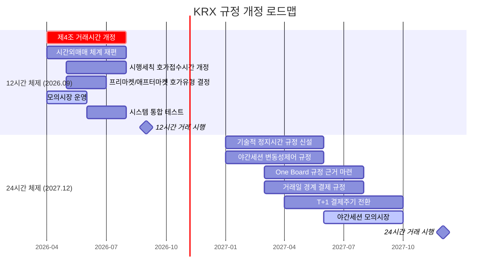

# KRX 유가증권시장 규정 분석 및 24시간 전환 규정 개정안

> 작성일: 2026년 3월 27일 | 프로젝트: KRX 24시간 거래 도입 전략

## 목차

- [1. Executive Summary (요약)](#1-executive-summary-요약)
- [2. EXTURE 3.0 시스템 프로파일](#2-exture-30-시스템-프로파일)
  - [2.1 시스템 개요](#21-시스템-개요)
  - [2.2 성능 사양](#22-성능-사양)
  - [2.3 아키텍처 한계](#23-아키텍처-한계)
  - [2.4 "One Board" 통합호가장 개발 현황](#24-one-board-통합호가장-개발-현황)
- [3. 현행 거래시간 및 세션 구조](#3-현행-거래시간-및-세션-구조)
  - [3.1 정규시장 (업무규정 제4조 제3항 제1호)](#31-정규시장-업무규정-제4조-제3항-제1호)
  - [3.2 장개시전 시간외시장 (제4조 제3항 제2호 가목)](#32-장개시전-시간외시장-제4조-제3항-제2호-가목)
  - [3.3 장종료후 시간외시장 (제4조 제3항 제2호 나목)](#33-장종료후-시간외시장-제4조-제3항-제2호-나목)
  - [3.4 시간외매매 5종 체계 (제33조~제36조)](#34-시간외매매-5종-체계-제33조제36조)
- [4. 주문 유형 체계 (제2조 제4항)](#4-주문-유형-체계-제2조-제4항)
  - [4.1 현행 8종 호가](#41-현행-8종-호가)
  - [4.2 세션별 주문 유형 적용 (시행세칙 제10조)](#42-세션별-주문-유형-적용-시행세칙-제10조)
  - [4.3 24시간 전환 시 주문 유형 과제](#43-24시간-전환-시-주문-유형-과제)
- [5. 가격 발견 및 매매방법 (제22조~제24조)](#5-가격-발견-및-매매방법-제22조제24조)
  - [5.1 단일가매매 (Call Auction) - 제23조](#51-단일가매매-call-auction---제23조)
  - [5.2 접속매매 (Continuous Auction) - 제24조](#52-접속매매-continuous-auction---제24조)
  - [5.3 24시간 전환 시 과제](#53-24시간-전환-시-과제)
- [6. 변동성 제어 체계](#6-변동성-제어-체계)
  - [6.1 가격제한폭 ±30% (제20조)](#61-가격제한폭-30-제20조)
  - [6.2 변동성완화장치 VI (제26조의2)](#62-변동성완화장치-vi-제26조의2)
  - [6.3 서킷브레이커 (제25조)](#63-서킷브레이커-제25조)
  - [6.4 24시간 전환 시 과제](#64-24시간-전환-시-과제)
- [7. 결제 체계 (제7조)](#7-결제-체계-제7조)
  - [7.1 현행 결제 종류](#71-현행-결제-종류)
  - [7.2 T+2에서 T+1 전환 추진 현황](#72-t2에서-t1-전환-추진-현황)
  - [7.3 24시간 전환 시 결제 과제](#73-24시간-전환-시-결제-과제)
- [8. 넥스트레이드 경쟁 및 최선집행 체계](#8-넥스트레이드-경쟁-및-최선집행-체계)
  - [8.1 넥스트레이드 운영 현황](#81-넥스트레이드-운영-현황)
  - [8.2 SOR 의무화 및 통합호가](#82-sor-의무화-및-통합호가)
  - [8.3 24시간 전환 시 SOR 과제](#83-24시간-전환-시-sor-과제)
- [9. 12시간 거래 규정 개정안 (2026년 9월)](#9-12시간-거래-규정-개정안-2026년-9월)
  - [9.1 제4조 개정: 거래시간 재정의](#91-제4조-개정-거래시간-재정의)
  - [9.2 시간외매매 체계 재편](#92-시간외매매-체계-재편)
  - [9.3 호가접수시간 개정 (시행세칙 제11조)](#93-호가접수시간-개정-시행세칙-제11조)
  - [9.4 프리마켓/애프터마켓 주문 유형 결정](#94-프리마켓애프터마켓-주문-유형-결정)
- [10. 24시간 거래 규정 개정안 (2027년 12월)](#10-24시간-거래-규정-개정안-2027년-12월)
  - [10.1 기술적 정지 시간 정의](#101-기술적-정지-시간-정의)
  - [10.2 야간 세션 변동성 제어](#102-야간-세션-변동성-제어)
  - [10.3 야간 세션 주문 유형 제한](#103-야간-세션-주문-유형-제한)
  - [10.4 거래일 경계 및 결제일 정의](#104-거래일-경계-및-결제일-정의)
  - [10.5 "One Board" 통합호가장 규정 근거](#105-one-board-통합호가장-규정-근거)
  - [10.6 휴장일 재정의 (제5조)](#106-휴장일-재정의-제5조)
- [11. 규정 개정 우선순위 체크리스트](#11-규정-개정-우선순위-체크리스트)
- [12. KRX 12시간에서 24시간 규정 개정 로드맵 다이어그램](#12-krx-12시간에서-24시간-규정-개정-로드맵-다이어그램)
- [참고문헌](#참고문헌)

---

## 1. Executive Summary (요약)

한국거래소(KRX) 유가증권시장은 「유가증권시장 업무규정」(2026.1.28. 최종 개정, 규정 제2405호) 및 「유가증권시장 업무규정 시행세칙」(2026.2.9. 최종 개정, 규정 제2396호)에 의해 규율되는 고도로 구조화된 세션 기반 거래 체계를 운영하고 있다. 현행 체계는 정규시장(09:00~15:30), 장개시전 시간외시장(08:00~09:00), 장종료후 시간외시장(15:40~18:00)의 3개 세션으로 구분되며, 시간외매매 5종(종가매매, 단일가매매, 경쟁대량매매, 대량매매, 바스켓매매), 8종 호가 유형, 3단계 서킷브레이커, 동적/정적 VI, 가격제한폭 +-30% 등의 정교한 시장미시구조(market microstructure)를 갖추고 있다. 이 규정 체계는 2005년 제정 이래 수백 차례 개정을 거치면서 단일 거래소 독점 환경의 주간 세션 중심으로 최적화되어 왔다.

2026년 9월 14일 예정된 12시간 거래(프리마켓 07:00~07:50, 애프터마켓 16:00~20:00) 전환과 2027년 12월 목표인 24시간 거래 체제 도입을 위해서는 업무규정 제4조(거래시간), 제5조(휴장일), 제7조(결제종류), 제20조(가격제한폭), 제22조~제24조(매매방법), 제25조(서킷브레이커), 제26조의2(VI), 제33조~제36조(시간외매매) 및 시행세칙 제11조(호가접수시간), 제32조(호가가격단위), 제35조(단일가매매 참여호가), 제41조의2(VI 발동기준) 등 최소 12개 이상의 핵심 조항에 대한 전면적 또는 부분적 개정이 불가피하다. 이는 NYSE Arca(22시간), NASDAQ(23/5), 24X National Exchange(23/5) 등 미국 거래소들이 SEC 규정 개정과 SIP 운영시간 확대를 병행 추진하는 것과 유사한 규모의 규정 전환 작업에 해당한다.

특히 KRX는 넥스트레이드(시장점유율 약 32%, 08:00~20:00 운영)와의 경쟁 환경에서 SOR(Smart Order Routing) 의무화에 따른 통합호가 운영, T+2에서 T+1으로의 결제주기 단축(2027년 10월 시행 가능성), EXTURE 3.0의 stateful 아키텍처 한계 극복이라는 세 가지 구조적 과제를 동시에 해결해야 하는 상황으로, 글로벌 주요 거래소 대비 규정 개정의 복잡도와 시급성이 모두 높은 상태이다.

---

## 2. EXTURE 3.0 시스템 프로파일

### 2.1 시스템 개요

EXTURE 3.0은 코스콤(Koscom)이 개발한 KRX의 차세대 거래 시스템으로, 레거시 EXTURE(Exture+) 시스템을 대체하여 2단계에 걸쳐 배포되었다.

- **Phase 1** (2023년 1월 25일): 매매체결(order matching) 및 정보분배(market data dissemination) 시스템 오픈
- **Phase 2** (2023년 10월 4일): 청산결제(clearing & settlement) 시스템 오픈

EXTURE 3.0은 유가증권시장, 코스닥시장, 코넥스시장, 파생상품시장을 포괄하는 통합 거래 플랫폼으로, 업무규정 제2조 제19항이 정의하는 "거래소시스템"(매매계약체결의 중개업무를 하기 위하여 거래소가 운영하는 전산시스템)의 물리적 구현체이다.

### 2.2 성능 사양

| 항목 | EXTURE+(레거시) | EXTURE 3.0 | 개선율 |
|------|----------------|------------|--------|
| 주문 처리 지연시간(Latency) | 70us | **50us** | 29% 개선 |
| 일일 처리 용량 | 4.2억 건 | **9.4억 건** | 124% 증가 |
| 주문 대역폭 | 12Mbps | **45Mbps** | 275% 증가 |
| 회선 수 | 7회선 | **10회선** | 43% 증가 |
| 프로토콜 지원 | FIX | **FIX/FAST** | FAST 추가 |

EXTURE 3.0의 50us 지연시간은 NASDAQ Genium INET의 sub-100us, MEMX/24X의 Aeron Sequencer 18us 대비 경쟁력 있는 수준이나, NYSE Pillar의 결정론적(deterministic) 바이너리 게이트웨이 아키텍처와 비교할 때 프로토콜 효율성 측면에서 차이가 존재한다.

### 2.3 아키텍처 한계

EXTURE 3.0의 근본적 한계는 **stateful daily cycle** 설계에 있다. 현행 아키텍처는 다음과 같은 구조적 특성으로 인해 24시간 연속 운영에 "structurally hostile"하다.

**1) 세션 경계에서의 호가장(Order Book) 상태 단절**: 시행세칙 제13조 제1항에 따라 정규시장에서는 "장개시전 시간외시장에서 접수된 호가"의 효력을 인정하지 않으며(제2호 가목), 장종료후 시간외시장에서는 "장개시전 시간외시장 및 정규시장에서 접수된 호가"의 효력을 인정하지 않는다(제3호 나목). 즉, 세션 전환 시 미체결 호가가 체계적으로 소멸(purge)되는 구조이다.

**2) End-of-Day 배치 처리 의존성**: 장종료 후 18:00까지의 시간외시장 종료 이후부터 익일 08:00 장개시전 시간외시장 개시까지의 약 14시간은 일일 원장(daily ledger) 확정, 회원사 대사(reconciliation), 청산증거금 산출, 기업공시 반영(주식분할, 배당 등) 등 대규모 배치 프로세싱에 활용된다.

**3) 거래일 기반 기준가격 체계**: 업무규정 제20조의 가격제한폭 산출, 제26조의2의 VI 발동 기준, 시행세칙 제30조의 기준가격 결정이 모두 "직전 매매거래일" 기준의 종가(또는 기세)에 의존하며, 이는 역일(calendar day) 단위의 단절적 운영을 전제한다.

### 2.4 "One Board" 통합호가장 개발 현황

KRX IT 부서는 2025년 12월부터 **"One Board" 통합호가장** 시스템 개발에 착수하였다. 이 시스템의 핵심 목표는 세션 경계에서의 미체결 지정가호가를 강제 소멸시키지 않고, 프리마켓(07:00~07:50) - 정규장(09:00~15:30) - 애프터마켓(16:00~20:00) 간 연속적으로 이월(carry-over)시키는 것이다.

One Board 시스템은 2027년 24시간 전환의 **절대적 전제조건(absolute prerequisite)**으로, NYSE Arca 및 NASDAQ의 연속 호가 유지(order persistence) 기능과 동등한 수준을 달성해야 한다. 현재 개발 중인 핵심 과제는 다음과 같다:

- Time-in-Force(TIF) 지시 체계의 재설계: 현행 "당일 호가접수시간 내" 효력(규정 제12조 제1항)을 초월하는 Day+, GTC(Good-Till-Cancelled) 등 신규 TIF 유형 도입
- 유동성 환경이 극단적으로 상이한 시간대(14:00 KST 최고 유동성 vs. 03:00 KST 최저 유동성) 간 지정가호가의 안전한 이월
- 세션 개시 시점에서 이월 호가에 대한 알고리즘 차익거래(arbitrage) 위험 차단

---

## 3. 현행 거래시간 및 세션 구조

### 3.1 정규시장 (업무규정 제4조 제3항 제1호)

업무규정 제4조 제3항 제1호는 정규시장의 매매거래시간을 다음과 같이 정의한다:

> "정규시장 : 9시부터 15시 30분(제23조제1항제4호의 장종료시의 가격을 결정하는 경우에는 15시 30분 이후 당해 가격이 결정되는 시점)까지로 하되, 제30조의2에 따른 장중경쟁대량매매는 9시부터 15시까지로 한다."

정규시장의 세부 시간 구조는 다음과 같다:

| 시간 | 매매 방식 | 근거 |
|------|-----------|------|
| 08:30~09:00 | 호가 접수 (장개시전 동시호가) | 시행세칙 제11조 제1항 제1호 |
| 09:00 | 시가 결정 (단일가매매 + random-end 30초) | 규정 제23조 제1항 제1호, 시행세칙 제35조 |
| 09:00~15:20 | 접속매매 (복수가격 개별경쟁매매) | 규정 제24조 |
| 09:00~15:00 | 장중경쟁대량매매 호가접수 | 규정 제30조의2 |
| 15:20~15:30 | 장종료 동시호가 (단일가매매 + random-end 30초) | 규정 제23조 제1항 제4호, 시행세칙 제35조 제1항 제3호 |

### 3.2 장개시전 시간외시장 (제4조 제3항 제2호 가목)

> "장개시전 시간외시장 : 8시부터 9시까지로 하되, 시간외종가매매는 8시 30분부터 8시 40분까지로 한다."

| 시간 | 매매 유형 | 가격 결정 |
|------|-----------|-----------|
| 08:00~09:00 | 시간외대량매매, 시간외바스켓매매, 시간외경쟁대량매매 | 협의가격 / VWAP |
| 08:30~08:40 | 시간외종가매매 | 전일 종가 |

### 3.3 장종료후 시간외시장 (제4조 제3항 제2호 나목)

> "장종료후 시간외시장 : 15시 40분부터 18시까지로 하되, 시간외종가매매의 경우에는 15시 40분부터 16시까지로 하고, 시간외단일가매매의 경우에는 16시부터 18시(최종가격을 결정하는 경우에는 18시 이후 당해 가격이 결정되는 시점)까지로 한다."

| 시간 | 매매 유형 | 가격 결정 |
|------|-----------|-----------|
| 15:40~16:00 | 시간외종가매매 | 당일 종가 |
| 16:00~18:00 | 시간외단일가매매 | 종가 +-10% 범위, 10분 간격 call auction |
| 15:40~18:00 | 시간외대량매매, 시간외바스켓매매 | 협의가격 (상한가~하한가 범위) |

### 3.4 시간외매매 5종 체계 (제33조~제36조)

업무규정 제33조는 시간외시장에서 이루어지는 매매거래를 다음 5종으로 구분한다:

| # | 매매 유형 | 근거 조항 | 적용 세션 | 가격 결정 방법 | 비고 |
|---|-----------|-----------|-----------|----------------|------|
| 1 | 시간외종가매매 | 제34조 | 장개시전(08:30~08:40), 장종료후(15:40~16:00) | 당일(장개시전은 전일) 종가 | 종가 불성립 시 매매 불가 |
| 2 | 시간외단일가매매 | 제34조의2 | 장종료후(16:00~18:00) | 종가 기준 +-10%, 10분 간격 단일가매매 | 정규장 미성립 시 불가 |
| 3 | 시간외경쟁대량매매 | 제34조의3 | 장개시전(08:00~09:00) | 당일 정규장 VWAP | VWAP 미산출 시 종가 |
| 4 | 시간외대량매매 | 제35조 | 장개시전(08:00~09:00), 장종료후(15:40~18:00) | 상한가~하한가 범위 내 협의 | 정규장 미성립 시 불가 |
| 5 | 시간외바스켓매매 | 제36조 | 장개시전(08:00~09:00), 장종료후(15:40~18:00) | 종목별 상한가~하한가 범위 내 협의 | 일괄 매매 성립 |

---

## 4. 주문 유형 체계 (제2조 제4항)

### 4.1 현행 8종 호가

업무규정 제2조 제4항은 8종의 호가 유형을 규정한다. 2025년 2월 5일 개정(규정 제2287호)으로 중간가호가와 스톱지정가호가가 신설되었다.

| # | 호가 유형 (한국어) | 영문명 | 정의 (규정 근거) | 신설 시기 |
|---|-------------------|--------|------------------|-----------|
| 1 | 지정가호가 | Limit Order | 종목, 수량 및 가격을 지정하는 호가 (제2조 제4항 제1호) | 원시 규정 |
| 2 | 시장가호가 | Market Order | 종목 및 수량은 지정하되, 가격은 지정하지 아니하는 호가 (제2호) | 원시 규정 |
| 3 | 조건부지정가호가 | Conditional Limit | 장종료시 단일가매매 시 시장가호가로 전환할 것을 조건으로 하는 지정가호가 (제3호) | 원시 규정 |
| 4 | 최유리지정가호가 | Best Limit | 매도 시 최우선매수호가 가격, 매수 시 최우선매도호가 가격 (제4호) | 원시 규정 |
| 5 | 최우선지정가호가 | Best Priority Limit | 매도 시 최우선매도호가 가격, 매수 시 최우선매수호가 가격 (제5호) | 원시 규정 |
| 6 | 경쟁대량매매호가 | Competitive Block | 제30조의2 또는 제34조의3에 따른 가격으로 매매 (제6호) | 2010.7.21 |
| 7 | 중간가호가 | Midpoint Order | 최우선매도호가와 최우선매수호가의 중간가격 (제7호) | **2025.2.5 신설** |
| 8 | 스톱지정가호가 | Stop Limit Order | 스톱가격 충족 시 지정가호가로 효력 발생 (제8호) | **2025.2.5 신설** |

### 4.2 세션별 주문 유형 적용 (시행세칙 제10조)

시행세칙 제10조 제1항에 따라 증권 종류별 호가 유형이 제한되며, 시행세칙 제13조(호가의 효력)에 따라 세션별로 추가적인 제한이 적용된다:

| 호가 유형 | 정규시장 (접속매매) | 정규시장 (장종료 단일가) | 시간외종가매매 | 시간외단일가매매 | 비고 |
|-----------|:---:|:---:|:---:|:---:|------|
| 지정가호가 | O | O | O | O | 전 세션 가능 |
| 시장가호가 | O | O | X | X | 정규시장만 |
| 조건부지정가호가 | O | 시장가 전환 | X | X | 장종료 단일가 시 시장가로 전환 |
| 최유리지정가호가 | O | O | X | X | 정규시장만 |
| 최우선지정가호가 | O | O | X | X | 정규시장만 |
| 경쟁대량매매호가 | 별도 세션 | X | X | X | 장중/시간외 경쟁대량매매 전용 |
| 중간가호가 | O | X | X | X | 접속매매 시간만 (제13조 제1항 제4호의2) |
| 스톱지정가호가 | O | O | X | X | 정규시장만 |

**주요 제한 사항**: 시행세칙 제13조 제1항 제4호의2에 따라, "규정 제23조제1항제4호에 따른 장종료시의 가격을 결정하기 위한 단일가격에 의한 개별경쟁매매 호가접수시간 이전에 접수되어 해당 호가접수시간까지 매매거래가 성립되지 않고 남아 있는 중간가호가"는 효력이 인정되지 않는다.

### 4.3 24시간 전환 시 주문 유형 과제

**조건부지정가호가(Conditional Limit)**: 현행 정의(제2조 제4항 제3호)가 "장종료시의 가격을 단일가격에 의한 개별경쟁매매의 방법으로 결정하는 경우"에 시장가호가로 전환한다고 규정하고 있어, 24시간 체제에서 "장종료"의 개념이 재정의되지 않는 한 기능적 공백이 발생한다. 복수의 세션 종료 시점이 존재하는 환경에서는 전환 조건의 명확화가 필요하다.

**시장가호가(Market Order)**: 야간 시간대의 극히 얇은(thin) 유동성 환경에서 시장가호가는 극단적 슬리피지(slippage) 위험을 초래한다. NASDAQ의 23/5 Night Session에서 시장가호가를 금지한 사례를 참조할 때, 야간 세션에서의 시장가호가 제한이 검토되어야 한다.

**중간가호가(Midpoint Order)**: 현행 정의(시행세칙 제4조의2)가 "복수가격에 의한 개별경쟁매매를 하는 시간의 최우선매도호가의 가격과 최우선매수호가의 가격을 단순산술평균한 가격"으로 중간가격을 산출하므로, 호가장 깊이(depth)가 충분하지 않은 야간 시간대에서는 NBBO(National Best Bid and Offer)의 신뢰성 문제가 발생한다.

**스톱지정가호가(Stop Limit)**: 시행세칙 제4조의3에 따라 "직전의 체결가격"을 기준으로 스톱가격 충족 여부를 판단하므로, 야간 시간대의 비연속적 체결 환경에서 과민 반응(false trigger) 위험이 존재한다.

---

## 5. 가격 발견 및 매매방법 (제22조~제24조)

### 5.1 단일가매매 (Call Auction) - 제23조

업무규정 제22조 제1항은 "매매거래는 개별경쟁매매의 방법에 의하며, 개별경쟁매매는 단일가격에 의한 개별경쟁매매와 복수가격에 의한 개별경쟁매매로 구분한다"고 규정한다.

**단일가매매 적용 시점** (제23조 제1항):
1. **시가** 결정 (제1호)
2. 시장 재개 후 최초 가격 (제2호: 규정 제6조 제2항에 의한 시장 재개)
3. **서킷브레이커/매매거래정지 재개 후** 최초 가격 (제3호: 제25조 제1항, 제26조 제4항 등)
4. **장종료시** 가격 (제4호)
5. **VI 발동 후** 최초 가격 (제5호: 제26조의2 제1항에 따른 매매계약체결방법 변경 후)

**합치가격(Clearing Price) 결정 로직** (제23조 제4항): 매도호가의 합계수량과 매수호가의 합계수량이 일정한 가격에서 합치하는 가격으로 결정하며, 호가의 우선순위(가격우선, 시간우선)에 따라 합치되는 호가간에 매매거래를 성립시킨다.

**Random-End 메커니즘** (시행세칙 제35조 제1항): 단일가매매 참여호가의 범위는 "각 호에서 정하는 시간동안 접수된 호가 및 **이후 30초 이내에서 거래소가 무작위로 정하는 시간**동안 접수된 호가"로 정의된다. 이 random-end 메커니즘은 HFT의 spoofing 공격을 방어하는 KRX 고유의 시장보호장치이다.

### 5.2 접속매매 (Continuous Auction) - 제24조

> "제23조제1항 각호외의 정규시장의 매매거래시간중 가격의 결정은 복수가격에 의한 개별경쟁매매에 의한다." (제24조 제1항)

접속매매에서의 가격 결정은 "매도호가와 매수호가의 경합에 의하여 가장 낮은 매도호가와 가장 높은 매수호가가 합치되는 경우 **선행호가의 가격**으로" 결정된다(제24조 제3항). 이는 가격-시간 우선(price-time priority) 원칙에 따른 연속 매칭을 의미한다.

### 5.3 24시간 전환 시 과제

**추가 단일가매매 세션 필요**: 12시간 체제에서는 프리마켓 개시(07:00), 정규장 개시(09:00), 애프터마켓 개시(16:00) 등 최소 3회의 단일가매매 세션이 필요하며, 24시간 체제에서는 야간 세션 개시/종료 시에도 추가될 수 있다.

**야간 세션의 매매방법 선택**: 접속매매 vs. 단일가매매(간격 확대) 중 선택이 필요하다. 24X National Exchange는 야간 세션에서 순수 접속매매(continuous matching)를 채택하되 가격밴드(Price Bands)를 강화한 반면, KRX의 시간외단일가매매(10분 간격 call auction)는 유동성이 극히 낮은 환경에서도 합리적 가격 발견이 가능한 장점이 있다.

**VI의 세션 전환 메커니즘 활용**: 현행 VI 발동 시 접속매매에서 단일가매매로 전환하는 메커니즘(제26조의2)을 세션 경계에서의 가격 발견에도 활용할 수 있다. 야간 세션에서 정규 세션으로의 전환 시 자동적으로 단일가매매를 실시하여 가격 연속성을 확보하는 방안이 검토되어야 한다.

---

## 6. 변동성 제어 체계

### 6.1 가격제한폭 +-30% (제20조)

업무규정 제20조 제2항은 가격제한폭을 다음과 같이 규정한다:

> "가격제한폭은 기준가격에 0.3을 곱하여 산출한 금액으로 하되, [...] 목표로 하는 기초자산의 가격 또는 지수 변화의 일정배율(음의 배율도 포함한다)로 연동하는 상장지수증권의 경우에는 동 금액에 당해 배율(음의 배율인 경우 그 절대값으로 한다)을 곱한 금액으로 한다."

즉, 일반 주권의 경우 **기준가격 x 0.3 = +-30%**이며, 2배 레버리지 ETF/ETN의 경우 +-60%까지 확대된다. 정리매매종목(상장규정 제9조)의 경우에는 가격제한을 적용하지 않는다(제20조 제3항).

기준가격은 원칙적으로 전일 종가이며, 시가기준가종목(시행세칙 제2조 제3호: 재상장종목, 변경상장종목 등)의 경우 당일 최초 가격이 기준가격이 된다.

### 6.2 변동성완화장치 VI (제26조의2)

업무규정 제26조의2는 "호가에 따른 잠정적인 체결가격"이 일정 비율 이상 변동하는 경우 매매계약체결방법을 단일가매매로 변경하도록 규정한다.

**동적 VI (Dynamic VI)** - 시행세칙 제41조의2 제1항:

| 대상 종목 | 발동 기준 | 장종료 단일가 시 | 파생상품 최종거래일 기초자산 |
|-----------|-----------|-----------------|---------------------------|
| KOSPI200 구성종목 | **3%** | 2% | 1% |
| 기타 종목 | **6%** | 4% | - |
| ETF/ETN (KOSPI200 등 주요지수 연동) | **3%** | 2% | - |
| ETF/ETN (기타) | **6%** | 4% | - |
| 외국주식예탁증권, 수익증권 | **6%** | 4% | - |

**정적 VI (Static VI)** - 시행세칙 제41조의2 제2항:

> "규정 제26조의2제1항제2호에서 '세칙에서 정한 비율'이란 주권, 상장지수집합투자기구 집합투자증권, 상장지수증권, 외국주식예탁증권 및 수익증권에 대하여 각각 **10%**를 말한다."

정적 VI의 기준 가격은 "제23조에 따른 단일가격에 의한 개별경쟁매매의 방법으로 결정된 가격"(시가 결정시에는 당일의 기준가격)이다.

**VI 발동 시 조치** (시행세칙 제41조의2 제3항): 접속매매 중이면 단일가매매로 전환하고, 이미 단일가매매 중이면 참여호가의 범위를 연장한다. 단일가매매 기간은 시행세칙 제35조 제1항 제4호에 따라 **2분간**(+ random-end 30초)이다.

**VI 적용 제외** (시행세칙 제41조의2 제4항): 정리매매종목, 단기과열종목, 이상급등 단일가매매종목, 투자유의종목, 단일가매매대상 저유동성종목, 신규상장 당일 종목 등.

### 6.3 서킷브레이커 (제25조)

업무규정 제25조 제1항은 코스피 수치 기반의 3단계 시장 전체 매매거래중단을 규정한다:

| 단계 | 발동 조건 | 조치 | 시간 제한 |
|------|-----------|------|-----------|
| 1단계 | 직전 매매거래일 최종 수치 대비 **-8%**, 1분 지속 | **20분간** 매매거래 중단 후 재개 | 장종료 40분전(14:50) 이후 미발동 |
| 2단계 | 1단계 재개 후 **-15%**, 1분 지속 | **20분간** 매매거래 중단 후 재개 | 장종료 40분전 이후 미발동 |
| 3단계 | 2단계 재개 후 **-20%**, 1분 지속 | 매매거래 중단 후 **당일 거래 종결** | 장종료 40분전 이후에도 적용 |

시행세칙 제39조의 추가 요건: 2단계는 1단계 중단 시점 대비 1% 이상 추가 하락이 1분간 지속되어야 하며, 3단계도 2단계 중단 시점 대비 1% 이상 추가 하락이 1분간 지속되어야 한다. 각 단계는 **당일 중 최초 1회만 적용**된다.

### 6.4 24시간 전환 시 과제

**가격제한폭 +-30%의 적용 단위 재정의**: 현행 +-30%는 "직전 매매거래일 종가" 기준으로 역일(calendar day) 단위 적용된다. 24시간 체제에서 거래일이 20:00 KST에 전환되는 경우, 기준가격을 어느 시점의 가격으로 설정할 것인지 결정해야 한다. 선택지:
- (A) 정규장 종가(15:30) 기준 유지
- (B) 거래일 전환 시점(20:00) 직전 가격 기준
- (C) 복수 기준가격 체계 (세션별 상이한 가격제한폭)

**야간 세션 VI 임계치 재보정**: 현행 동적 VI 3%/6%는 정규장의 높은 유동성을 전제로 설계되었다. 야간 시간대의 얇은 유동성 환경에서는 정상적 가격변동만으로도 빈번한 VI 발동이 예상되므로, 24X National Exchange의 계층적 가격밴드 모델(20%/10%/6%, 가격대별 차등)을 참조한 야간 전용 VI 임계치 설계가 필요하다.

**서킷브레이커의 야간 적용 문제**: 현행 서킷브레이커는 코스피 지수의 실시간 산출을 전제하나, 야간 시간대에는 대부분의 구성종목 거래가 극히 미미하여 신뢰할 수 있는 코스피 수치 산출이 곤란하다. 대안으로:
- KOSPI200 선물(야간 거래 가능)을 대리지표(proxy)로 활용
- 야간 세션 전용의 종목별 서킷브레이커 도입
- 서킷브레이커 3단계의 "당일 거래 종결" 조항을 "야간 세션 일시 중단"으로 변경

---

## 7. 결제 체계 (제7조)

### 7.1 현행 결제 종류

업무규정 제7조 제1항은 매매거래의 종류를 다음과 같이 규정한다:

> "1. **당일결제거래** : 매매계약을 체결한 당일에 결제하는 매매거래
> 2. **익일결제거래** : 매매계약을 체결한 날의 다음 날(세칙으로 정하는 경우에는 그 다음 날로 한다)에 결제하는 매매거래
> 3. **보통거래** : 매매계약을 체결한 날부터 기산하여 **3일째 되는 날**에 결제하는 매매거래"

제7조 제4항에 따라 "상장증권의 매매거래의 종류는 세칙에서 정하는 경우를 제외하고는 **보통거래(T+2)**로 한다." 채무증권의 경우 시행세칙 제9조에 따라 국채전문유통시장은 익일결제(T+1), 기타 채무증권은 당일결제(T+0)가 적용된다.

### 7.2 T+2에서 T+1 전환 추진 현황

KRX는 2025년 10월 T+1 결제주기 전환을 위한 **워킹그룹을 출범**하였다. 주요 현황:

- **시행 시기**: 미확정. 이르면 **2027년 10월** 시행 가능성
- **선결 과제**: 옴니버스계좌(omnibus account) 제도 도입, 자동화 무역확인(trade affirmation) 플랫폼 구축, 증거금 관리 API 고도화
- **글로벌 참조**: 미국은 2024년 5월 T+1 전환 완료 후 DTCC 24/5 청산 확대를 추진 중

제7조 제2항에 따라 "제1항제2호 및 제3호의 규정에 의한 일수의 계산시 휴장일은 제외한다"는 조항은 T+1 전환 시에도 유지되나, 제7조 제1항 제3호의 "3일째 되는 날"을 "**2일째 되는 날**"로 개정하는 것이 가장 직접적인 법적 전환 경로이다.

### 7.3 24시간 전환 시 결제 과제

**거래일 경계(Trade Date Boundary) 정의**: 24시간 체제에서 "매매계약을 체결한 날"의 역일 기준이 모호해진다. DTCC 모델에서는 20:00 ET를 거래일 전환 시점으로 설정하고 FIX Tag 715(Clearing Business Date)를 통해 모든 거래에 결제 기준일을 명시한다. KRX도 유사하게 **20:00 KST를 거래일 전환 시점**으로 설정하여:
- 20:00 이전 체결 거래 -> 당일(T) 거래일 배정 -> T+1(또는 T+2) 결제
- 20:00 이후~익일 20:00 이전 체결 거래 -> 익일(T+1) 거래일 배정

**T+2와 T+1의 동시 전환 리스크**: 미국의 경우 T+1 전환을 완료한 후 24시간 거래 확대를 추진하는 순차적 접근을 취했으나, KRX는 12시간/24시간 전환과 T+1 전환이 시기적으로 중첩될 가능성이 높다. 이는 결제 리스크를 기하급수적으로 증대시키므로, 야간 거래에 대한 별도의 증거금 정책과 실시간 리스크 산출 체계가 필수적이다.

---

## 8. 넥스트레이드 경쟁 및 최선집행 체계

### 8.1 넥스트레이드 운영 현황

넥스트레이드(Nextrade)는 2025년 3월 4일 출범한 대체거래시스템(ATS)으로, KRX의 독점적 시장 지위를 근본적으로 변화시켰다:

| 항목 | 현황 |
|------|------|
| 출범일 | 2025년 3월 4일 |
| 시장점유율 | 약 **32%** (2026년 3월 기준) |
| 거래시간 | 08:00~20:00 (**12시간**) |
| 매매방법 | 접속매매(continuous matching) |
| 추진 사항 | **07:00 개장** 추진 중 |

넥스트레이드의 프리마켓(08:00~08:50), 정규시장(09:00~15:25), 애프터마켓(15:30~20:00)은 KRX의 현행 시간외시장을 상당 부분 흡수하는 구조로, 특히 16:00~20:00 시간대의 유동성을 선점하고 있다.

### 8.2 SOR 의무화 및 통합호가

2025년 ATS 도입과 함께 **SOR(Smart Order Routing) 의무화** 정책이 시행되었다:

- 증권사는 고객 주문 시 KRX와 넥스트레이드의 호가를 비교하여 최선 가격에 체결하도록 의무화
- **통합호가창(consolidated order book)** 운영으로 투자자에게 양 시장의 호가 정보를 통합 제공
- 최선집행기준 설명서 공시 의무

이는 미국의 Regulation NMS Rule 611(Order Protection Rule)과 기능적으로 유사하나, 법적 강제력과 적용 범위에서 차이가 존재한다.

### 8.3 24시간 전환 시 SOR 과제

**시간 불일치 문제**: KRX가 24시간 체제로 전환하되 넥스트레이드가 12시간(08:00~20:00)을 유지하는 경우, 20:00~08:00 야간 시간대에는 KRX가 유일한 거래소로 운영된다. 이 경우:
- SOR 로직이 단일 거래소 모드로 자동 전환되어야 함
- 야간 시간대 최선집행 의무의 적용 범위가 재정의되어야 함
- 넥스트레이드 개장(08:00) 시점에서 KRX 야간 세션 가격과의 괴리에 따른 차익거래 위험이 발생

**가격 연속성 문제**: 양 시장의 호가가격단위(tick size)가 동일하더라도, 야간 시간대 KRX에서 형성된 가격이 넥스트레이드 개장 시 참조가격으로 사용되는 메커니즘이 부재하면 가격 단절이 발생한다.

---

## 9. 12시간 거래 규정 개정안 (2026년 9월)

### 9.1 제4조 개정: 거래시간 재정의

2026년 9월 14일 시행 예정인 12시간 거래 전환을 위해 업무규정 제4조 제3항의 전면 개정이 필요하다.

**현행 제4조 제3항:**
```
1. 정규시장 : 9시부터 15시 30분까지
2. 시간외시장
  가. 장개시전 시간외시장 : 8시부터 9시까지
  나. 장종료후 시간외시장 : 15시 40분부터 18시까지
```

**개정안:**
```
1. 프리마켓 : 7시부터 7시 50분까지
2. 정규시장 : 9시부터 15시 30분까지 (현행 유지)
3. 애프터마켓 : 16시부터 20시까지
4. 시간외시장
  가. 장개시전 시간외시장 : [프리마켓 종료 후~정규시장 개시 전]
  나. 장종료후 시간외시장 : [정규시장 종료 후~애프터마켓 개시 전]
```

핵심 변경 사항:
- "시간외시장"의 2분법(장개시전/장종료후)을 **프리마켓/정규시장/애프터마켓의 3분법**으로 전환
- 프리마켓 07:00~07:50 (기존 제안 08:00에서 1시간 단축, 2026.3.17 발표)
- 애프터마켓 16:00~20:00 (기존 시간외시장 18:00 종료에서 2시간 연장)

### 9.2 시간외매매 체계 재편

12시간 체제 전환에 따라 시간외매매 5종(제33조~제36조)의 구조적 재편이 불가피하다:

**폐지 대상**:
- **시간외단일가매매**(제34조의2): 현행 16:00~18:00의 10분 간격 call auction이 애프터마켓 접속매매로 대체됨. 제34조의2의 삭제 또는 적용 범위 축소가 필요

**시간 조정 대상**:
- **시간외종가매매**(제34조): 장개시전(08:30~08:40) 시간은 프리마켓 존재로 인해 06:30~06:50 등으로 전진 배치 검토. 장종료후(15:40~16:00) 시간은 현행 유지 가능
- **시간외대량매매**(제35조) 및 **시간외바스켓매매**(제36조): 호가접수시간을 프리마켓 이전(06:00~07:00) 및 애프터마켓 이후(20:00~20:30)로 확대 검토

**신설 필요**:
- 프리마켓 세션 및 애프터마켓 세션의 매매방법(접속매매)에 관한 별도 조항 또는 제30조의3(프리마켓매매), 제30조의4(애프터마켓매매) 신설

### 9.3 호가접수시간 개정 (시행세칙 제11조)

시행세칙 제11조 제1항의 전면 개정이 필요하다:

**현행:**
```
1. 정규시장 : 장개시 30분전(08:30)부터 장종료시(15:30)까지
2. 시간외시장
  가. 장개시전 : 08:00~09:00 (유형별 차등)
  나. 장종료후 : 15:40~18:00 (유형별 차등)
```

**개정안:**
```
1. 프리마켓 : 06:50부터 07:50까지
  - 프리마켓 동시호가: 06:50~07:00
  - 프리마켓 접속매매: 07:00~07:50
2. 정규시장 : 08:30부터 15:30까지 (현행 유지)
  - 장개시전 동시호가: 08:30~09:00
  - 접속매매: 09:00~15:20
  - 장종료 동시호가: 15:20~15:30(+random-end)
3. 애프터마켓 : 15:50부터 20:00까지
  - 애프터마켓 동시호가: 15:50~16:00
  - 애프터마켓 접속매매: 16:00~20:00
4. 시간외시장 (대량/바스켓/경쟁대량매매)
  - 장개시전: 06:00~07:00
  - 장종료후: 15:40~15:50 (시간외종가매매)
```

### 9.4 프리마켓/애프터마켓 주문 유형 결정

12시간 체제에서의 세션별 호가 유형 적용 방안:

| 호가 유형 | 프리마켓 (07:00~07:50) | 정규시장 (09:00~15:30) | 애프터마켓 (16:00~20:00) |
|-----------|:---:|:---:|:---:|
| 지정가호가 | **O** | O | **O** |
| 시장가호가 | **X** (유동성 부족) | O | **X** (유동성 부족) |
| 조건부지정가호가 | X | O | X |
| 최유리지정가호가 | **O** | O | **O** |
| 최우선지정가호가 | **O** | O | **O** |
| 경쟁대량매매호가 | X | 별도 세션 | X |
| 중간가호가 | **O** (접속매매 시) | O | **O** (접속매매 시) |
| 스톱지정가호가 | **O** | O | **O** |

**시장가호가 금지 근거**: 프리마켓 및 애프터마켓은 정규장 대비 유동성이 현저히 낮아 시장가호가의 극단적 슬리피지 위험이 존재한다. NASDAQ 23/5 Night Session에서 pegging 주문과 MOO/LOO/MOC/LOC 주문을 금지한 사례가 참조 근거가 된다.

---

## 10. 24시간 거래 규정 개정안 (2027년 12월)

### 10.1 기술적 정지 시간 정의

24시간 거래 체제에서도 **일일 기술적 정지(Technical Pause)**는 필수적이다. 글로벌 표준을 참조하면:

| 거래소 | 기술적 정지 시간 | 시간(KST 환산) |
|--------|-----------------|----------------|
| NYSE Arca | 23:30~01:30 ET (2시간) | 13:30~15:30 KST |
| NASDAQ | 20:00~21:00 ET (1시간) | 10:00~11:00 KST |
| 24X | 19:00~20:00 ET (1시간) | 09:00~10:00 KST |

**KRX 기술적 정지 시간 제안**: **20:00~21:00 KST (1시간)**

선정 근거:
- 애프터마켓 종료(20:00) 시점과 일치하여 기존 12시간 체제와의 연속성 확보
- DTCC의 20:00 ET 거래일 전환 시점(KST 10:00)과 시차를 두어 글로벌 청산 시스템과의 충돌 방지
- 국내 투자자 활동이 가장 낮은 시간대
- 기업공시 반영, 배당/분할 등 corporate action 처리, 데이터베이스 동기화 수행

**규정 근거 마련**: 업무규정 제6조(시장의 임시정지 및 재개)의 "시장관리상 필요하다고 인정하는 경우" 조항을 활용하되, 별도의 **제6조의2(일일 기술적 정지)**를 신설하여 법적 근거를 명확화:

```
제6조의2(일일 기술적 정지) ① 거래소는 시스템 유지보수, 청산결제 처리,
기업행위 반영 등을 위하여 매 매매거래일 20시부터 21시까지 매매거래를 정지한다.
② 제1항의 기술적 정지 시간 중에는 취소호가를 포함한 일체의 호가접수를
중단하며, 정지 종료 후 매매거래를 재개한다.
③ 제1항의 시간은 거래소가 시장관리상 필요하다고 인정하는 경우 변경할 수 있다.
```

### 10.2 야간 세션 변동성 제어

24시간 체제의 야간 세션(21:00~07:00 KST)에는 현행 변동성 제어 체계의 대폭 수정이 필요하다.

**계층적 가격밴드(Tiered Price Bands) 제안** (24X 모델 참조):

| 종목 가격대 | 야간 세션 가격밴드 | 현행 정규장 가격제한폭 |
|------------|-------------------|----------------------|
| 5,000원 미만 | **+-20%** | +-30% |
| 5,000원~50,000원 | **+-10%** | +-30% |
| 50,000원 이상 | **+-6%** | +-30% |

야간 세션 가격밴드는 정규장의 +-30% 가격제한폭 내에서 추가적으로 적용되는 **이중 제한** 구조로 설계한다.

**야간 VI 임계치 조정안**:

| 대상 종목 | 현행 동적 VI | 야간 동적 VI (제안) | 현행 정적 VI | 야간 정적 VI (제안) |
|-----------|:-----------:|:------------------:|:-----------:|:------------------:|
| KOSPI200 구성종목 | 3% | **5%** | 10% | **15%** |
| 기타 종목 | 6% | **10%** | 10% | **20%** |

야간 VI 발동 시 단일가매매 전환 기간을 현행 2분에서 **5분**으로 확대하여 얇은 유동성 환경에서의 가격 수렴 시간을 보장한다.

**야간 서킷브레이커 대안**: 코스피 지수의 실시간 산출이 곤란한 야간에는 시장 전체 서킷브레이커 대신 **종목별 서킷브레이커**를 적용한다:
- 개별 종목이 야간 가격밴드 한계에 도달 시 해당 종목 매매거래 정지
- 정지 종목 수가 전체 상장종목의 일정 비율(예: 10%)을 초과 시 야간 세션 전체 일시 중단

### 10.3 야간 세션 주문 유형 제한

야간 세션(21:00~07:00 KST)에서의 호가 유형은 다음과 같이 제한한다:

| 호가 유형 | 야간 세션 허용 | 제한 사유 |
|-----------|:-----------:|-----------|
| 지정가호가 | **O** | 기본 호가 유형으로 항시 허용 |
| 시장가호가 | **X** | 얇은 유동성 환경에서 극단적 슬리피지 위험 |
| 조건부지정가호가 | **X** | "장종료" 개념의 다중화로 전환 조건 모호 |
| 최유리지정가호가 | **X** | 호가장 일방 부재 시 비합리적 가격 산출 위험 |
| 최우선지정가호가 | **X** | 호가장 일방 부재 시 비합리적 가격 산출 위험 |
| 경쟁대량매매호가 | **X** | 야간 VWAP 산출 기반 부재 |
| 중간가호가 | **O** | 양방향 호가 존재 시 중간가격 산출 가능 (다만 효력정지 조건 강화) |
| 스톱지정가호가 | **O** | 리스크 관리 목적으로 허용, 스톱가격 충족 판단은 지정가호가로만 |

NASDAQ 23/5 모델에서 Night Session 중 Primary Pegging, Market Pegging, Midpoint Pegging을 모두 비활성화하고, MOO/LOO/MOC/LOC 주문을 금지한 사례를 참조한 것이다.

### 10.4 거래일 경계 및 결제일 정의

**20:00 KST를 거래일 전환 시점(Trade Date Cutoff)으로 설정**:

```
[거래일 T]
  07:00 KST (프리마켓 개시) ~ 20:00 KST (기술적 정지 개시)
  -> 이 시간대의 모든 체결 거래는 거래일 T에 배정
  -> T+1(또는 T+2) 결제

[기술적 정지]
  20:00 KST ~ 21:00 KST
  -> 거래일 전환 처리, corporate action 반영, 기준가격 재산정

[거래일 T+1]
  21:00 KST (야간 세션 개시) ~ 익일 07:00 KST (프리마켓 개시)
  -> 이 시간대의 모든 체결 거래는 거래일 T+1에 배정
```

이는 NYSE Arca에서 21:00~00:00 ET 사이 체결된 거래를 익일 거래일에 배정하는 로직과 동일한 구조이다. 업무규정 제7조 제1항의 "매매계약을 체결한 날"을 역일(calendar day)이 아닌 **거래일(trading day)**로 재정의하고, 거래일의 시작/종료 시점을 명시하는 개정이 필요하다.

**FIX Tag 715 상당 태그 도입**: DTCC의 FIX Tag 715(Clearing Business Date) 모델을 참조하여, 거래소시스템의 매매계약체결 통보 메시지에 결제 기준 거래일을 명시하는 필드를 추가한다.

### 10.5 "One Board" 통합호가장 규정 근거

One Board 시스템의 법적 근거를 마련하기 위해 다음 조항의 개정이 필요하다:

**업무규정 제12조(호가의 효력 등) 제1항 개정**:

현행:
> "호가는 호가접수 **당일의** 제10조의 규정에 의한 호가접수시간 내에서 호가를 접수한 때부터 매매거래가 성립될 때까지 효력이 있다."

개정안:
> "호가는 호가를 접수한 때부터 매매거래가 성립되거나 **세칙으로 정하는 호가 유효기간이 만료**될 때까지 효력이 있다. 다만, 세칙이 정하는 경우에는 호가의 효력을 제한하거나 **세션 간 이월**할 수 있다."

**시행세칙 신설: TIF 유형 체계**:

```
제13조의3(호가의 유효기간) ① 회원은 호가 시 다음 각 호의 유효기간을
지정할 수 있다.
1. 당일(Day): 해당 거래일의 기술적 정지 개시 시점까지
2. 당일연장(Day+): 해당 거래일의 기술적 정지를 포함한 다음
   거래일의 정규시장 개시 시점까지
3. 취소시까지(GTC): 회원이 취소할 때까지 (최대 30거래일)
4. 즉시체결(IOC): 접수 즉시 체결 가능한 수량만 체결
5. 전량체결(FOK): 전량 즉시 체결 가능한 경우에만 체결
② 제1항제2호 및 제3호의 유효기간이 지정된 호가의 경우,
기술적 정지 종료 후 호가장에 재등록되며, 이 경우 기존의
시간 우선순위는 유지된다.
```

### 10.6 휴장일 재정의 (제5조)

업무규정 제5조의 휴장일 규정은 24시간 체제에서 재정의가 필요하다:

현행:
> "1. 관공서의공휴일에관한규정에 의한 공휴일
> 2. 근로자의날제정에관한법률에 의한 근로자의 날
> 3. 토요일
> 4. 12월 31일
> 5. 그 밖에 [...] 시장관리상 필요하다고 인정하는 날"

**24시간 체제 하 휴장일 정책 옵션**:

| 옵션 | 내용 | 장점 | 단점 |
|------|------|------|------|
| A. 현행 유지 | 토/일/공휴일 완전 휴장 | 노조/증권사 부담 최소화 | 글로벌 24/7 추세와 괴리 |
| B. 야간 세션만 유지 | 공휴일 전일 20:00~익일 07:00 야간 세션만 운영 | 글로벌 연속성 부분 확보 | 시스템 복잡도 증가 |
| C. 주말 야간 운영 | 금요일 야간~월요일 프리마켓 연속 운영 | 주말 글로벌 이벤트 대응 | 인력/시스템 부담 극대 |

KRX 노조의 강력한 반발과 증권사 인프라 부담을 고려할 때, **단기적으로는 옵션 A(현행 유지)**를 채택하되, 중장기적으로 글로벌 시장 환경 변화에 따라 옵션 B로의 점진적 전환이 현실적이다. 이 경우 제5조 제5호의 "시장관리상 필요하다고 인정하는 날" 조항을 활용하여 탄력적 운영이 가능하다.

---

## 11. 규정 개정 우선순위 체크리스트

| 우선순위 | 조항 | 현행 내용 | 필요 개정 | 대상 단계 | 복잡도 |
|:--------:|------|-----------|-----------|:---------:|:------:|
| **1** | 업무규정 제4조 제3항 | 정규시장 09:00~15:30, 시간외시장 08:00~18:00 | 프리마켓/애프터마켓 신설, 거래시간 전면 재정의 | 12h | 상 |
| **2** | 시행세칙 제11조 | 호가접수시간 (세션별 정의) | 프리마켓/애프터마켓 호가접수시간 신설 | 12h | 상 |
| **3** | 업무규정 제33조~제34조의2 | 시간외매매 5종 체계 | 시간외단일가매매 폐지, 시간 재조정 | 12h | 중 |
| **4** | 시행세칙 제10조/제13조 | 세션별 호가 유형 및 효력 제한 | 프리마켓/애프터마켓 호가 유형 규정 | 12h | 중 |
| **5** | 업무규정 제12조 | 호가 효력: 당일 호가접수시간 내 | One Board 세션간 이월 근거 마련 | 24h | 상 |
| **6** | 업무규정 제6조의2 (신설) | 해당 없음 | 일일 기술적 정지 시간(20:00~21:00) 신설 | 24h | 중 |
| **7** | 시행세칙 제41조의2 | 동적 VI 3%/6%, 정적 VI 10% | 야간 세션 전용 VI 임계치 신설 (5%/10%, 15%/20%) | 24h | 중 |
| **8** | 업무규정 제25조 | 서킷브레이커 -8%/-15%/-20% (코스피 기준) | 야간 세션 종목별 서킷브레이커 대안 마련 | 24h | 상 |
| **9** | 업무규정 제20조 | 가격제한폭 +-30% (전일 종가 기준) | 거래일 전환 시 기준가격 재정의, 야간 계층적 밴드 도입 | 24h | 상 |
| **10** | 업무규정 제7조 | 보통거래 T+2 (3일째) | T+1 전환(2일째), 거래일 정의 명확화 | 24h | 상 |
| **11** | 업무규정 제5조 | 휴장일: 토/일/공휴일/12.31 | 24시간 체제 하 "거래일" 재정의, 야간 운영 정책 | 24h | 중 |
| **12** | 시행세칙 제35조 | 단일가매매 random-end 30초 | 야간 세션 단일가매매 기간 확대(5분), 세션 전환 시 call auction 추가 | 24h | 중 |
| **13** | 시행세칙 제32조 | 호가가격단위 (가격대별 7단계) | 야간 세션 tick size 확대 검토 (유동성 공급 유인) | 24h | 하 |
| **14** | 업무규정 제26조의2 | VI 적용: 정규시장 + 시간외단일가매매 | 프리마켓/애프터마켓/야간 세션으로 적용 범위 확대 | 12h/24h | 중 |

---

## 12. KRX 12시간에서 24시간 규정 개정 로드맵 다이어그램



---

## 참고문헌

### 1차 자료 (KRX 규정 원문)
1. 유가증권시장 업무규정 (2026.1.28. 최종 개정, 규정 제2405호)
2. 유가증권시장 업무규정 시행세칙 (2026.2.9. 최종 개정, 규정 제2396호)

### 2차 자료 (비교 분석)
3. "Comparative Analysis of Global 24-Hour Trading Architectures: Regulatory Frameworks, System Evolution, and Strategic Roadmap for the Korea Exchange" (KRX 24-Hour Trading: Global Comparison 보고서)
4. SR-NASDAQ-2025-106: NASDAQ 23/5 Trading Proposal
5. SR-NYSEArca-2024-89: NYSE Arca 22-Hour Extended Trading
6. 24X National Exchange LLC Rules (SEC Filing, 2024.8.21)
7. DTCC, "The Shift to 24x5 Trading: What It Means for U.S. Equity Markets"
8. DTCC, "Equities Clearing Enhancements: UTC - 24/5 Extended Trading Hours"

### 웹 리서치 자료
9. Korea Exchange 12시간 거래 확대 계획 (2026.1.13, Korea Times)
10. KRX 24시간 목표 선포 - 정은보 이사장 (2027.12 목표)
11. KRX 12시간 시행일 2026년 9월 14일 연기 발표 (2026.3.17)
12. EXTURE 3.0 배포: Phase 1 - 2023.1.25, Phase 2 - 2023.10.4
13. 넥스트레이드 출범 (2025.3.4), 시장점유율 약 32%
14. T+1 워킹그룹 출범 (2025.10), 시행 가능 시기 2027.10
15. KRX 노조 거래시간 연장 반대 성명
16. SOR 의무화 및 통합호가창 운영 현황
17. Seoul Economic Daily, "Korea Exchange Begins Building 'Order Carryover' System" (2025.12.25)
